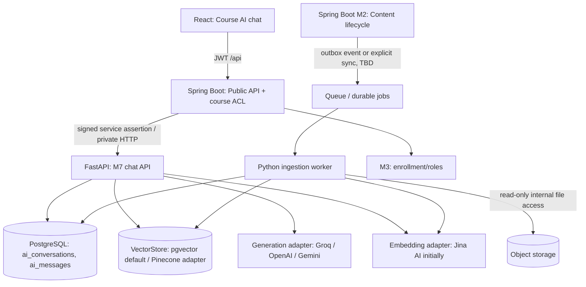
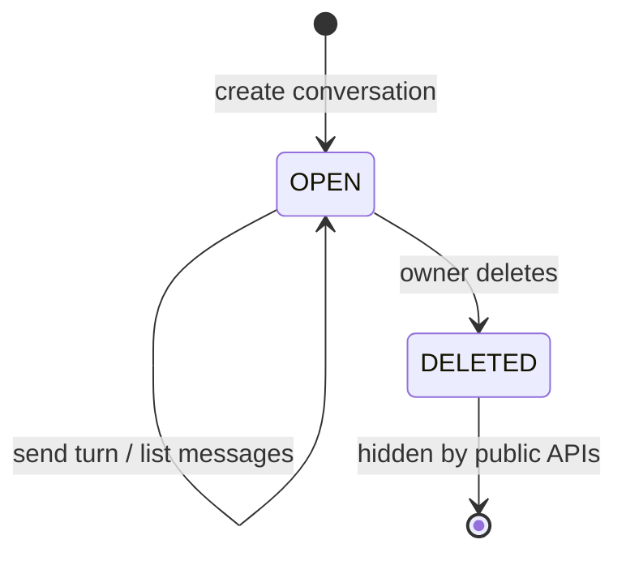
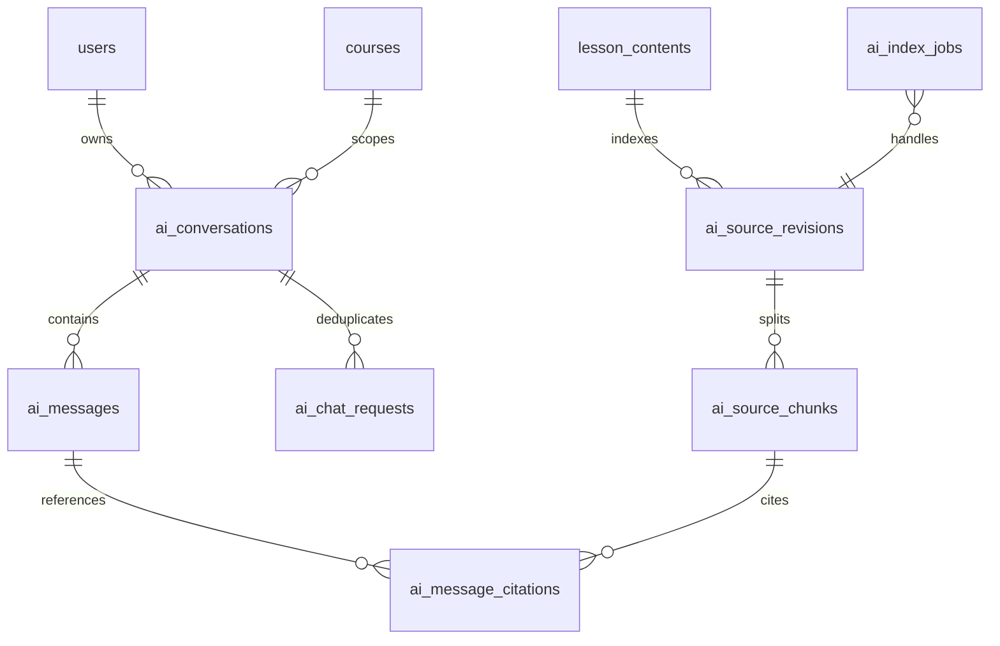
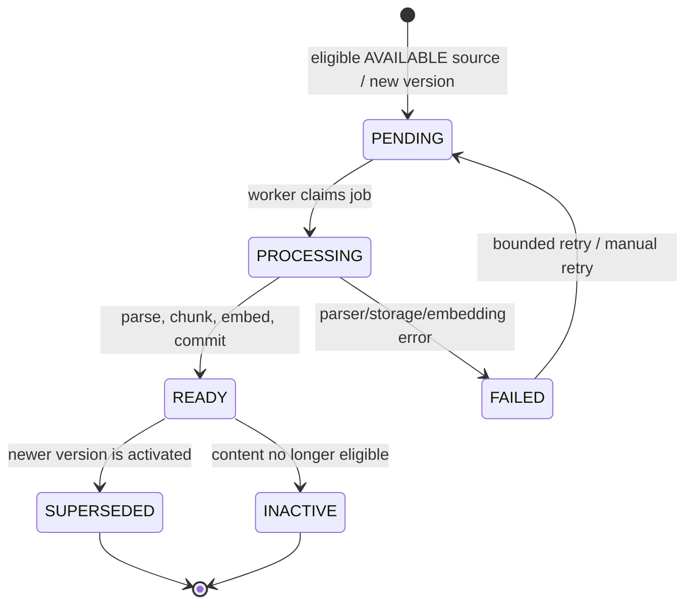
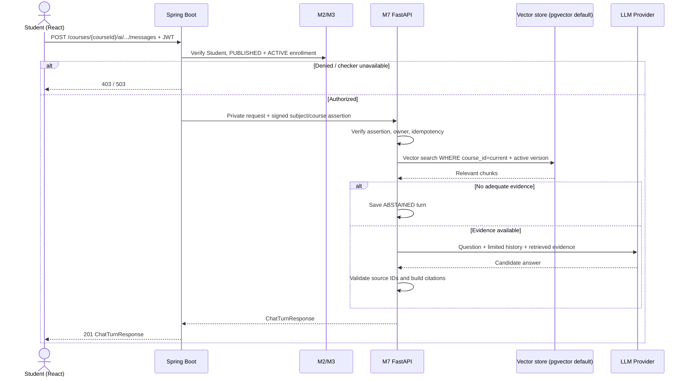

# M7 AI Tutor: RAG, access isolation, conversation, indexing and integration

> **Status:** REVIEW DRAFT — updated 2026-11-19. This document specifies *intended* M7 behavior; it does **not** assert that controllers, workers, migrations, cloud deployment or evaluation have been implemented.
>
> **API contract:** [`openapi/m7-ai-tutor.yaml`](../openapi/m7-ai-tutor.yaml) — OpenAPI 3.0.3. The public contract is planned for Spring Boot; the separate AI runtime is planned for Python/FastAPI.
>
> **Reviewed inputs:** Current `backend/README.md`, `BUSINESS.md`, `DATABASE.md`, `FLOWS.md`, `STATUS.md`, live gateway configuration and relevant M2/M3/assessment code. Earlier M2/M3 draft OpenAPI files are absent from this checkout; confirm integration behavior against live code. M5/notifications/common API standards were **not** supplied for this review.
>
> **Decision records:** [`ADR index`](../adr/README.md) indexes M7 ADRs. Pending ADRs are proposals for team discussion; accepted ADRs capture decisions already agreed.

> **Implementation order (2026-11-19):** Deliver functional requirements before the separate non-functional milestone in [`IMPLEMENTATION_PLAN.md`](../IMPLEMENTATION_PLAN.md). The first deployment uses pgvector by default, with both pgvector and Pinecone adapters behind `VectorStore`. Groq `openai/gpt-oss-120b` is the initial generation configuration; Groq/OpenAI/Gemini generation adapters are required. Jina AI `jina-embeddings-v5-text-small` at 1024 dimensions is the initial embedding configuration; Jina/OpenAI/Gemini embedding adapters are required. Provider/model/store IDs live in configuration, never in RAG or HTTP business logic.

## 1. Product scope and decisions

**Objective.** Provide a course-scoped AI Tutor that answers student questions from **authorized course learning materials** using Retrieval-Augmented Generation (RAG), with source citations, separate per-user conversations, and safe abstention when evidence is insufficient.

| Capability | MVP decision / status |
| --- | --- |
| Course-grounded question answering with retrieved evidence | **Functional requirement** |
| Retrieval isolation by authorized `course_id` | **Functional requirement**; mandatory security invariant |
| Conversation history per `(user_id, course_id)` | **Functional requirement** |
| Citations with M2 `content_id`, `lesson_id`, and source excerpt | **Functional requirement** |
| Abstain on missing/insufficient material | **Functional requirement** |
| Idempotent chat turn persistence/replay | **Functional phase**; accepted behavior |
| Per-user rate limits and load tuning | **Later non-functional phase** |
| Async content ingestion and reindex on updates | **Functional requirement**; event transport is an engineering contract to finalize |
| Indexed-source status / not-ready behavior | **Functional requirement** |
| Streaming via SSE | **Later functional enhancement**; first release returns completed JSON |
| Reranking, OCR, multi-course chat | Deferred |
| General platform FAQ / open-domain answers | **OUT** of first MVP; use a separately authorized FAQ knowledge base if approved later |
| Agent/tool use, quiz/assignment grading, recommendations | **OUT** of first MVP |

**Source-grounded constraints (existing M2/M3):**

- M2 organizes materials as `Course → Module → Lesson → Content`. Source identifiers are M2 `lesson_contents.id`, `lesson_id`, `content_type`, `upload_status`, and `version_number`. File types include `VIDEO`, `PDF`, `SLIDE`, `DOCUMENT`, `FILE`; inline types include `TEXT`, `LINK`. M2 has no distinct `MD` or `JSON` content type; this release maps Admin-uploaded `.md` and `.json` learning materials through `FILE` with MIME/extension validation.
- M2 uses object storage and presigned upload/access URLs, **not video streaming**. Do not copy storage object keys or signed URLs into AI public responses.
- M2 confirms `ARCHIVED` denies student access even with `ACTIVE` enrollment; `DRAFT`, `DISABLED` and unpublished content are not student-readable. Previously issued signed URLs expire by TTL and are not immediately revoked; this does **not** authorize new AI answers after access revocation.
- M3 enrollment states are `ACTIVE`, `COMPLETED`, `WITHDRAWN`, `REMOVED`. `WITHDRAWN` and `REMOVED` retain history but do not have current learning access. M7's confirmed first-release policy uses `ACTIVE` only and denies `COMPLETED`; revisit if M2/M3 course-content policy changes.
- A `PRIVATE` course is accessible to an eligible Student only after M3 successfully enrolls them via the invite-code flow. `PUBLIC + PUBLISHED` catalog visibility is **not** authorization to view AI-grounding material.
- M2 already has Admin lesson-content upload endpoints and a `FILE` content type. Its M7 indexing event hook, Markdown/JSON MIME allowlist and Admin processing-status management route still need integration. M7 pagination/error conventions and some M3 access details remain contract work.

## 2. Authorization matrix and invariants

| Actor / course and enrollment state | Create/list/read/delete own M7 chat | Ask on M2 content | Notes |
| --- | :---: | :---: | --- |
| Student + `PUBLISHED` + `ACTIVE` | Yes | Yes | PUBLIC or PRIVATE; PRIVATE requires prior valid enrollment |
| Student + `PUBLISHED` + `COMPLETED` | No | No | First-release rule; revisit if M2/M3 later changes completed-student access |
| Student + `WITHDRAWN` or `REMOVED` | No | No | Retain stored history; do not expose via M7 APIs |
| Student + `ARCHIVED`, `DRAFT` or `DISABLED` | No | No | Even if an enrollment row exists |
| Instructor, `OWNER`, `CO_INSTRUCTOR` or `ADMIN` | No | No | No M7 chat, status or history access; Admin retains ordinary M2 content-management rights |
| Unauthenticated or student from another course | No | No | 401 or 403; cross-user chat IDs return 404 |

**Mandatory checks for *every* request:**

1. React sends its normal bearer token to Spring Boot; **user identity must be derived from authenticated credentials**, never `user_id` supplied by React.
2. Spring Boot checks that the course is `PUBLISHED` and verifies the Student's `ACTIVE` M3 enrollment for the requested `courseId`. If a required check is unavailable, return **503 and fail closed**; never fall back to permissive chat.
3. Spring Boot forwards verified identity and `course_id` to a **private** FastAPI endpoint over an authenticated service-to-service channel (e.g. short-lived signed internal assertion, restricted network). FastAPI validates issuer, audience, expiry, signature and course claim. A mere untrusted `X-User-Id` header is insufficient.
4. M7 enforces `(conversation.user_id == verified_user_id)` **and** `(conversation.course_id == verified_course_id)` on read/write/delete. Unknown or foreign conversation IDs return **404** to avoid enumeration.
5. Search must filter **inside the vector query** by verified `course_id`, active source version and authorized source state; filtering LLM output *after* retrieving cross-course chunks is forbidden.
6. A file citation link uses the existing M2 endpoint `GET /api/lesson-contents/{contentId}/view-url`, which independently rechecks permission. Never issue raw storage keys or durable public file URLs.
7. Recheck access on every turn, including a follow-up in a previously valid conversation. Do not rely on permission observed when the conversation was created.
8. Block M7 chat and history while the Student has a quiz `IN_PROGRESS` in the same course. There is no per-lesson AI switch. Index and retrieve eligible `AVAILABLE` content of the authorized `PUBLISHED` course automatically; a course-level chat can use evidence from any eligible lesson in that course. The assessment state and content eligibility must be authoritative, not client-supplied.

> **Revocation consistency:** An authorization decision applies to one request. In-flight requests, caches and already-issued presigned URLs may have different revocation latency. M7 must not cache enrollment entitlements across requests for the MVP; decide any stronger immediate-cancellation requirement explicitly.

## 3. Architecture and responsibilities



**Ownership:**

- **M2** owns courses, lesson/content metadata, lifecycle, storage access, and authoritative content versions.
- **M3** owns enrollment state and enrollment authorization decisions.
- **Spring Boot / gateway** owns public JWT authentication, current course entitlement checks, public M7 route and uniform external errors.
- **M7 (FastAPI, separately deployed Python service)** owns RAG logic, its own chat records, indexing jobs, vector-store adapter, generation/embedding adapters and citation generation. M7 does **not** create a second enrollment database. Spring Boot calls private M7 HTTP endpoints; React never calls them.
- **React** owns the UI and requests protected content URLs from M2 when a citation is opened; it does not call the private Python service directly. Course media delivery and any CDN remain under M2/cloud infrastructure, not M7 ingestion.

**Integration boundary:** The agreed public path is `/api/courses/{courseId}/ai/...`, matching the live gateway's `/api/courses/**` pattern. Spring Boot must call the equivalent private FastAPI handlers after authorization; the method/path/body/error mapping is tracked in [`java-python-api.md`](java-python-api.md). This is a design contract, **not** proof of an implemented Java client, gateway route or Python handler. Internal endpoints use service credentials and must not be publicly routed.

**Proposed Spring Boot → FastAPI identity assertion (not client-controllable):**

```json
{
  "iss": "oep-gateway",
  "aud": "m7-ai-tutor",
  "sub": "33333333-3333-4333-8333-333333333333",
  "course_id": "11111111-1111-4111-8111-111111111111",
  "access_type": "STUDENT_ACTIVE",
  "iat": 1792634400,
  "exp": 1792634460,
  "jti": "88888888-8888-4888-8888-888888888888"
}
```

These claims are **illustrative**, not an approved JWT/issuer contract. Only the gateway may issue the signed assertion after checking live M2/M3 permissions; FastAPI must validate its signature and claims rather than trust client headers. The public end-user JWT must not be blindly forwarded as an internal service credential. A mutually authenticated alternative (mTLS plus verified context) is also possible.

**Storage decision:** pgvector is the temporary deployment default. Keep M7-owned conversation, request, source-version and job records in PostgreSQL. Implement **both** `PgvectorStore` and `PineconeStore` behind one `VectorStore` interface (`upsert`, course-filtered `query`, revision `deactivate/delete`, `health`), selected by configuration. The RAG, ingestion, chat, public API and private Java → Python API must not branch on the store name. Both adapters return normalized chunk IDs and scores and pass the same course/version/deletion tests. Identify an embedding space by provider/model/version, dimension and task/preprocessing settings; store its key with source revisions and chunks. With pgvector, use a native `vector` column and create a dimension-specific expression/partial index for the active space (initially 1024 dimensions), with course/current-source and embedding-space predicates inside SQL. Never compare vectors across spaces. With Pinecone, generate embeddings outside Pinecone, use a bring-your-own-vectors index for each dimension/space, filter by verified `course_id` in the vector query and revalidate returned IDs against current `READY` source revisions in PostgreSQL. In either store, deactivation must exclude old evidence from answers before acknowledging M2. Switching stores requires moving or rebuilding vectors and verifying current source versions; it does not change M7's HTTP contracts. An embedding-space change requires a new compatible index and re-embedding. Confirm an authoritative M2 metadata read interface if the services do not share a safe view.

## 4. Conversation lifecycle, persistence and idempotency



- The conversation has a **fixed** `user_id` and `course_id`. Switching courses always requires another conversation.
- Each turn stores one USER message and one ASSISTANT message (possibly `ABSTAINED`), preserving creation order. Store referenced citation IDs / excerpts as of answer time, but never bypass current M2 access checks when opening old citations.
- `DELETE` hides the conversation and its messages from public APIs and future model context immediately. **Proposed retention:** physically purge a user-deleted conversation within 30 days; purge inactive conversations after 12 months without activity. These periods are a proposal pending the team's data-retention decision. Retaining chat across `WITHDRAWN`/`REMOVED` is not permission to read it.
- `Idempotency-Key` is a required client-generated UUID v4 on **send message**. Bind it to user, conversation and normalized payload hash. The same key/payload replays the persisted result without duplicate turns; same key/different payload returns `409 IDEMPOTENCY_CONFLICT`.
- Keep a durable request ledger with a unique `(user_id, conversation_id, idempotency_key)`, state `PROCESSING|COMPLETED|FAILED_RETRYABLE|FAILED_FINAL`, payload hash, attempt metadata and cached response reference. A `FAILED_RETRYABLE` request may resume with the same key and identical payload; a `FAILED_FINAL` request replays its terminal error. Concurrent duplicate requests return `409 AI_REQUEST_IN_PROGRESS` (retry the same key later). Validation and authorization failures occur before the ledger is claimed. Check current authorization before replaying any cached result.
- Commit the USER message, ASSISTANT message and `COMPLETED` request state atomically. A transient failure before that commit can be retried without creating a partial turn. If a provider timeout leaves it uncertain whether generation completed, retry may incur another provider charge; the ledger still prevents more than one committed turn.
- Guarantee **at most one committed chat turn per idempotency key**, not exactly-once execution or exactly-once upstream LLM charges in the event of process crashes.

### Proposed M7 ERD



| M7 table (proposed) | Key fields / constraints |
| --- | --- |
| `ai_conversations` | UUID `id` PK; `user_id`, `course_id` FKs or validated external IDs; title, created/updated/deleted timestamps; index `(user_id, course_id, updated_at)` |
| `ai_messages` | UUID PK; `conversation_id`, `role`, `content`, `answer_status`, `created_at`; index `(conversation_id, created_at, id)` |
| `ai_chat_requests` | UUID PK; unique `(user_id, conversation_id, idempotency_key)`; `payload_hash`, `status`, `response_message_id`, timestamps |
| `ai_source_revisions` | UUID PK; `(content_id, version_number)` unique; `course_id`, `lesson_id`, `content_type`, `state`, checksum, `embedding_space_key`; one current `READY` revision per content at a time |
| `ai_source_chunks` | UUID PK; `source_revision_id`, `course_id`, `chunk_index`, `text`, page/heading/JSON path nullable, `embedding_space_key`, `embedding_dimension`; unique `(source_revision_id, chunk_index)`; pgvector adapter owns native `vector` storage, Pinecone adapter owns vector IDs; neither changes the logical chunk contract |
| `ai_message_citations` | UUID PK; `message_id`, `chunk_id`/snapshot metadata, ordinal; only for grounded assistant messages |
| `ai_index_jobs` | UUID PK; source/version/action, `event_id` unique, `status`, `attempt_count`, error and timestamps |

`users`, `courses` and `lesson_contents` belong to other modules. Cross-service database foreign keys may not be possible; validation and ownership responsibilities must be made explicit at the integration boundary. There is **no** new M7 enrollment or course membership table.

## 5. Content eligibility and indexing state machine

**Functional-release ingestion allowlist (agreed):** eligible `AVAILABLE` inline `TEXT`, text-based `PDF`, Markdown `.md` and JSON `.json` in a `PUBLISHED` course. Map Admin-uploaded Markdown/JSON learning materials to the existing M2 `FILE` type with MIME/extension validation. Preserve Markdown headings and JSON paths in chunk metadata. Flatten JSON scalar leaves into readable `path: value` passages; do not ingest arbitrary user/account JSON. `LINK` is not crawled; `VIDEO`, `SLIDE`, DOCX and other generic files are excluded from this release. Scanned PDF/OCR is deferred and reported as unsupported.



**Sequence (intended):**

1. An M2 `TEXT` creation/update becomes `AVAILABLE` immediately, or an allowed PDF/MD/JSON file upload is verified and becomes `AVAILABLE` through M2's completion workflow. It enters the M7 eligible set when its course is `PUBLISHED`; publishing an existing course must enqueue its eligible content.
2. **Proposed** M2 AI-specific outbox event / direct internal sync submits `{event_id, course_id, lesson_id, content_id, version_number, action}` to the M7 index queue. The backend has a generic outbox/RabbitMQ pattern, but AI content events and their delivery contract are not implemented.
3. The M7 worker loads authoritative M2 metadata, validates full `Course → Module → Lesson → Content` ancestry and checks `PUBLISHED` course, content availability and type. For file content it gets a *private* object-storage read grant; it must not reuse a student's presigned access URL.
4. Parser → deterministic chunking → selected embedding adapter → vector-store adapter. Tag every chunk with `course_id`, `content_id`, `lesson_id`, `version_number`, embedding model/version and parser metadata (PDF page, Markdown heading or JSON path when available).
5. Write the new revision/chunks durably, atomically set the current revision `READY` and retire any former revision. Idempotent repeated events for the same `(content_id, version_number, action)` must not duplicate chunks; out-of-order older versions must not replace newer versions.
6. Retrieval selects only `READY`, current, eligible revisions of `AVAILABLE` content in the verified `PUBLISHED` course. No answer is generated from stale, failed, unavailable or deleted sources.

**Content invalidation/deletion protocol (AGREED FOR IMPLEMENTATION):** M2 first transitions the source to a non-readable state such as `DELETING`/unavailable, so new student access and indexing stop. M2 then synchronously requests M7 to deactivate the affected revision and remove it from retrieval, and waits for an acknowledgement. Only after acknowledgement does M2 finalize deletion (or replacement). If M7 is unavailable or does not acknowledge, M2 leaves the source unavailable and the operation pending/retryable; it must not finalize deletion while stale chunks remain queryable. The invalidation operation is idempotent. For replacement, M7 must not retrieve the old version after M2 activates the new version; the old version can remain until the new revision is ready only if M2 still considers the old version current and authorized. When a course stops being `PUBLISHED`, Spring denies M7 access immediately and M2 schedules deactivation of its indexed sources. An after-the-fact asynchronous event alone cannot guarantee no stale retrieval.

**Index readiness (AGREED):** `GET /courses/{courseId}/ai/status` reports counts of eligible sources in each state. `NOT_READY` means there is no queryable source and no source currently being processed (for example, there are no eligible sources, or all attempts failed); counts distinguish these cases. `INDEXING` means no source is queryable yet and at least one is pending or processing. `READY` means every currently eligible source has a current queryable revision. `DEGRADED` means at least one source is queryable while another eligible source is pending, processing or failed. A course with zero eligible sources is `NOT_READY` with all counts zero. If no source is queryable, chat returns `409 AI_INDEX_NOT_READY` rather than generating an answer without evidence.

## 6. RAG answering and source citations



**Answer generation and embedding decision:** Groq with `openai/gpt-oss-120b` is the initial generation configuration. The RAG service uses a provider-neutral generation interface with Groq, OpenAI and Gemini adapters; provider/model selection and credentials are configuration. A separate embedding interface has Jina, OpenAI and Gemini adapters; initially select Jina `jina-embeddings-v5-text-small` with 1024-dimensional `retrieval.passage` and `retrieval.query` vectors. The RAG, ingestion and HTTP layers do not branch on provider/model names. Switching generation providers does not require re-indexing, whereas switching the embedding space does.

- Only `COURSE` mode in MVP. The model must treat retrieved material as *untrusted data*, not instructions to override the application/system policy.
- On follow-up questions, load only messages from the current conversation. Bound history length/token budget; optional query rewriting cannot alter verified course scope.
- Retrieve Top-K candidate chunks (initial experiment `K=5`; **not** a guaranteed optimum). Use threshold/abstention criteria tuned on an evaluation set instead of assuming any returned chunk is relevant.
- Require each factual assertion relying on course material to be supported by supplied chunk IDs. The server validates citations against the current result set and current source version. The LLM never invents `content_id` or page numbers.
- If relevant evidence is absent or contradictory, answer with `answer_status=ABSTAINED` and a brief explanation. An answer without citations is acceptable **only** for an explicit abstention, not as an ungrounded course answer.
- Never expose raw S3 keys, signing credentials, other students' conversations, hidden content, or arbitrary retrieved metadata.

**Citation response fields:** `content_id`, `lesson_id`, `chunk_id`, `source_title`, `excerpt`, `version_number`, optional `page_number`, `heading` or `json_path`. React displays these alongside the answer; opening a PDF/MD/JSON file calls M2 `GET /api/lesson-contents/{contentId}/view-url` with the original user JWT. Inline `TEXT` may navigate to the protected lesson instead. A citation contains **no signed URL**.

## 7. API contract, pagination and errors

Public APIs require the normal end-user JWT and course entitlement; user IDs are **never** client-controlled.

| Method | Public path (prefix `/api`) | Purpose |
| --- | --- | --- |
| `GET` | `/courses/{courseId}/ai/status` | Index readiness for course tutor |
| `POST` | `/courses/{courseId}/ai/conversations` | Create empty conversation |
| `GET` | `/courses/{courseId}/ai/conversations` | List current user's conversations |
| `GET` | `/courses/{courseId}/ai/conversations/{conversationId}` | Read own conversation metadata |
| `DELETE` | `/courses/{courseId}/ai/conversations/{conversationId}` | Logically delete own conversation |
| `GET` | `/courses/{courseId}/ai/conversations/{conversationId}/messages` | List own messages |
| `POST` | `/courses/{courseId}/ai/conversations/{conversationId}/messages` | Send a grounded chat turn; requires `Idempotency-Key` |

Private operational routes (not internet-exposed) are `POST /internal/v1/ai/index-jobs` and `GET /internal/v1/ai/index-jobs/{jobId}`. They accept only an internal service token. The enqueue endpoint is an **alternative to** event-driven ingestion where the group's event transport is not yet available; do not call it from React.

**Draft conventions and compatibility:**

- M7 adopts **M2-style** `page` starting at 1, `page_size` default 20 (max 100), `items` + `pagination`; and M2-style `{"error":{"code","message","request_id","details"}}`. The agreed `/api` path matches the live gateway.
- M3 currently uses **0-based** `page`, `size` and a *different* error model. M7 keeps M2 conventions for its public contract; the gateway translates internal M3 checker errors rather than exposing M3's response envelope to M7 clients. The common gateway can align this later.
- Standard timestamps: UTC RFC 3339; identifiers: UUID; consistent request IDs across Spring Boot ↔ FastAPI.
- Main errors: `401 UNAUTHORIZED`; `403 AI_COURSE_ACCESS_DENIED`; `404 AI_CONVERSATION_NOT_FOUND`; `409 AI_INDEX_NOT_READY`, `IDEMPOTENCY_CONFLICT` or `AI_REQUEST_IN_PROGRESS`; `422 VALIDATION_ERROR`; `429 AI_RATE_LIMITED`; `503 ENROLLMENT_CHECK_UNAVAILABLE` or `AI_SERVICE_UNAVAILABLE`.
- On authorization failure, **do not** fall back to generic LLM chat. On no evidence, save an `ABSTAINED` turn. External LLM/provider errors should return a safe 503 and not a fabricated answer.

## 8. Integration interfaces to confirm

| Owner / dependency | Proposed interface or event | Status / decision needed |
| --- | --- | --- |
| **M7 → M2** | Query authoritative `course.lifecycle_status`, `lesson_contents` ancestry, `content_type`, `upload_status=AVAILABLE`, and `version_number` | Confirm internal read interface / DB-view ownership and when files are ready |
| **M7 → M3** | Spring Boot `EnrollmentChecker` before every Student chat/read; `ACTIVE` only in the first release | Confirm authoritative checker contract; revise completed-student policy only with M2/M3 alignment |
| **M2 → M7 indexing** | Proposed `content.available`, `content.updated`, `content.deactivated`, with stable `event_id`, content ID and version; or private index-job enqueue | **OPEN:** event names, outbox deployment, retries and who publishes |
| **M7 ↔ M2 delete** | M2 makes source unavailable, synchronously asks M7 to deactivate its revision, and finalizes only after acknowledgement; otherwise leave operation pending and retry | **AGREED FOR IMPLEMENTATION** |
| **Gateway → M7** | Private HTTP proxy + signed user/course assertion, request/correlation ID | Public `/api` prefix agreed; internal token issuance, network policy and failure mapping remain open |
| **M7 → Object Storage** | Least-privilege server-side read of eligible source objects | **OPEN:** cloud provider, bucket/prefix permissions and key lookup |
| **React ↔ M7/M2** | Chat list/history, citations; open citation via M2 protected access URL | **OPEN:** UI error/not-ready and pagination conventions |
| **Common API** | Public M7 uses `/api`, M2-style `page`/`page_size` and error envelope; gateway translates internal dependency errors | Agreed for first release |

Do not assume M5 is the notification owner: the supplied M2 notes themselves flag module-name ambiguity, and M5 API material was not supplied for M7 review.

## 9. Non-functional milestone: cloud operations, limits and performance (deferred)

| Area | MVP implementation target / trade-off |
| --- | --- |
| Runtime | FastAPI HTTP service + Python worker (same codebase/image, different entrypoints), deployed as separate containers |
| Queue | Managed queue if available; durable jobs table acceptable for an initial demo if retries are safe |
| Storage | Authorized object storage and M7-owned PostgreSQL metadata; pgvector is the temporary default, Pinecone is a second configurable adapter |
| External model | Groq `openai/gpt-oss-120b` initially; configurable Groq/OpenAI/Gemini generation adapters and Jina/OpenAI/Gemini embedding adapters |
| Autoscaling | Scale stateless FastAPI containers by CPU/concurrency; scale ingestion workers by queue depth; DB/LLM quotas remain bottlenecks |
| Security | JWT at gateway, signed internal identity, private network, principle of least privilege, secret manager, prompt-injection defense, size/rate limits |
| Observability | Request ID, log event/latency/error codes, ingestion state/duration, retrieval count, LLM token counts/cost; never log bearer tokens, signed URLs or complete private conversations by default |
| CI/CD | Lint/type-check/unit tests, OpenAPI validation, Docker build, integration tests, cloud deployment pipeline |
| Budget | Proposed maximum question length, history window, prompt/output token caps, per-user request rate and spend alert; quantify after testing |
| Reliability | Timeouts, bounded retry only for safe/idempotent operations, dead-letter jobs, health/readiness endpoints, graceful 503 |

**Proposed measurable demo targets (not measured):** 20 simultaneous M7 chat clients and a p95 latency report (record actual observed value, no unsupported guarantee); index a PDF and answer with correct citations; show ingestion job failure/retry; exercise unauthorized cross-course access; record prompt/output tokens per request. The separately required concurrent quiz/load scenario remains owned by the quiz module.

## 10. Acceptance and evaluation cases

| ID | Scenario | Expected behavior |
| --- | --- | --- |
| M7-01 | Student with `ACTIVE` enrollment asks about published course material | `201 ANSWERED`, at least one verifiable citation |
| M7-02 | Student A asks a course B not enrolled in, including PUBLIC catalog course | `403`, no cross-course retrieval or LLM call |
| M7-03 | Student A requests Student B's conversation UUID | `404`; no history exposure |
| M7-04 | Student switches the path `courseId` for an existing conversation | `404`; original scope cannot be changed |
| M7-05 | Enrollment transitions `ACTIVE → WITHDRAWN` or `REMOVED` | Subsequent M7 read/send denied; history remains stored |
| M7-06 | Course `PUBLISHED → ARCHIVED` | Subsequent student chat/history denied regardless of enrollment |
| M7-07 | `COMPLETED` enrollment asks AI | `403` in the first release |
| M7-08 | Student asks an unsupported or out-of-scope question | `201 ABSTAINED`, no invented citation |
| M7-09 | Same send request is retried 100 times with same key and payload | Exactly one committed pair of messages, replayed result |
| M7-10 | Same idempotency key is reused with a different message | `409 IDEMPOTENCY_CONFLICT` |
| M7-11 | Content new version indexed twice/out of order | Only current eligible version returned; no duplicate chunks |
| M7-12 | Content no longer `AVAILABLE` or is pending deletion | No retrieval from invalidated chunks; enforce M2 deletion coordination |
| M7-13 | Enrollment checker unavailable | `503`, no LLM/retrieval access (fail closed) |
| M7-14 | Citation clicked after enrollment revoked | M2 denies new access URL; no raw object key exposed |
| M7-15 (later non-functional phase) | 20 concurrent chats on staging | Report throughput, error rate, p50/p95 and LLM cost, without claiming a priori SLA |

**Functional checks:** Cover each supported format, authorized and unauthorized access, citation validation, abstention, version changes and content invalidation. The 80-question benchmark, Recall@K, latency and cost measurements belong to the later non-functional phase in the implementation plan.

## 11. Decisions and engineering contracts remaining

**Confirmed for the first release:** M7 is a separate Python/FastAPI service called privately by Spring Boot. M7 chat/status/history is Student-only. Require `ACTIVE` enrollment, block same-course `IN_PROGRESS` quiz and automatically use eligible `AVAILABLE` learning content in a `PUBLISHED` course, with no per-lesson AI switch. Public M7 uses `/api/courses/{courseId}/ai/...`, completed JSON chat turns, and 404 for foreign conversation IDs. Use pgvector as the temporary deployment default with both pgvector and Pinecone adapters. Start with Groq `openai/gpt-oss-120b` and Jina `jina-embeddings-v5-text-small` (1024 dimensions), while keeping provider/model choice configurable and implementing Groq/OpenAI/Gemini generation and Jina/OpenAI/Gemini embedding adapters. Ingest `TEXT`, text PDF, MD and JSON; map MD/JSON Admin uploads through M2 `FILE`. The synchronous M2–M7 invalidation handshake, index-readiness definitions and idempotent atomic chat turns remain agreed.

**Engineering contracts to finalize against the live backend before cross-service coding:**

1. Define the M2 content event/outbox payload and authoritative source/version read interface; retain the separate synchronous deactivation API.
2. Define the signed private service assertion, issuer/audience/TTL/key rotation, exact Java → Python request/response mapping and contract tests in `java-python-api.md` and OpenAPI.
3. Reconcile AI table/migration ownership with the existing Java entities and baseline migration. Locate the authoritative same-course quiz checker and instructor authorization/audit flow in the live backend.
4. Validate M2 `FILE` MIME/extension/size rules and whether `AVAILABLE` content in a `PUBLISHED` course has any additional visibility gate. Keep arbitrary user/account JSON outside M7 ingestion.

**Later non-functional decisions:** retention and backup purge, production Jina account/model terms, deployment region, cost limits, load targets and SSE details. None of these is claimed implemented or measured here.

**Design status:** The functional scope is agreed; private integration details, code, migrations and end-to-end verification remain to be completed.
