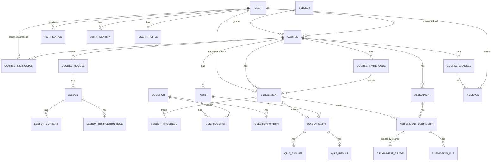

# DATABASE.md — Thiết kế database (Project 8: Online Education Platform)

Nguồn chân lý là code trong `core-model/src/main/java/com/oep/coremodel/{entity,enums}`; tài liệu này mô tả lại schema đó dưới dạng dễ đọc, kèm lý do thiết kế, để không ai sửa entity mà quên ảnh hưởng nghiệp vụ. Mọi bảng do Hibernate tạo trên **primary** Postgres (`ddl-auto: update`, dev only) khi `core-lms-service` khởi động — xem `CLAUDE.md` mục 3.

## 1. Nguyên tắc

- PK: `UUID` sinh bởi DB (`BaseEntity`), không dùng số tự tăng (tránh lộ thứ tự/khối lượng dữ liệu qua URL).
- Không hard-delete theo nghiệp vụ: mọi "xoá" là đổi trạng thái (`AccountStatus.DISABLED`, `CourseLifecycleStatus.ARCHIVED/DISABLED`, `EnrollmentStatus.WITHDRAWN/REMOVED`...). Chỉ các bảng audit/outbox là append-only thật.
- Entity chỉ sửa trong `core-model`; mỗi service viết riêng repository/service của mình (quy ước đã có trong `CLAUDE.md`).
- Mỗi bảng phải truy ngược được về một dòng nghiệp vụ cụ thể trong yêu cầu — không có bảng/flow "tiện thì thêm" mà tài liệu không nhắc tới (xem mục 5 — các flow đã loại bỏ).

## 2. Ánh xạ nghiệp vụ → bảng

| Vai trò | Hành vi | Bảng chịu trách nhiệm |
|---|---|---|
| Admin | Trung tâm dạy nhiều môn | `subjects`, `courses.subject_id` |
| Admin | Sinh mã code gửi học sinh | `course_invite_codes` |
| Admin | Tạo giáo viên + tài khoản, mật khẩu random, bắt đổi mật khẩu lần đầu | `users` (role=INSTRUCTOR), `auth_identities.password_hash` + `must_change_password` |
| Admin | Tạo khóa học, assign nhiều giáo viên | `courses`, `course_instructors` |
| Admin | Đăng video/quiz/bài tập/tài liệu | `course_modules`, `lessons`, `lesson_contents`, `quizzes`+`questions`, `assignments` |
| Admin | Quản lý user active/inactive | `users.account_status` |
| Học sinh | Đăng ký, đăng nhập | `users` (role=STUDENT), `auth_identities` |
| Học sinh | Xem tất cả khóa học, chưa có mã chỉ thấy giới thiệu | `courses` (title/description luôn đọc được khi `PUBLISHED`; nội dung con bên trong chỉ đọc được qua `enrollments`) |
| Học sinh | Nhập mã code → học khóa học | `course_invite_codes` → `enrollments.invite_code_id` (bắt buộc, không có mã thì không tạo được enrollment) |
| Học sinh | Học video/quiz/bài tập | `lesson_contents`, `quiz_attempts`+`quiz_answers`, `assignment_submissions` |
| Học sinh | Xem tiến độ | `lesson_progress`, `enrollments.status` |
| Giáo viên | Đăng nhập, tài khoản do admin cấp, đổi mật khẩu lần đầu | `auth_identities.must_change_password` |
| Giáo viên | Xem khóa học được giao, không sửa được | `course_instructors` (chỉ là danh sách được gán — không có quyền ghi vào `lesson_contents`/`quizzes`/`assignments`, ràng buộc ở tầng service/API) |
| Giáo viên | Chấm điểm bài tập | `assignment_grades` |
| Giáo viên | Trả lời câu hỏi học sinh | `course_channels` + `messages` |

## 3. ERD tổng quan

AI tutor (`ai_conversations`, `ai_messages`, `ai_document_chunks`) nằm ngoài phạm vi tài liệu nghiệp vụ hiện tại — xem mục 6, không vẽ ở đây để ERD không bị loãng.

## 4. Chi tiết theo domain

### 4.1 `identity` — tài khoản & xác thực

**`users`**
| Cột | Kiểu | Ghi chú |
|---|---|---|
| id | UUID PK | |
| email | varchar(255) UNIQUE NOT NULL | |
| role | enum `UserRole` (STUDENT, INSTRUCTOR, ADMIN) NOT NULL | |
| account_status | enum `AccountStatus` (ACTIVE, DISABLED) NOT NULL | admin bật/tắt user |
| created_at / updated_at | timestamp | |

**`auth_identities`** — tách khỏi `users` để hỗ trợ nhiều provider đăng nhập mà không phình bảng user.
| Cột | Kiểu | Ghi chú |
|---|---|---|
| id | UUID PK | |
| user_id | FK → users NOT NULL | |
| provider | enum `AuthProvider` (LOCAL, GOOGLE) | |
| provider_user_id | varchar(255) | null nếu LOCAL |
| password_hash | varchar(255) | null nếu không phải LOCAL |
| email_verified_at | timestamp null | học sinh tự đăng ký cần verify email |
| must_change_password | boolean NOT NULL default false | **bật khi admin tạo tài khoản giáo viên**, API login phải chặn tới khi đổi xong |
| created_at | timestamp | |
| UNIQUE(provider, provider_user_id) | | |

**`user_profiles`** (1-1, PK = user_id) — full_name, avatar_object_key, phone, bio, organization, date_of_birth, updated_at.

**`refresh_tokens`** — user_id, token_hash (unique), device_info, expires_at, is_revoked, created_at. Index (user_id, is_revoked).

### 4.2 `course` — danh mục & nội dung (chỉ Admin được ghi)

**`subjects`** *(mới thêm)* — trung tâm dạy nhiều môn.
| Cột | Kiểu |
|---|---|
| id | UUID PK |
| name | varchar(255) UNIQUE NOT NULL |
| description | text null |
| is_active | boolean NOT NULL default true |
| created_at / updated_at | timestamp |

**`courses`**
| Cột | Kiểu | Ghi chú |
|---|---|---|
| id | UUID PK | |
| subject_id | FK → subjects NOT NULL | 1 khóa học thuộc đúng 1 môn |
| title / description | varchar(255) / text | description = phần giới thiệu luôn hiển thị, kể cả chưa có mã |
| lifecycle_status | enum `CourseLifecycleStatus` (DRAFT, PUBLISHED, ARCHIVED, DISABLED) NOT NULL | chỉ PUBLISHED mới hiện trong danh sách học sinh thấy |
| capacity | integer null | giới hạn sĩ số (tuỳ chọn) |
| start_at / end_at | timestamp null | |
| learning_mode | enum `LearningMode` (FREE_NAVIGATION, SEQUENTIAL) | |
| created_by | FK → users NOT NULL | luôn là Admin |
| created_at / updated_at | timestamp | |
| INDEX(lifecycle_status), INDEX(subject_id), INDEX(created_by) | | |

> Đã bỏ cột `visibility` (PUBLIC/PRIVATE): tài liệu yêu cầu *mọi* khóa học đã publish đều hiện giới thiệu công khai, không có khóa "ẩn hẳn"; việc khoá nội dung chi tiết hoàn toàn dựa vào có `enrollment` hợp lệ hay chưa.

**`course_instructors`** — bảng gán giáo viên dạy, composite PK (course_id, instructor_id).
| Cột | Kiểu |
|---|---|
| course_id | FK → courses (PK) |
| instructor_id | FK → users (PK, role=INSTRUCTOR) |
| added_by | FK → users (admin thực hiện gán) |
| added_at | timestamp |

> Đã bỏ cột `course_role` (OWNER/CO_INSTRUCTOR): tài liệu không mô tả cấp bậc giữa các giáo viên — Admin luôn là bên sở hữu nội dung, giáo viên chỉ được "assign để dạy", không ai trong số họ có quyền cao hơn người khác.

**`course_modules`** — course_id, title, description, position, is_default. INDEX(course_id, position).

**`lessons`** — module_id, title, description, position, is_required. INDEX(module_id, position).

**`lesson_contents`** — lesson_id, content_type (`ContentType`: TEXT, LINK, VIDEO, PDF, SLIDE, DOCUMENT, FILE), title, text_content, external_url, object_key (GCP Storage), file_name, mime_type, file_size, duration_seconds, upload_status (`UploadStatus`: PENDING, UPLOADED, AVAILABLE, FAILED), position, version_number, created_by/updated_by (admin), timestamps. INDEX(lesson_id, position).

**`lesson_completion_rules`** — lesson_id (UNIQUE), minimum_time_seconds, min_video_percentage, require_quiz, require_assignment. Dùng để tính tiến độ.

### 4.3 `registration` — mở khóa khóa học bằng mã

**`course_invite_codes`** — course_id, code (UNIQUE), expires_at, is_active, created_by (admin), created_at. 1 khóa học có thể có nhiều mã (ví dụ sinh mã mới theo lớp/đợt), mã cũ hết hạn/khoá bằng `expires_at`/`is_active` chứ không xoá.

> Đã bỏ `instructor_applications`, `enrollment_requests`, `course_invitations`: tài liệu không có quy trình "giáo viên tự ứng tuyển", "học sinh xin duyệt vào khóa không cần mã", hay "admin/giáo viên mời riêng từng học sinh" — chỉ có đúng một đường vào: **nhập mã code**.

### 4.4 `enrollment` — ghi danh & tiến độ

**`enrollments`**
| Cột | Kiểu | Ghi chú |
|---|---|---|
| id | UUID PK | |
| course_id | FK → courses NOT NULL | |
| student_id | FK → users NOT NULL | |
| invite_code_id | FK → course_invite_codes NOT NULL | **mọi enrollment đều phải có mã**, lưu lại đúng mã đã dùng để truy vết/đo hiệu quả từng mã |
| status | enum `EnrollmentStatus` (ACTIVE, COMPLETED, WITHDRAWN, REMOVED) | |
| enrolled_at / completed_at / withdrawn_at / removed_at | timestamp | |
| UNIQUE(course_id, student_id) | | 1 học sinh chỉ có 1 enrollment / khóa |
| INDEX(student_id, status), INDEX(invite_code_id) | | |

> Trước đây có cột tự do `created_via` (string "DIRECT"); đã thay bằng FK thật `invite_code_id` cho chuẩn hoá — không còn "chuỗi magic" không kiểm chứng được.

**`lesson_progress`** — enrollment_id, lesson_id, status (`LessonProgressStatus`: NOT_STARTED, IN_PROGRESS, COMPLETED), time_spent_seconds, last_content_id, started_at, completed_at, last_accessed_at. UNIQUE(enrollment_id, lesson_id) — đây là nguồn dữ liệu cho màn "Tiến độ" của học sinh.

### 4.5 `quiz` — trắc nghiệm

- **`question_banks`**: course_id, name, created_by.
- **`questions`**: question_bank_id (null nếu câu hỏi gắn trực tiếp vào 1 quiz), question_type (`QuestionType`: TRUE_FALSE, SINGLE_CHOICE, MULTIPLE_CHOICE, KEYWORD_FILL), question_text, keyword_answer, created_by.
- **`question_options`**: question_id, option_text, is_correct, position.
- **`quizzes`**: course_id, lesson_id (null = quiz độc lập không gắn bài học), title, description, question_source, time_limit_seconds, deadline, max_attempts, grading_policy (`QuizGradingPolicy`: HIGHEST, LATEST, AVERAGE), randomize_questions/answers, show_score, show_correct_answers, is_locked, created_by.
- **`quiz_questions`**: composite PK (quiz_id, question_id), position, points — bảng nối N-N giữa quiz và câu hỏi (dùng lại câu hỏi ở nhiều quiz).
- **`quiz_attempts`**: quiz_id, enrollment_id, attempt_number, status (`QuizAttemptStatus`: IN_PROGRESS, SUBMITTED, TIMED_OUT, GRADED), started_at, submitted_at, snapshot_payload (jsonb — đề đã chốt lúc làm bài, chống việc sửa đề sau khi học sinh đã thi), idempotency_key. UNIQUE(quiz_id, enrollment_id, attempt_number).
- **`quiz_answers`**: attempt_id, question_id, selected_option_data (jsonb), text_answer, is_correct, awarded_score. UNIQUE(attempt_id, question_id).
- **`quiz_results`**: attempt_id (UNIQUE), auto_score, final_score, adjusted_by, adjustment_reason — tách khỏi attempt để chỗ cho giáo viên chỉnh điểm tay mà không đụng dữ liệu bài làm gốc.

### 4.6 `assignment` — bài tập & chấm điểm

- **`assignments`**: course_id, lesson_id (null), title, instructions, deadline, max_submissions, allow_late_submission, allow_text, allow_files, max_score, created_by (admin).
- **`assignment_submissions`**: assignment_id, enrollment_id, text_content, submission_count, status (`AssignmentStatus`: SUBMITTED, PENDING_REGRADE, GRADED), submitted_at, is_late. UNIQUE(assignment_id, enrollment_id).
- **`submission_files`**: submission_id, object_key, file_name, file_type, file_size, upload_status, uploaded_at.
- **`assignment_grades`**: submission_id (UNIQUE), score, feedback, graded_by (**giáo viên**), graded_at, previous_score/regraded_at/regrade_reason (lịch sử chấm lại) — đây là nơi hiện thực hoá "giáo viên chấm điểm bài tập".

### 4.7 `social` — hỏi đáp trong khóa học

- **`course_channels`**: course_id (UNIQUE) — mỗi khóa học có đúng 1 kênh chat chung.
- **`messages`**: channel_id, sender_id (học sinh hoặc giáo viên), content, created_at, edited_at, deleted_at — đây là nơi "giáo viên trả lời câu hỏi học sinh".
- **`message_attachments`**: message_id, object_key, file_name, file_type, file_size.

### 4.8 `notification`

- **`notifications`**: user_id, event_type, title, message, dedupe_key (UNIQUE — chống bắn trùng do retry), target_type/target_id, is_read, read_at.
- **`notification_preferences`**: user_id + event_type (UNIQUE), in_app_enabled, email_enabled, reminder_before_minutes.
- **`email_notification_events`**: user_id, event_type, recipient_email, status (`NotificationDeliveryStatus`: PENDING, SENT, FAILED), scheduled_at, sent_at, retry_count.

### 4.9 `system` — hạ tầng (không phải nghiệp vụ, phục vụ vận hành)

- **`audit_logs`**: actor_id, action, target_type, target_id, metadata (jsonb), created_at.
- **`content_change_logs`**: content_id (→ lesson_contents), changed_by, action, version_number, changed_at — lịch sử sửa nội dung bài học của Admin.
- **`outbox_events`**: aggregate_type, aggregate_id, event_type, payload (jsonb), status (`OutboxStatus`: PENDING, PROCESSED, FAILED), retry_count, processed_at — outbox pattern để bắn message sang RabbitMQ an toàn khi ghi DB.

## 5. Các thay đổi so với schema cũ (lý do)

| Thay đổi | Lý do |
|---|---|
| Xoá `instructor_applications` | Tài liệu: Admin tạo giáo viên trực tiếp, không có flow giáo viên tự nộp đơn ứng tuyển. |
| Xoá `enrollment_requests` | Tài liệu: học sinh chỉ vào học bằng mã code, không có flow xin duyệt. |
| Xoá `course_invitations` | Tài liệu không có flow admin/giáo viên mời riêng từng học sinh. |
| Xoá `course_reviews` | Tài liệu không có yêu cầu đánh giá/rating khóa học. |
| Xoá cột `courses.visibility` (`CourseVisibility`) | Mọi khóa đã publish đều hiện giới thiệu; không có khái niệm khóa "ẩn hẳn khỏi danh sách". |
| Xoá cột `course_instructors.course_role` (`CourseInstructorRole`) | Không có cấp bậc giữa các giáo viên được assign; Admin luôn là bên sở hữu nội dung. |
| Thêm bảng `subjects` + `courses.subject_id` | Tài liệu nêu rõ "trung tâm dạy nhiều môn" nhưng schema cũ không có cách nhóm khóa học theo môn. |
| Đổi `enrollments.created_via` (string tự do) → `enrollments.invite_code_id` (FK bắt buộc) | Mọi lượt ghi danh đều phải qua mã code hợp lệ; dùng FK thật để truy vết mã nào tạo ra bao nhiêu học sinh, thay vì chuỗi không kiểm chứng. |

`EnrollmentService.enroll(...)` (core-lms-service) đã cập nhật theo đúng các thay đổi trên: luôn bắt buộc một `course_invite_codes.code` còn hiệu lực (active, chưa hết hạn, đúng khóa học) cho **mọi** lượt ghi danh, không còn rẽ nhánh theo visibility.

## 6. Ngoài phạm vi tài liệu nghiệp vụ hiện tại

`entity/ai/*` (`ai_conversations`, `ai_messages`, `ai_document_chunks`) phục vụ tính năng AI Tutor (RAG + Pinecone) được nêu trong sơ đồ kiến trúc ở `CLAUDE.md` nhưng **không** nằm trong tài liệu nghiệp vụ Admin/Giáo viên/Học sinh hiện tại. Giữ nguyên, không đụng tới — nếu nghiệp vụ chưa cần, có thể bỏ qua các bảng này khi review schema.

## 7. Xác thực (đã triển khai trong `core-lms-service`)

`core-lms-service` vừa là **token issuer** vừa là **resource server**: ký access token bằng RSA keypair sinh trong RAM lúc khởi động (`security/JwtKeyService`), expose public key tại `GET /.well-known/jwks.json` để `api-gateway` (và service khác sau này) validate — đúng với `JWK_SET_URI` đã cấu hình sẵn trong `api-gateway/application.yml`.

| Endpoint | Ai gọi được | Nghiệp vụ |
|---|---|---|
| `POST /api/auth/register` | Public | Học sinh tự đăng ký (role=STUDENT, auto-login) |
| `POST /api/auth/login` | Public | Đăng nhập, trả `mustChangePassword` để frontend bắt buộc đổi mật khẩu nếu cần |
| `POST /api/auth/refresh` | Public (cần refresh token hợp lệ) | Xoay access+refresh token (refresh cũ bị revoke ngay khi dùng) |
| `POST /api/auth/logout` | Đã đăng nhập | Revoke refresh token hiện tại |
| `POST /api/auth/change-password` | Đã đăng nhập | Đổi mật khẩu — dùng cho flow bắt buộc đổi lần đầu của giáo viên/admin được seed |
| `GET /api/auth/me` | Đã đăng nhập | Thông tin user hiện tại + `mustChangePassword` |
| `POST /api/admin/teachers` | ADMIN only | Admin tạo tài khoản giáo viên, sinh mật khẩu ngẫu nhiên 12 ký tự, trả về đúng 1 lần để admin gửi cho giáo viên; `must_change_password=true` buộc đổi ở lần đăng nhập đầu |

Chi tiết:
- Access token: JWT RS256, 15 phút (`oep.jwt.access-ttl-seconds`), claim `sub`=user id, `email`, `role`, `must_change_password`.
- Refresh token: chuỗi ngẫu nhiên 32 byte, chỉ lưu **hash SHA-256** vào `refresh_tokens.token_hash` (không lưu raw); TTL 30 ngày (`oep.jwt.refresh-ttl-seconds`); mỗi lần `/refresh` sẽ revoke token cũ và phát token mới (rotation) — dùng lại token cũ bị từ chối.
- `/api/admin/**` yêu cầu `ROLE_ADMIN` ở tầng `SecurityConfig` (path-based), không cần khai báo lại ở từng controller.
- **`AdminSeeder`**: DB trống thì tự tạo 1 tài khoản ADMIN (`oep.admin.seed.email`/`oep.admin.seed.password`, mặc định `admin@oep.local` / `Admin@12345`, `must_change_password=true`) — nếu không có cách nào khác để đăng nhập lần đầu. Dev-only, giống các shortcut dev khác đã ghi trong `CLAUDE.md`; production phải seed qua kênh khác và đổi ngay.
- Giới hạn biết trước (dev-only, đã ghi trong code): RSA keypair sinh lại mỗi lần restart service → access token phát trước khi restart hết hiệu lực ngay (refresh token trong DB vẫn còn, user chỉ cần gọi `/refresh` hoặc login lại).
- Đã verify thật bằng curl trên DB chạy thật: JWKS, 401 khi không có token, 403 khi sai role, đăng ký/đăng nhập/đổi mật khẩu/logout/rotate refresh token đều đúng hành vi.
