# FLOWS.md — Tài liệu luồng (Project 8: Online Education Platform)

> **[SNAPSHOT LỊCH SỬ — Phase 1–5]:** Tài liệu này mô tả các luồng API cơ bản giai đoạn đầu (chưa bao gồm HLS `360p/720p`, Blind Grading/Appeals, Center Operations, AI Tutor RAG và các luồng bổ sung của BRD v1.4). Luồng nghiệp vụ hiện hành và kế hoạch bổ sung MVP xem tại **[BRD v1.4](../docs/BRD_Project8_OEP_v1.4.md)**, **[BUSINESS.md](BUSINESS.md)** và **[STATUS.md](STATUS.md)**.

Mô tả từng luồng nghiệp vụ theo đúng thứ tự gọi API thật đã triển khai (tên endpoint lấy trực tiếp từ controller, không suy diễn). Nghiệp vụ gốc: `BUSINESS.md`. Schema: `DATABASE.md`. Mọi request của frontend đều đi qua `api-gateway :8080`; cột "Service" cho biết gateway route request đó tới đâu.

## 1. Admin tạo tài khoản giáo viên

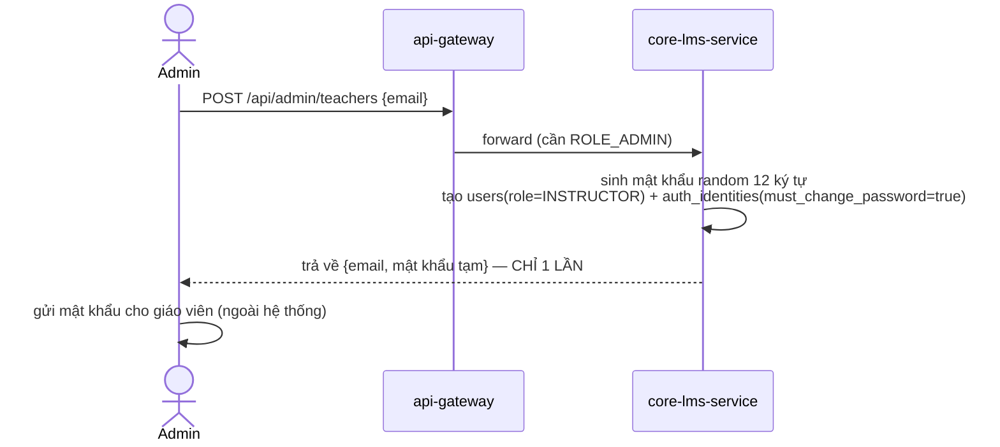

Sau đó, lần đăng nhập đầu của giáo viên:
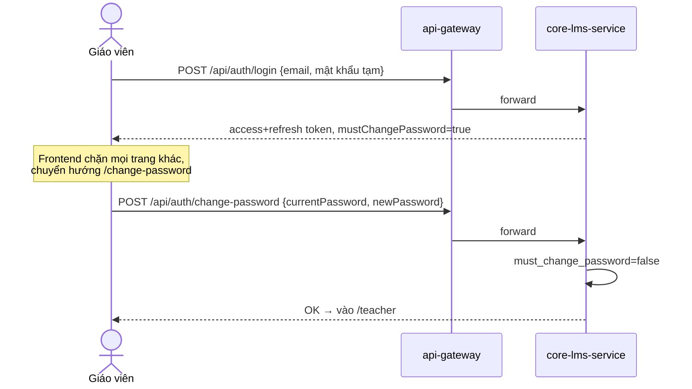

## 2. Admin tạo khóa học, gán giáo viên, sinh mã mời

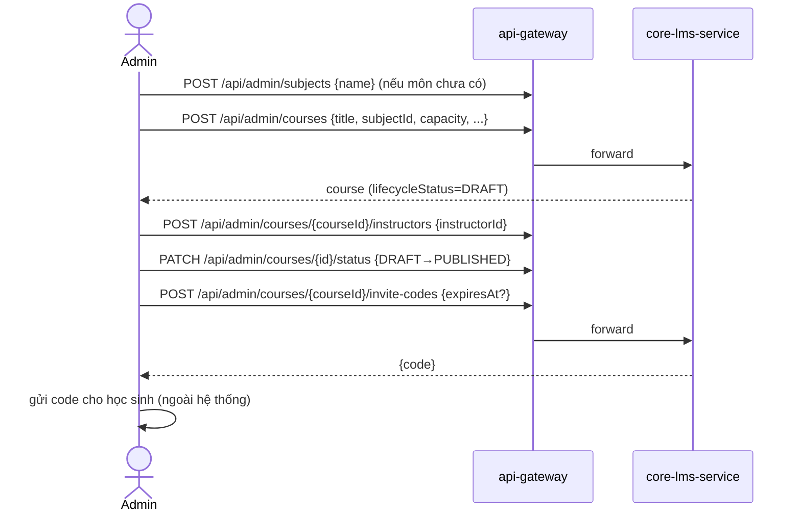

## 3. Admin soạn nội dung khóa học (module → lesson → content/quiz/assignment)

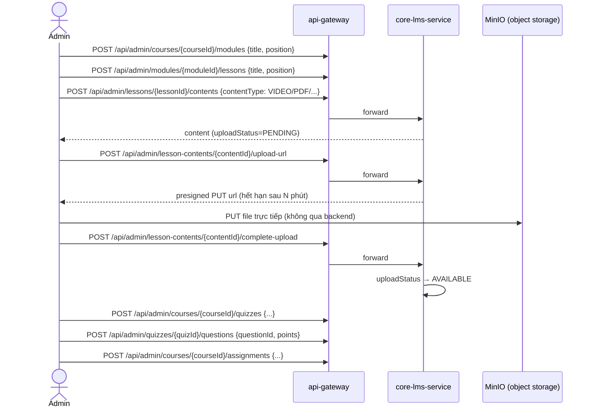

## 4. Học sinh đăng ký, duyệt khóa học, nhập mã, vào học

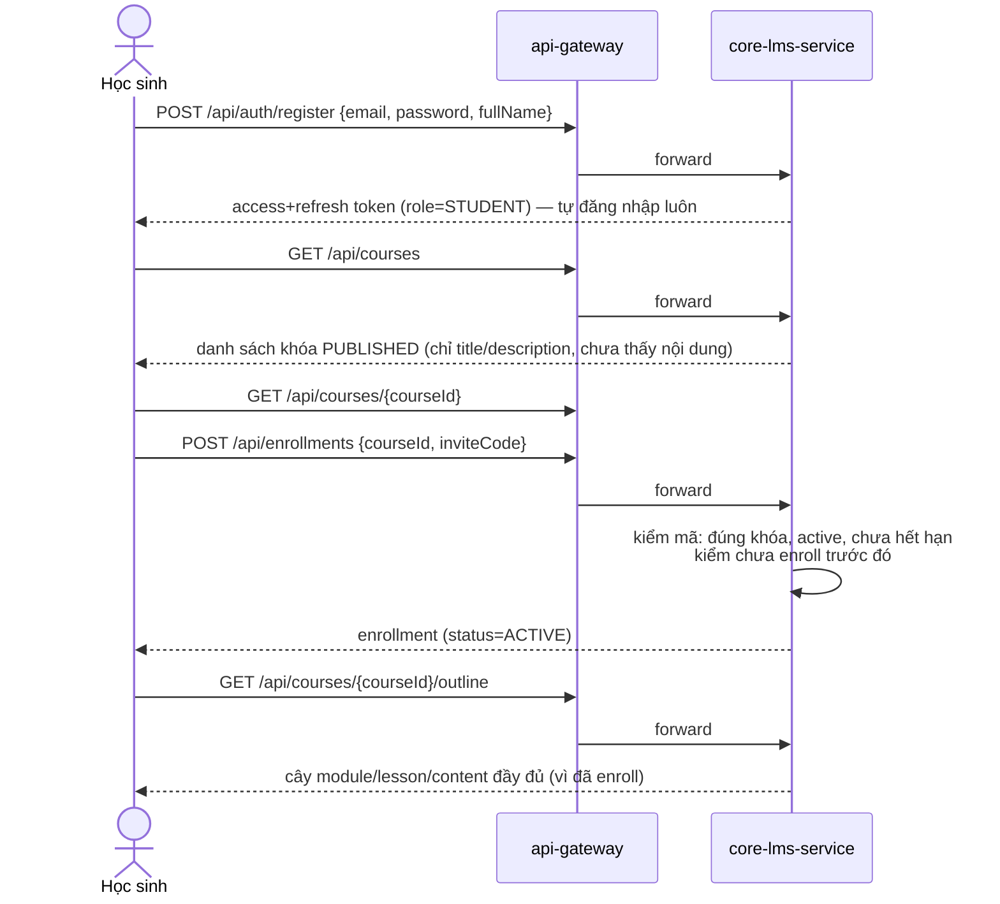

## 5. Học sinh học bài (xem nội dung + cập nhật tiến độ)

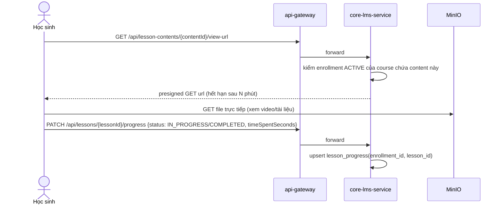

## 6. Học sinh làm quiz (snapshot đề, tự chấm)

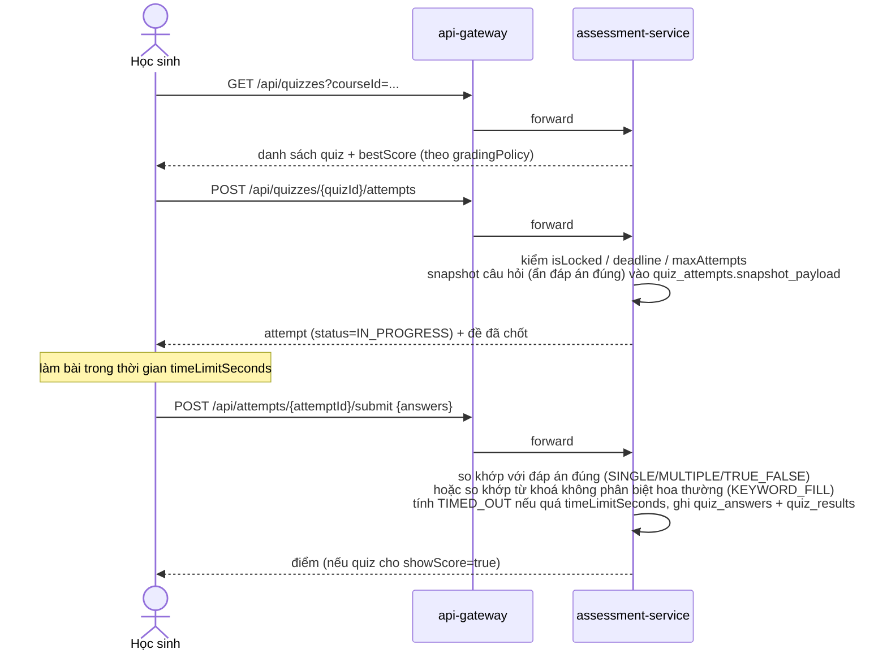

## 7. Học sinh nộp bài tập

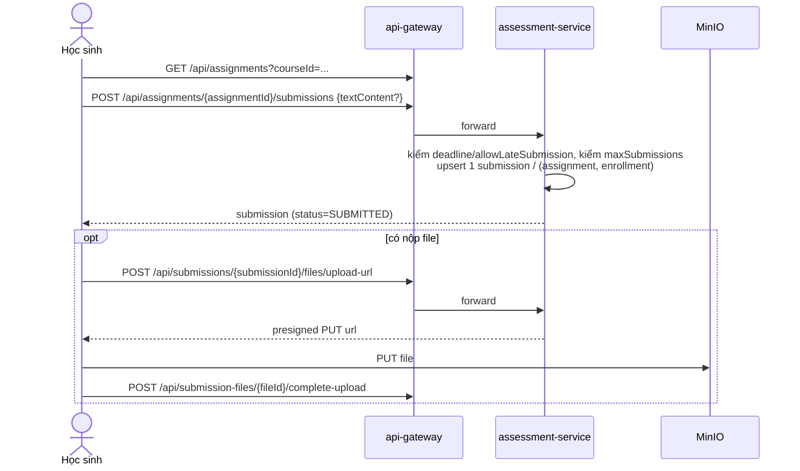

## 8. Giáo viên xem khóa học được giao (read-only) + chấm bài

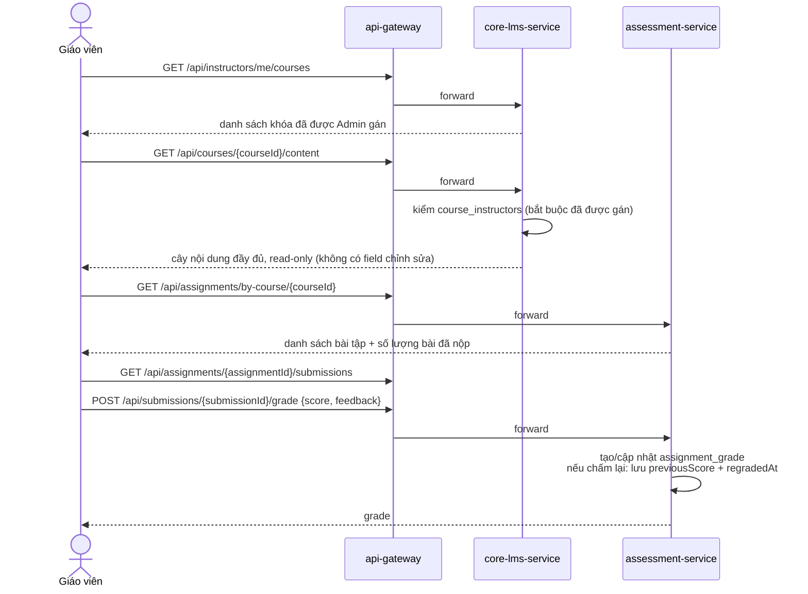

## 9. Hỏi đáp trong khóa học (Học sinh ↔ Giáo viên/Admin)

Một endpoint dùng chung cho cả 3 vai trò — quyền truy cập phân nhánh theo role ngay trong service (xem `CourseMessageService.requireAccess`):

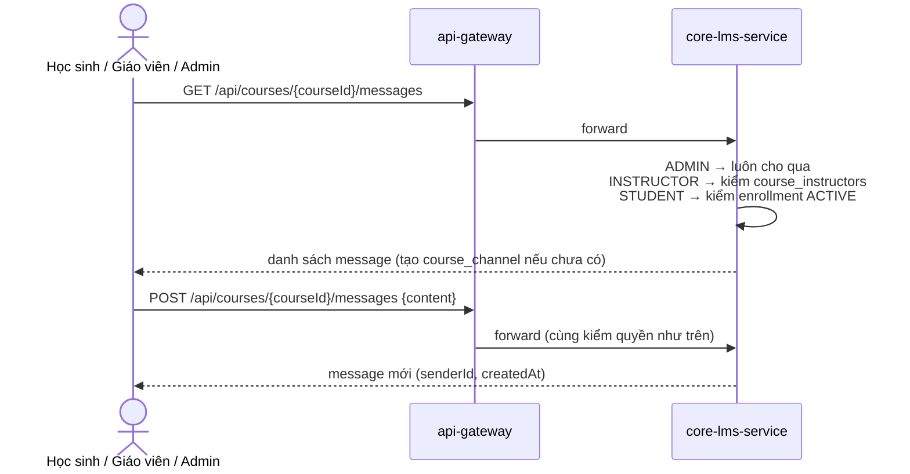

## 10. Admin quản lý trạng thái tài khoản người dùng

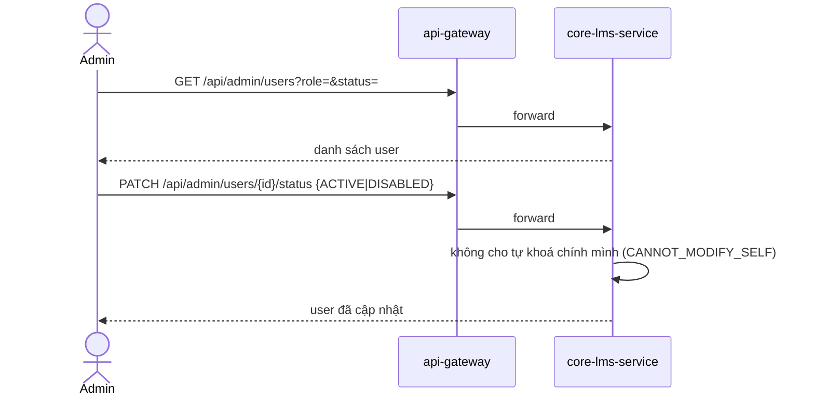
