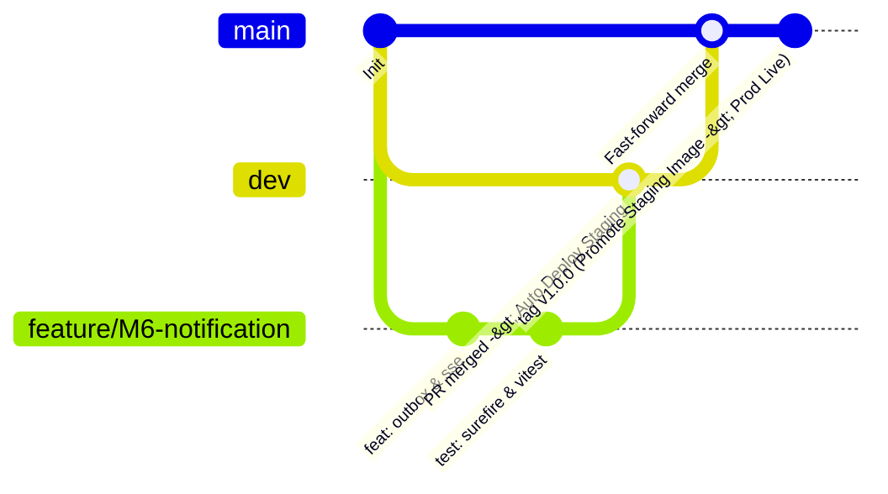

# 📖 Sổ Tay Vận Hành CI/CD & Triển Khai (CI/CD Runbook)
> **Dự án:** Online Education Platform (OEP)  
> **Tài liệu tham chiếu:** Kế hoạch 8 tuần (Dòng 552: DoD, Quy tắc PR ≤ 400 dòng; Ngày 16–22: Staging & Production CD)  
> **Thời gian thiết lập hoàn tất:** ≤ 10 phút cho thành viên mới

---

## 1. Bản Đồ Workflows GitHub Actions

Hệ thống CI/CD của dự án OEP tự động hóa toàn bộ vòng đời từ phát triển đến phát hành production theo kiến trúc **Build Once, Promote**:

| Workflow File | Tên Workflow | Nhánh / Triggers | Mục Đích Chính |
|---|---|---|---|
| `.github/workflows/ci.yml` | CI Quality Gate Orchestrator | PR & Push vào `main`, `dev` | Tự động phân loại thay đổi (Path Filtering via `dorny/paths-filter`), điều phối `backend-ci`, `frontend-ci`, `iac-ci` và cung cấp cổng kiểm soát duy nhất `CI Gate / Quality & Security Assurance` cho Branch Protection. |
| `.github/workflows/backend-ci.yml` | Backend CI Pipeline | Được gọi bởi `ci.yml` (`workflow_call`) | Gitleaks, Trivy fs quét CVE HIGH & CRITICAL, Flyway Dry-run tuần tự (V1 users, V6 notifications...), PostgreSQL pgvector + Redis + RabbitMQ services, 5 module test & JaCoCo ≥ 70%, ArchUnit, Security Matrix. |
| `.github/workflows/frontend-ci.yml` | Frontend CI Pipeline | Được gọi bởi `ci.yml` (`workflow_call`) | Oxlint, Prettier, TypeScript strict type-check, Vitest unit test & coverage, OpenAPI contract sync & typegen, Trivy fs scan (HIGH & CRITICAL), Build SPA. |
| `.github/workflows/iac-ci.yml` | Infrastructure as Code CI | Được gọi bởi `ci.yml` (`workflow_call`) | Terraform fmt, Terraform validate, Trivy config scan (Bảo mật hạ tầng, severity HIGH & CRITICAL). |
| `.github/workflows/deploy-staging.yml` | Staging CD & Rollback | Push vào `dev` hoặc `workflow_dispatch` | Build các service thay đổi với tag immutable `sha-<8>`, kiểm soát kích thước image, Trivy scan HIGH & CRITICAL, ECS Rolling update theo batch, xác thực `rolloutState == COMPLETED`, chạy Staging E2E Smoke Tests. |
| `.github/workflows/deploy-production.yml` | Production CD & Release | **Chỉ kích hoạt khi gắn Tag `v*.*.*`** hoặc Rollback qua `workflow_dispatch` | **Build Once, Promote**: Tái sử dụng image tested từ Staging qua commit SHA tag, **Manual Approval Gate** (`environment: production`), ECS Circuit Breaker, Rollout verification, 1-Click Rollback. |
| `.github/workflows/e2e-tests.yml` | Playwright E2E Tests | PR & Push vào `main`, `dev` (thay đổi `frontend/**`) | Chạy kiểm thử Playwright Chromium trên local preview bundle. |
| `.github/workflows/load-test.yml` | Performance & Load Testing (k6) | Định kỳ thứ Hai hàng tuần hoặc `workflow_dispatch` | Định chuẩn hiệu năng k6 (Stream L3: 67 RPS, p95 <= 500ms; Stream L4: 1000 concurrent, p95 <= 1500ms). |

---

## 2. Thiết Lập GitHub Environments & Phê Duyệt Thủ Công

Triển khai Production yêu cầu cổng phê duyệt có kiểm soát (Manual Approval Gate) theo quy định an toàn bảo mật.

### Các bước cấu hình trên GitHub Repository:
1. Vào **Settings** → **Environments** → Bấm **New environment**.
2. Đặt tên: `production`.
3. Trong mục **Environment protection rules**:
   - Tích chọn **Required reviewers**.
   - Thêm tài khoản Tech Lead hoặc DevOps Engineer (ví dụ: `nhnam200512` hoặc team lead).
   - Thiết lập **Wait timer** (tùy chọn: 0 phút).
   - Tích chọn **Deployment branches and tags** → Chọn **Selected tags** và điền `v*.*.*`.
4. Bấm **Save protection rules**.

---

## 3. Danh Mục GitHub Secrets & Variables Cần Thiết

Hệ thống sử dụng xác thực **AWS OIDC (OpenID Connect)** không dùng Long-term Access Key, triệt tiêu nguy cơ rò rỉ secret.

Vào **Settings** → **Secrets and variables** → **Actions**:

### A. Repository Secrets:
| Tên Secret | Bắt Buộc | Mô Tả |
|---|:---:|---|
| `AWS_OIDC_ROLE_ARN` | **Có** | ARN của IAM Role cho phép GitHub Actions assume role qua OIDC (ví dụ: `arn:aws:iam::123456789012:role/github-actions-oep-deployer`) |
| `LOAD_TEST_JWT` | Tùy chọn | Token JWT dùng xác thực cho k6 load test |
| `SLACK_WEBHOOK_URL` | Tùy chọn | Webhook URL gửi thông báo kết quả deploy vào kênh Slack |

### B. Repository Variables:
| Tên Variable | Giá Trị Mặc Định | Mô Tả |
|---|---|---|
| `AWS_REGION` | `ap-southeast-1` | AWS Region chứa ECR và cụm ECS Fargate |
| `STAGING_APP_URL` | `https://staging.oep.internal` | Domain trỏ vào Application Load Balancer Staging (dùng cho E2E test) |
| `STAGING_HEALTH_URL` | `https://staging-api.oep.internal/actuator/health` | URL kiểm tra healthcheck trên Staging |
| `PRODUCTION_APP_URL` | `https://oep.internal` | Domain chính thức của nền tảng trên Production |
| `PRODUCTION_HEALTH_URL` | `https://api.oep.internal/actuator/health` | URL kiểm tra healthcheck trên Production |

---

## 4. Quy Trình Phát Triển & Phát Hành Chuẩn



### Bước 1: Phát triển nhánh Feature & Pull Request
- Nhánh đặt tên: `feature/<module>-<tính-năng>` hoặc `fix/<vấn-đề>`.
- Kiểm tra cục bộ trước khi push:
  - **Backend:** `cd backend && mvn verify`
  - **Frontend:** `cd frontend && npm run lint && npm run format:check && npm run test:coverage`
- Mở PR vào `dev`:
  - `ci.yml` tự động chạy path filter.
  - Cổng tổng hợp `CI Gate / Quality & Security Assurance` chuyển xanh khi tất cả kiểm thử hợp lệ.
  - Cần tối thiểu **1 Approval** từ Reviewer.

### Bước 2: Tự động Triển khai Staging
- Khi PR merge vào `dev`:
  - `deploy-staging.yml` tự động kích hoạt.
  - Xây dựng Docker images cho các service có thay đổi với tag `sha-<8>` và `staging-latest`.
  - Quét an toàn Trivy (chặn 100% CVE HIGH và CRITICAL).
  - Cập nhật ECS cluster `oep-staging-cluster` và đợi ổn định theo lô 5 service.
  - Chạy Playwright E2E smoke test trực tiếp trên môi trường Staging.

### Bước 3: Phát hành Production (Release)
- Khi code trên `dev` đã được xác thực hoàn toàn trên Staging:
  - Đồng bộ nhánh `dev` sang `main` bằng cơ chế **Fast-forward / Rebase merge** để giữ nguyên commit SHA.
  - Gắn Git Release Tag:
    ```bash
    git checkout main
    git tag v1.0.0
    git push origin v1.0.0
    ```
- `deploy-production.yml` tự động khởi chạy:
  - **Promote**: Nhận diện image tag `sha-<8>` đã được build và test thành công từ Staging trên ECR, re-tag sang `v1.0.0` và `prod-latest` bằng manifest (không compile lại mã nguồn).
  - Dừng chờ tại bước **Manual Approval Gate** (`environment: production`).
  - Reviewer vào GitHub Actions nhấn **Approve and deploy**.
  - ECS Fargate tiến hành **Rolling Update** với **Deployment Circuit Breaker**.

---

## 5. Quy Trình Khôi Phục Khẩn Cấp (1-Click Rollback)

Khi phiên bản mới trên Staging hoặc Production phát sinh sự cố, thực hiện rollback tức thì trong ≤ 5 phút:

### Thao tác Rollback qua Giao diện GitHub Actions:
1. Truy cập tab **Actions** trên repository GitHub.
2. Chọn workflow cần rollback:
   - **Staging:** Chọn `Staging Continuous Deployment & Rollback`
   - **Production:** Chọn `Production Continuous Deployment & Release`
3. Nhấp vào nút **Run workflow** ở góc phải:
   - Mục **Branch**: Chọn `dev` (với Staging) hoặc `main` (với Production).
   - Mục **Image tag to rollback to**: Nhập Image Tag ổn định trước đó (Ví dụ: `sha-a1b2c3d` hoặc `v1.0.0`).
4. Nhấn **Run workflow**:
   - **Pre-validation**: Pipeline tự động kiểm tra tag tồn tại trên toàn bộ 5 ECR repos trước khi chạm vào ECS (chống lỗi rollback blind).
   - Bỏ qua toàn bộ bước compile mã nguồn.
   - Re-tag image đích và cập nhật ECS Fargate hoàn tất trong ≤ 3 phút.

---

## 6. Xử Lý Sự Cố Thường Gặp (Troubleshooting)

### A. Gitleaks phát hiện Secrets trong commit
- **Nguyên nhân:** Có file chứa mật khẩu, token, hoặc file cấu hình nhạy cảm được commit.
- **Khắc phục:**
  1. Hủy commit: `git reset HEAD~1`
  2. Bổ sung file nhạy cảm vào `.gitignore`.
  3. Nếu đã push: Dùng `git-filter-repo` để xóa triệt để khỏi lịch sử git trước khi mở lại PR.

### B. Trivy Scan chặn vì phát hiện CVE HIGH hoặc CRITICAL
- **Chính sách:** Toàn bộ pipeline chặn 100% lỗ hổng có mức độ nghiêm trọng `HIGH` và `CRITICAL`.
- **Khắc phục:**
  - Kiểm tra log chi tiết của bước "Trivy Scan".
  - Nâng cấp phiên bản thư viện trong `pom.xml` hoặc `package.json`.
  - Cập nhật base image Alpine/Temurin lên tag bản vá mới nhất.
  - Trường hợp ngoại lệ chưa có bản vá (unfixed) từ upstream vendor, khai báo giải trình cụ thể trong `frontend/.trivyignore`.

### C. ArchUnit Boundary Violations
- **Nguyên nhân:** Vi phạm ranh giới Clean Architecture (ví dụ: tầng Domain import trực tiếp tầng Infrastructure).
- **Khắc phục:**
  - Đọc log chi tiết trong GitHub Step Summary của `Backend CI`.
  - Đảm bảo Dependency Inversion: Tầng ngoài phụ thuộc tầng trong thông qua Interfaces/Ports.
