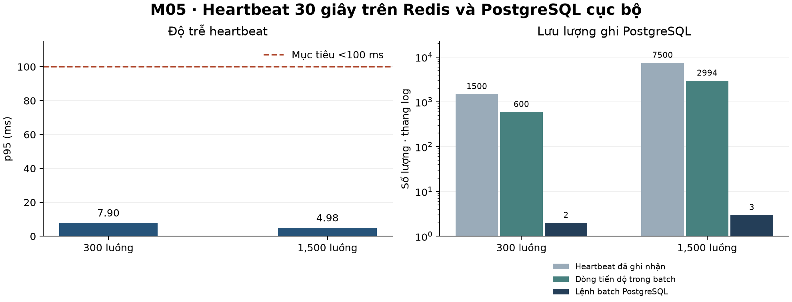

# Kết quả kiểm thử tải M05 ngày 30–36

Đo ngày 12/11/2026 trên một máy Windows. k6 gọi trực tiếp Core LMS qua HTTP
localhost và dùng JWT của từng học viên. Core LMS dùng Redis và PostgreSQL
cục bộ, với PostgreSQL 16.4, Redis Windows portable 8.10.3, k6 2.3.0 và Java 21.
Mỗi học viên gửi 5 heartbeat cách nhau 30 giây, stagger thời điểm mở luồng trong
30 giây đầu. Mỗi lượt mất khoảng 3 phút. Video thử nghiệm dài 60 phút để đo
flush định kỳ độc lập với mốc xem 80%.

| Luồng | RPS khi ổn định theo lịch | RPS toàn lượt | p95 (ms) | Lỗi | Heartbeat đã ghi | Batch PostgreSQL | Dòng upsert | Giảm số lần ghi | Giảm số dòng |
| ---: | ---: | ---: | ---: | ---: | ---: | ---: | ---: | ---: | ---: |
| 300 | 10 | 8,34 | 7,90 | 0,00% | 1.500 | 2 | 600 | 99,87% | 60,00% |
| 1.500 | 50 | 41,64 | 4,98 | 0,00% | 7.500 | 3 | 2.994 | 99,96% | 60,08% |

Mốc đối chiếu là một upsert đồng bộ cho mỗi heartbeat được chấp nhận, theo
đường ghi cũ. Số batch lấy từ ledger PostgreSQL sau khi flush phần còn lại.
Mức giảm số lần ghi là `1 − số batch / số heartbeat`. Mức giảm số dòng là
`1 − số dòng đưa vào batch / số heartbeat`. Số batch giảm hơn 80% ở cả hai
lượt. Số dòng giảm ít hơn vì một dòng của cùng học viên có thể xuất hiện ở nhiều
batch. Phép đo này chưa đo CPU hoặc I/O so với phiên bản cũ chạy cùng tải.

## Kiểm thử nghiệp vụ

- Thiết bị thứ hai mở phiên thành công. Heartbeat từ phiên thứ nhất nhận
  `409 STREAM_SUPERSEDED`. Heartbeat từ phiên mới nhận `204`.
- Gửi lại cùng sequence không cộng trùng tiến độ. Ghi lại cùng batch ID
  không cộng giây lần thứ hai. Vị trí xem được lưu khi flush.
- Mốc xem 80% kích hoạt flush trước chu kỳ 120 giây.

## Phạm vi nghiệm thu

Cả hai lượt local đạt p95 dưới 100 ms và tỷ lệ lỗi dưới 0,1%. Cần chạy lại qua
gateway trên môi trường triển khai để kiểm chứng độ trễ mạng và đường phát
video thực tế. Phép thử đổi thiết bị xác nhận thu hồi token ở API heartbeat.
Tích hợp trình phát tự dừng và hạn mức của `ARCHIVED_STATIC` thuộc các luồng
M04/M05 trước đó.

Xem [hướng dẫn tái chạy](../tests/load/README-m05-heartbeat.md).
