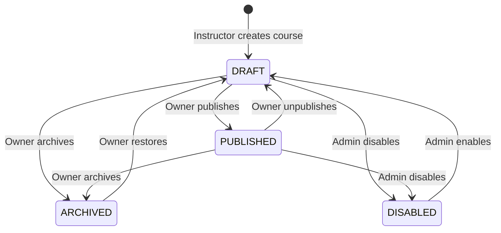
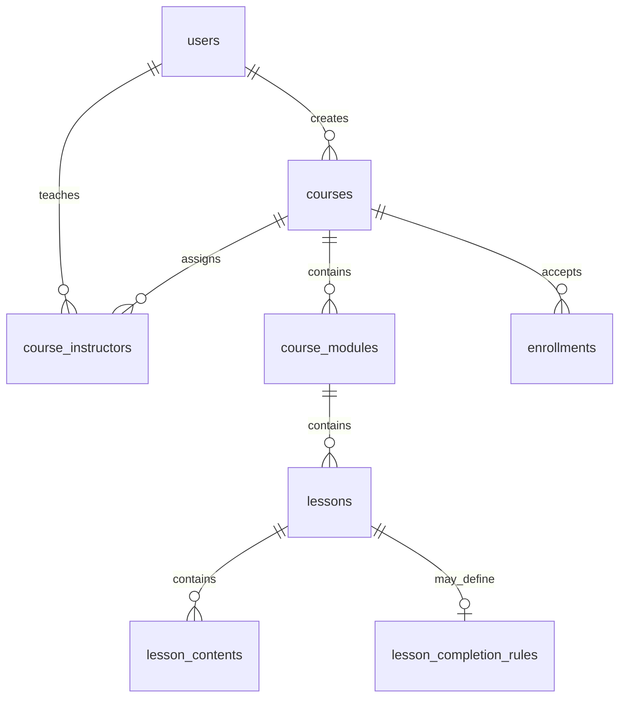

# M2 course management: lifecycle, ERD and integration

The API contract is `openapi/m2-course.yaml` (**37 operations**, **24 path templates**, **6 tags**).

## Course lifecycle and permissions

- An approved system-level `INSTRUCTOR` can create a course. M2 creates the
  course and its single `OWNER` association in the same transaction. `OWNER`
  and `CO_INSTRUCTOR` are **course-scoped**, not system-wide roles.
- `OWNER` and `CO_INSTRUCTOR` can update course metadata (`title`,
  `description`, `visibility`, `capacity`, `learning_mode`, `start_at`,
  `end_at`) and manage modules, lessons and contents. Only `OWNER` can
  publish, unpublish, archive, restore or manage co-instructors. Only `ADMIN`
  can disable/enable a course. Unauthorized lifecycle actions return 403;
  invalid transitions return 409.
- `PATCH /courses/{courseId}` cannot change lifecycle, creator or instructor
  membership. Such extra fields fail schema validation (422). The current
  draft only permits course metadata edits in `DRAFT` or `PUBLISHED`.
- **Confirmed:** `ARCHIVED` denies student course detail, outline, learning
  content and _new_ signed access URLs even when enrollment is `ACTIVE`.
  Database records are retained. Previously issued signed URLs can remain
  usable until expiry; archive is not immediate URL revocation.
- **Proposed:** no physical course deletion. `POST /courses/{courseId}/archive`
  is the primary endpoint. Deprecated `DELETE /courses/{courseId}` is a
  `DRAFT`-only archive alias retained for the co-instructor 403 acceptance
  test; the team must decide whether to keep it. Requiring at least one
  usable lesson/content before publishing is also a proposal.

| Action                                                 | OWNER | CO_INSTRUCTOR |   STUDENT   | ADMIN |
| ------------------------------------------------------ | :---: | :-----------: | :---------: | :---: |
| Edit course metadata; manage module/lesson/content     |  Yes  |      Yes      |     No      |  No   |
| Publish/unpublish; archive/restore; manage instructors |  Yes  |      No       |     No      |  No   |
| Disable/enable course                                  |  No   |      No       |     No      |  Yes  |
| Read public published metadata and preview outline     |  Yes  |      Yes      |     Yes     |  Yes  |
| Read protected content / obtain file access URL        |  Yes  |      Yes      | Conditional |  No   |

The `STUDENT` condition is a published course plus valid L3 enrollment
entitlement; a `PRIVATE` course additionally requires successful invite-code
enrollment. Administrative inspection of non-public metadata/outline is a
separate restricted policy, not permission to download protected files.

## Student access and enrollment integration

- `PUBLIC + PUBLISHED` courses appear in the public catalog; metadata and a
  preview outline may be read without enrollment. Detailed lesson content and
  signed file URLs still require enrollment for students.
- **Confirmed MVP scope:** a student joins a `PRIVATE` course by supplying an
  invite code through **L3**. L3 issues/validates the code, enforces capacity
  and creates or reactivates enrollment. M2 does not implement the join flow;
  it checks entitlement before exposing private metadata/outline/content.
- L3 enrollment states are `ACTIVE`, `COMPLETED`, `WITHDRAWN`, `REMOVED`.
  **OPEN:** whether `COMPLETED` retains M2 content access. The M2 draft uses
  provisional `ACTIVE`-only authorization (fail closed); this is **not** a
  final product decision. `WITHDRAWN`/`REMOVED` cannot obtain new content URLs.
- The proposed synchronous `EnrollmentChecker` offers
  `get_active_enrollment(student_id, course_id)` for access checks and
  `count_occupied_seats(course_id)` for capacity reductions. M2 derives the
  student ID from authenticated identity, not from a client-supplied query.
  If the checker is unavailable, protected requests fail closed with 503.
- Updating `courses.capacity` or switching visibility `PUBLIC` ↔ `PRIVATE`
  requires coordination with L3. Counting occupied seats and then updating in
  another transaction is not race-safe against concurrent enrollment; L3/M2
  must agree on serialization or an atomic reservation mechanism. The set of
  enrollment statuses occupying capacity is still unresolved.

## Course structure, content and ERD review

`enrollments` belongs to M3/L3. The `lesson_completion_rules` relationship is
present in the reviewed DBML, but **its API ownership and implementation
phase are OPEN**. The diagram does not imply that migrations or constraints
have been implemented.

| Table                | Relation / existing design                                                            | Review outcome                                                                                                                                                       |
| -------------------- | ------------------------------------------------------------------------------------- | -------------------------------------------------------------------------------------------------------------------------------------------------------------------- |
| `courses`            | UUID PK; `created_by` references user; visibility, lifecycle, capacity, learning mode | Keep metadata and archive-only behavior. Coordinate capacity changes with L3.                                                                                        |
| `course_instructors` | `(course_id, instructor_id)` relationship with `OWNER`/`CO_INSTRUCTOR`                | Create the owner association atomically. Composite uniqueness alone does not guarantee **at most one** owner per course; add a suitable owner uniqueness constraint. |
| `course_modules`     | FK `course_id`; `position`, `is_default`                                              | Enforce unique positions per course and at most one default module; decide whether exactly one default is required.                                                  |
| `lessons`            | FK `module_id`; `position`, `is_required`                                             | Enforce positions per module; avoid deletion while progress, quizzes or assignments reference the lesson.                                                            |
| `lesson_contents`    | FK `lesson_id`; `position`, file metadata and `upload_status`                         | Enforce positions per lesson, validate file ownership/storage, and reject deletion with downstream references (409).                                                 |

Reordering needs atomic position updates to avoid uniqueness collisions.
There is no confirmed generic soft-delete scheme for child tables; do not
assume `deleted_at` or destructive cascading deletes. M2 must validate the
entire course → module → lesson → content parent chain; mismatched resources
should not expose another course's data.

## Content upload and protected download

- `TEXT` and `LINK` contents use inline text or an external URL. File content
  types (`VIDEO`, `PDF`, `SLIDE`, `DOCUMENT`, `FILE`) use object storage;
  **video is downloadable as a file, not streamed**. The draft does not use
  `min_video_percentage` as a trusted completion rule for downloads.
- Upload flow: create file content in `PENDING` → request a presigned `PUT`
  URL → client uploads directly to storage → call `complete-upload` → server
  checks the stored object and marks it `AVAILABLE` (possibly after an
  intermediate `UPLOADED` state).
- Only `OWNER`/`CO_INSTRUCTOR` can upload. Student download calls
  `GET /contents/{contentId}/access-url`, requiring `PUBLISHED`, valid L3
  entitlement and `AVAILABLE` content. Do not disclose raw storage keys or
  log signed URLs. URLs already issued before archive, unpublish or removal
  can remain valid until their TTL ends.
- **Proposed, not approved:** 100 MiB maximum file size, 10-minute upload
  URL and 5-minute download URL, plus MIME/type validation. Invalid file size
  or type may return 413/415 from M2; the storage provider's direct response
  need not use the API's error envelope.
- **Contract review gap:** the current `CompleteUploadRequest` schema requires
  `object_key` from the caller, while the upload-url response intentionally
  omits a raw key and the design says keys remain server-side. Resolve how a
  client obtains a safe confirmation handle (or change the confirmation
  contract) **before implementation**; this document does not modify the API.

## Integration and implementation gaps

| Owner / dependency                | Intended interface or event                                                                                       | Decision needed                                                                                                                                   |
| --------------------------------- | ----------------------------------------------------------------------------------------------------------------- | ------------------------------------------------------------------------------------------------------------------------------------------------- |
| **L3 → M2**                       | `EnrollmentChecker.get_active_enrollment(...)`; `count_occupied_seats(...)`                                       | Final `COMPLETED` access policy, occupied-seat statuses, timeout/auth, and race-safe capacity coordination.                                       |
| **L3 → M2 (PRIVATE)**             | Invite-code enrollment before protected M2 reads                                                                  | Define code persistence, issuance, expiry/reuse, join API and visibility-change behavior. Minimal invite-code support **is confirmed for MVP**.   |
| **M2 ↔ M3/L4/M5**                 | `lesson_completion_rules` with `require_quiz` / `require_assignment`; M5 assignments may reference a lesson       | Confirm completion-rule ownership, phase and whether one or all associated quizzes/assignments are required. Prevent deleting referenced lessons. |
| **M2 → event/notification owner** | Transactional outbox; proposed `course.updated`, `course.published`, `course.archived`, `content.available`, etc. | Confirm event naming, envelope, consumer ownership, deduplication and notification behavior. Never emit `course.deleted` for an archive.          |
| **Common / gateway**              | JWT authorization, errors, pagination, storage limits and routes                                                  | Approve error envelope and 403/404 behavior; align pagination and deployment routes across M2/M3/M5.                                              |

The M2 integration draft proposes storing an event in `outbox_events` within
the same transaction as a resource change; an asynchronous worker publishes it
with retry, and consumers deduplicate notifications by
`(event_id, recipient_user_id)`. These are **proposed integration contracts**,
not proof of an implemented outbox or delivery guarantee. The M2 notes call
its events/notifications collaborator "L5", whereas the supplied M5 document
is **Assignments/Submissions/Grading**; the team should clarify the actual
owner instead of assuming these labels are interchangeable.

The M2 contract currently proposes pagination `page=1`, `page_size=20`, max
`100`, and errors shaped as
`{"error":{"code":"...","message":"...","request_id":"...","details":{}}}`.
These formats differ from M3/M5 and still require common approval. They are
**not changed by this document**.

## Pending approvals and acceptance checks

- **Confirmed in the M2 design:** co-instructors may edit metadata but not
  lifecycle; `ARCHIVED` blocks students even with `ACTIVE` enrollment;
  minimal `PRIVATE` invite-code joining belongs to MVP.
- **Proposed:** archive-only course deletion and deprecated DELETE alias;
  publish readiness requirement; upload limits/TTLs; EnrollmentChecker
  signature and event catalog.
- **OPEN:** `COMPLETED` content access; lesson completion-rule ownership and
  scope; course reviews/ratings scope in the current M2 draft; capacity seat
  semantics; exact private-code model; admin audit policy; common error and
  pagination conventions.

Minimum acceptance scenarios for implementation review: co-instructor PATCH
metadata succeeds, lifecycle calls fail 403, invalid lifecycle update fields
fail 422, archiving preserves rows and blocks an `ACTIVE` student, PRIVATE
content stays protected before a successful L3 enrollment, checker failure
returns 503 without issuing a URL, capacity cannot drop below occupied seats,
and signed URLs are only issued for available files to authorized callers.

**Design status:** OpenAPI draft and ERD/permission/integration reviews exist.
L3, M5/event-owner and common sign-off, implementation of controllers and
migrations, automated integration tests and PR merge must be confirmed
separately; none is asserted complete here.
