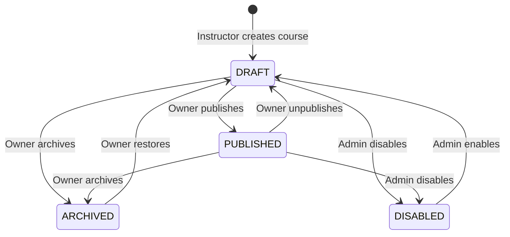
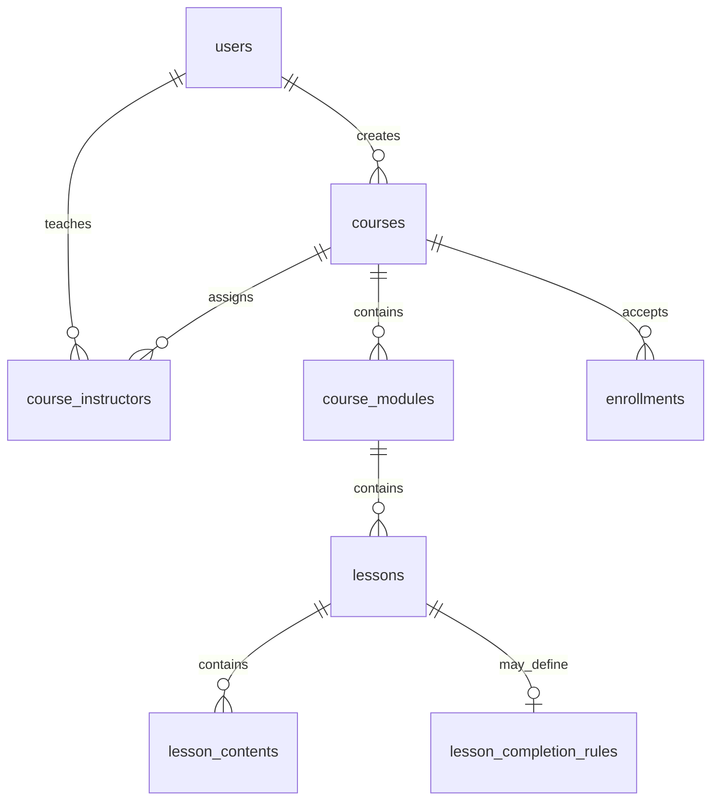

# M2 course management: lifecycle, ERD and integration

The API contract is `openapi/m2-course.yaml` (**37 operations**, **24 path templates**, **6 tags**).

## Course lifecycle and permissions

- An approved system-level `INSTRUCTOR` can create a course. M2 creates the
  course and its single `OWNER` association in the same transaction. `OWNER`
  and `CO_INSTRUCTOR` are **course-scoped**, not system-wide roles.
- `OWNER` and `CO_INSTRUCTOR` can update course metadata (`title`,
  `description`, `visibility`, `capacity`, `learning_mode`, `start_at`,
  `end_at`) and manage modules, lessons and contents. Only `OWNER` can
  publish, unpublish, archive, restore or manage co-instructors. Only `ADMIN`
  can disable/enable a course. Unauthorized lifecycle actions return 403;
  invalid transitions return 409.
- `PATCH /courses/{courseId}` cannot change lifecycle, creator or instructor
  membership. Such extra fields fail schema validation (422). The current
  draft only permits course metadata edits in `DRAFT` or `PUBLISHED`.
- **Confirmed:** `ARCHIVED` denies student course detail, outline, learning
  content and _new_ signed access URLs even when enrollment is `ACTIVE`.
  Database records are retained. Previously issued signed URLs can remain
  usable until expiry; archive is not immediate URL revocation.
- **Proposed:** no physical course deletion. `POST /courses/{courseId}/archive`
  is the primary endpoint. Deprecated `DELETE /courses/{courseId}` is a
  `DRAFT`-only archive alias retained for the co-instructor 403 acceptance
  test; the team must decide whether to keep it. Requiring at least one
  usable lesson/content before publishing is also a proposal.

### Module 2 role matrix (draft for team approval)

| Operation | OWNER | CO_INSTRUCTOR | STUDENT |
| --- | :---: | :---: | :---: |
| Create a course (eligible system-level INSTRUCTOR; creator becomes OWNER) | Eligible INSTRUCTOR | Eligible INSTRUCTOR | No |
| Read public catalog and PUBLIC + PUBLISHED metadata/preview outline | Yes | Yes | Yes |
| Read managed course metadata or outline in any lifecycle state | Yes | Yes | No |
| Read private course metadata, learning outline, modules, lessons and AVAILABLE content | Yes | Yes | ACTIVE enrollment in PUBLISHED course |
| Update course metadata | Yes | Yes | No |
| Create/read/update modules, lessons and lesson contents | Yes | Yes | Read only under student access rule |
| Delete lesson | Yes, only when no contents or dependent records exist | Yes, same rule | No |
| Reorder modules and lessons | Yes | Yes | No |
| Delete an empty module | Yes | Yes | No |
| Archive a DRAFT course through deprecated `DELETE /courses/{courseId}` alias | Yes | No; receives 403 | No |
| Transfer course ownership | Not supported in current M2 contract | Not supported in current M2 contract | No |
| Publish, unpublish, archive, restore; manage co-instructors | Yes | No | No |
| Request upload URL and confirm upload | Yes | Yes | No |
| Request signed file access URL | Yes | Yes | ACTIVE enrollment in PUBLISHED course; content must be AVAILABLE |

`OWNER` and `CO_INSTRUCTOR` refer to course-scoped assignments. `STUDENT`
access to private resources requires successful L3 enrollment; archived or
disabled courses do not grant new student reads or access URLs. ADMIN lifecycle
operations (disable / enable) are outside this three-role matrix. This matrix
describes the current M2 contract and implementation draft; team approval is
still pending.

## Student access and enrollment integration

- `PUBLIC + PUBLISHED` courses appear in the public catalog; metadata and a
  preview outline may be read without enrollment. Detailed lesson content and
  signed file URLs still require enrollment for students.
- **Confirmed MVP scope:** a student joins a `PRIVATE` course by supplying an
  invite code through **L3**. L3 issues/validates the code, enforces capacity
  and creates or reactivates enrollment. M2 does not implement the join flow;
  it checks entitlement before exposing private metadata/outline/content.
- L3 enrollment states are `ACTIVE`, `COMPLETED`, `WITHDRAWN`, `REMOVED`.
  **OPEN:** whether `COMPLETED` retains M2 content access. The M2 draft uses
  provisional `ACTIVE`-only authorization (fail closed); this is **not** a
  final product decision. `WITHDRAWN`/`REMOVED` cannot obtain new content URLs.
- The L3/M3 draft proposes the synchronous
  `EnrollmentChecker.requireActive(studentId, courseId)` interface, returning
  the enrollment ID or throwing 403. M2 derives the student ID from
  authenticated identity, not from a client-supplied query. The method
  signature and cross-service failure mapping still need L3 confirmation.
  If the checker is unavailable, protected requests fail closed with 503.
- Updating `courses.capacity` or switching visibility `PUBLIC` ↔ `PRIVATE`
  requires coordination with L3. Counting occupied seats and then updating in
  another transaction is not race-safe against concurrent enrollment; L3/M2
  must agree on serialization or an atomic reservation mechanism. The set of
  enrollment statuses occupying capacity is still unresolved.

## Course structure, content and ERD review

`enrollments` belongs to M3/L3. The `lesson_completion_rules` relationship is
present in the reviewed DBML, but **its API ownership and implementation
phase are OPEN**. The diagram does not imply that migrations or constraints
have been implemented.

| Table                | Relation / existing design                                                            | Review outcome                                                                                                                                                       |
| -------------------- | ------------------------------------------------------------------------------------- | -------------------------------------------------------------------------------------------------------------------------------------------------------------------- |
| `courses`            | UUID PK; `created_by` references user; visibility, lifecycle, capacity, learning mode | Keep metadata and archive-only behavior. Coordinate capacity changes with L3.                                                                                        |
| `course_instructors` | `(course_id, instructor_id)` relationship with `OWNER`/`CO_INSTRUCTOR`                | Create the owner association atomically. Composite uniqueness alone does not guarantee **at most one** owner per course; add a suitable owner uniqueness constraint. |
| `course_modules`     | FK `course_id`; `position`, `is_default`                                              | Course creation inserts a default module at position 0. Inserting at an occupied position shifts later modules while preserving order; keep positions unique and at most one default. |
| `lessons`            | FK `module_id`; `position`, `is_required`                                             | Inserting at an occupied position shifts later lessons while preserving order. Delete only when the lesson has no contents, completion rule, progress, quiz, assignment, or AI reference; otherwise return 409 without cascading. |
| `lesson_contents`    | FK `lesson_id`; `position`, file metadata and `upload_status`                         | Inserting at an occupied position shifts later content while preserving order. Validate file ownership/storage and reject deletion with downstream references (409).  |

Reordering needs atomic position updates to avoid uniqueness collisions.
There is no confirmed generic soft-delete scheme for child tables; do not
assume `deleted_at` or destructive cascading deletes. M2 must validate the
entire course → module → lesson → content parent chain; mismatched resources
should not expose another course's data.

## Content upload and protected download

- `TEXT` and `LINK` contents use inline text or an external URL. File content
  types (`VIDEO`, `PDF`, `SLIDE`, `DOCUMENT`, `FILE`) use object storage;
  **video is downloadable as a file, not streamed**. The draft does not use
  `min_video_percentage` as a trusted completion rule for downloads.
- Upload flow: create file content in `PENDING` → request a presigned `PUT`
  URL → client uploads directly to storage → call `complete-upload` → server
  checks the stored object and marks it `AVAILABLE` (possibly after an
  intermediate `UPLOADED` state).
- Only `OWNER`/`CO_INSTRUCTOR` can upload. Student download calls
  `GET /contents/{contentId}/access-url`, requiring `PUBLISHED`, valid L3
  entitlement and `AVAILABLE` content. Do not disclose raw storage keys or
  log signed URLs. URLs already issued before archive, unpublish or removal
  can remain valid until their TTL ends.
- **Proposed, not approved:** 100 MiB maximum file size, 10-minute upload
  URL and 5-minute download URL, plus MIME/type validation. Invalid file size
  or type may return 413/415 from M2; the storage provider's direct response
  need not use the API's error envelope.
- Upload completion is bodyless: the server uses the content ID to find the
  server-managed object key, checks storage metadata, then marks content
  `AVAILABLE`. The public contract does not expose `object_key`.

## Integration and implementation gaps

| Owner / dependency | Draft interface or event | Decision needed |
| --- | --- | --- |
| **L3 / M2** | `EnrollmentChecker.requireActive(studentId, courseId)` returns enrollment ID or throws 403, matching `docs/m3-enrollment-progress.md`. | L3 confirmation of signature, `COMPLETED` access policy, timeout/auth behavior, and cross-service error mapping. M2 currently checks its local enrollment table; this interface is not implemented. |
| **L3 / M2 (PRIVATE)** | L3 handles invite-code enrollment before protected M2 reads. | Define code persistence, issuance, expiry/reuse, join API and visibility-change behavior. Minimal invite-code support is confirmed for MVP. |
| **M2 / M3/L4/M5** | `lesson_completion_rules` with `require_quiz` / `require_assignment`; M5 assignments may reference a lesson. | Completion-rule ownership and scope remain open. Lesson deletion is implemented conservatively: return 409 while contents, completion rules, progress, quizzes, assignments, or AI references exist; no dependent rows are cascaded. |
| **M2 / L5 notifications** | L5's current notification catalog includes `COURSE_CONTENT_UPDATED` and `COURSE_DISABLED`; it also lists `COURSE_ANNOUNCEMENT`, `COURSE_APPROVED`, and `COURSE_REJECTED`. | Confirm which M2 content/lifecycle changes emit notifications, recipients, payload/envelope, and whether domain events share the notification catalog. `COURSE_PUBLISHED`, `COURSE_ARCHIVED`, and `CONTENT_AVAILABLE` are not in the current catalog. |
| **Common / gateway** | M2 proposes 1-based `page`, `page_size` default 20 / maximum 100, and `{"error":{"code":"...","message":"...","request_id":"...","details":{}}}`. | Approve a common pagination/error contract and align differences with M3/M5. The common standard is not present in this repository. |

The L5 notification catalog is in `docs/m6-notification.md`, section 5. Its
`event_type` values describe notifications and may differ from domain-event
names carried by an outbox. The M2/L5 mapping, payload, recipients and delivery
guarantees still need agreement. The catalog is not evidence that M2 currently
emits those notifications. Confirm that the team's "L5" owner refers to the
notification module (the supplied M5 document covers
Assignments/Submissions/Grading).

The M2 contract already defines the proposed pagination and error envelope in
`openapi/m2-course.yaml`. These formats differ from M3/M5 and still require
common approval; no approved common API standard is present in the repository.

## Pending approvals and acceptance checks

- **Confirmed in the M2 design:** co-instructors may edit metadata but not
  lifecycle; `ARCHIVED` blocks students even with `ACTIVE` enrollment;
  minimal `PRIVATE` invite-code joining belongs to MVP.
- **Proposed:** archive-only course deletion and deprecated DELETE alias;
  publish readiness requirement; upload limits/TTLs; EnrollmentChecker
  signature and event catalog.
- **OPEN:** `COMPLETED` content access; lesson completion-rule ownership and
  scope; course reviews/ratings scope in the current M2 draft; capacity seat
  semantics; exact private-code model; admin audit policy; common error and
  pagination conventions.

Minimum acceptance scenarios for implementation review: co-instructor PATCH
metadata succeeds, lifecycle calls fail 403, invalid lifecycle update fields
fail 422, archiving preserves rows and blocks an `ACTIVE` student, PRIVATE
content stays protected before a successful L3 enrollment, checker failure
returns 503 without issuing a URL, capacity cannot drop below occupied seats,
and signed URLs are only issued for available files to authorized callers.

**Design status:** OpenAPI draft and ERD/permission/integration reviews exist.
L3, M5/event-owner and common sign-off, implementation of controllers and
migrations, automated integration tests and PR merge must be confirmed
separately; none is asserted complete here.
