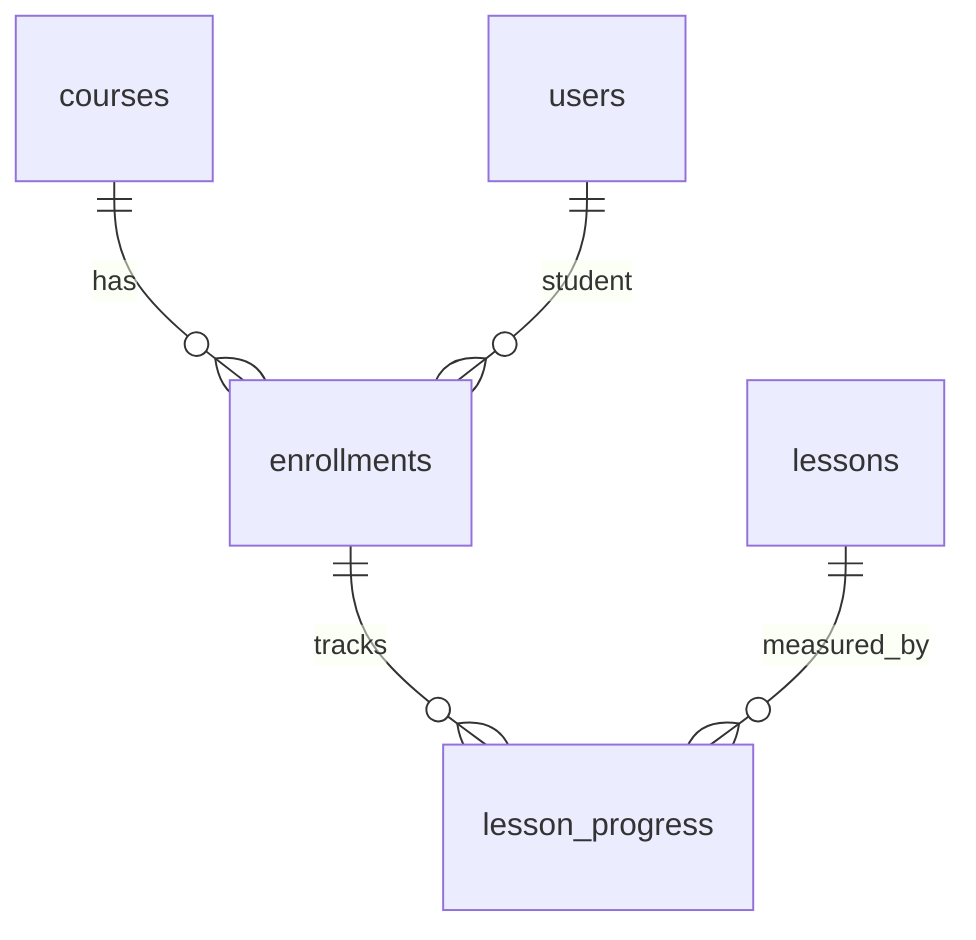

# M3 enrollment and progress: state, ERD and integration

This is the M3 part of the Day 1–3 design deliverable in the **1210**
worksheet of `Ke_hoach_8_tuan_Project8.xlsx`. The contract is
`openapi/m3-enrollment.yaml` (11 operations). It describes intended behavior;
controllers and migrations have not yet been implemented. The review baseline
is `origin/dev` at commit `7af0443`.

## Enrollment state machine

```mermaid
stateDiagram-v2
    [*] --> ACTIVE: successful enrollment
    ACTIVE --> COMPLETED: all required lessons complete
    ACTIVE --> WITHDRAWN: student withdraws
    WITHDRAWN --> ACTIVE: student re-enrolls; retain progress
    ACTIVE --> REMOVED: instructor removes
    WITHDRAWN --> REMOVED: instructor removes
    COMPLETED --> REMOVED: instructor removes
    REMOVED --> [*]: no student self-reactivation
```

| Current state | Action | Next state / result |
| --- | --- | --- |
| No row | Student enrolls in `PUBLIC + PUBLISHED` course with room | New `ACTIVE` row, 201 |
| `ACTIVE` | Same student enrolls again | Same row, 200; no duplicate |
| `WITHDRAWN` | Student enrolls again and capacity permits | Same row becomes `ACTIVE`, 200; keep lesson progress and submissions |
| `COMPLETED` | Same student enrolls again | Same row, 200; remains `COMPLETED` |
| `REMOVED` | Student tries to enroll | 403; instructor intervention is required |
| `ACTIVE` | Student withdraws | `WITHDRAWN`; history retained |
| `ACTIVE` | All required lessons complete | `COMPLETED`; set `completed_at` |
| `ACTIVE`, `WITHDRAWN`, `COMPLETED` | Authorized instructor removes | `REMOVED`; history retained |

Only `ACTIVE` accepts progress heartbeat. `COMPLETED` rejects heartbeat
without deleting progress, but may still submit or resubmit an assignment while
`submission_count < max_submissions`, subject to its deadline policy. The
enrollment stays `COMPLETED` afterward. Whether a completed student may use a
remaining quiz attempt belongs to L4's `max_attempts` contract. `WITHDRAWN`
keeps progress but cannot submit until re-enrolled.

An identical enrollment request returns 200, as required by the later workbook
acceptance criteria, despite the existing `ALREADY_ENROLLED 409` code.
`COURSE_FULL 409` applies to a new enrollment or `WITHDRAWN` reactivation
when no seat is available. Capacity checks must lock the course row/counter or
update it atomically. The sample `EnrollmentService` on `dev` counts active
rows without a lock, so it can race.

## Lesson and course completion

For a required lesson, evaluate its L2 `lesson_completion_rules`:

1. Meet `minimum_time_seconds`.
2. Meet `min_video_percentage` if a video requirement applies.
3. If `require_quiz`, have a submitted attempt for a quiz attached to the
   lesson. **No passing score is required.**
4. If `require_assignment`, have a submitted assignment attached to the
   lesson. **No passing score is required.**
5. All enabled conditions must hold. When all lessons with `is_required=true`
   are complete, change the enrollment to `COMPLETED`.

Proposed association rule for L2/L4 review: when a lesson has multiple linked
quizzes/assignments, each required item must have a submission. They should
confirm whether the rule should instead mean any one linked item. Later grade
changes do not revoke completion. Changes to lesson rules do not retroactively
change already completed students, per the L2 plan.

## Progress idempotency and performance

The client sends a heartbeat every **15 seconds** while the lesson is visible,
at most four times per minute per lesson. It reuses an `Idempotency-Key` UUID
v4 on retries and increases `sequence` per `(enrollment_id, lesson_id)`.
The server binds a key to the student's payload. A duplicate key returns the
earlier result; a reused key with a different payload returns
`IDEMPOTENCY_CONFLICT 409`. An older/equal sequence with a different key is
acknowledged without increasing time or rewinding playback. An accepted delta
is capped at 30 seconds. One hundred retries of one heartbeat must add time
once. Video duration is sourced from trusted lesson content metadata, rather
than the heartbeat request.

Implementation needs a durable dedupe marker (for example a
`progress_heartbeat_events` table with unique event ID and payload hash) or
an equivalent atomic sequence ledger. A plain upsert of
`lesson_progress.time_spent_seconds` cannot prove deduplication.

Initial target: **at least 50 RPS**, heartbeat p95 **≤200 ms** on staging, with
one progress-row write per accepted heartbeat as the target. Later load testing
models 1,000 students / 15 seconds = about **67 RPS** for ten minutes with
<0.5% errors. These are different milestones, neither measured yet.

## M3 ERD review

| Table | Existing key / relation | Review outcome |
| --- | --- | --- |
| `enrollments` | UUID PK; FKs `course_id`, `student_id`; unique pair | Keep uniqueness for reactivation. Add index `(course_id, status)` for capacity checks and enforce concurrency. |
| `lesson_progress` | UUID PK; FKs `enrollment_id`, `lesson_id`; unique pair | Keep upsert key. Add video position/percentage or agreed per-content progress table; add sequence and durable idempotency marker. Validate that lesson belongs to enrollment's course. |

## Integration for L2 and L4 review

| Owner | Proposed interface / event | Decision needed |
| --- | --- | --- |
| L3 → L2 | `EnrollmentChecker.requireActive(studentId, courseId)` returns enrollment ID or throws 403; L2 calls it before protected learning content. | Confirm signature and whether `COMPLETED` can still read content. M5 separately allows completed resubmission. |
| L4 → L3 | L4 publishes or exposes `QuizSubmitted(enrollmentId, lessonId, quizId, submittedAt)`; M3 re-evaluates the lesson. | Confirm which attempt statuses count as submitted and the multiple-quiz rule. Score does not gate completion. |
| M5 → M3 | Accepted assignment submission invokes/publishes `AssignmentSubmitted(enrollmentId, lessonId, assignmentId, submittedAt)`; M3 re-evaluates the lesson. | Confirm sync/event delivery and multiple-assignment rule. |
| L5 / gateway | Route `/api/progress/**` and `/api/instructor/**`. | These routes are absent from the current gateway. |

The current `ErrorCode` enum includes `COURSE_FULL`, `COURSE_NOT_OPEN`,
`ALREADY_ENROLLED`, `FORBIDDEN` and `VALIDATION_FAILED`. New M3 errors in
the OpenAPI require implementation later. The workbook describes a modular
monolith and Flyway, while `dev` currently uses separate services and
Hibernate `ddl-auto: update`; L1/L5 must resolve this architecture difference
before BE implementation.
