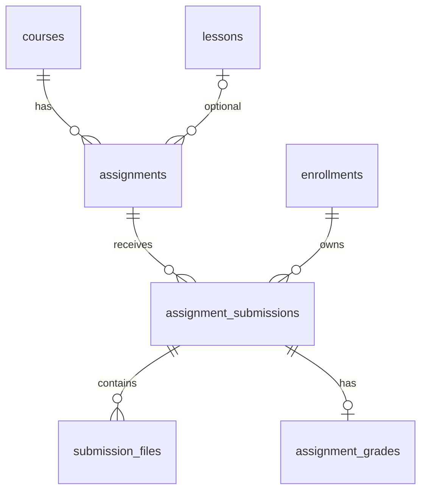

# M5 assignment, submission and grading: ERD and rules

This is the M5 part of the Day 1–3 design deliverable in the **1210**
worksheet of `Ke_hoach_8_tuan_Project8.xlsx`. The contract is
`openapi/m5-assignment.yaml` (14 operations). It describes intended behavior;
controllers and migrations have not yet been implemented. The review baseline
is `origin/dev` at commit `7af0443`.

## Submission lifecycle

- One `assignment_submissions` row exists per
  `(assignment_id, enrollment_id)`. Resubmission replaces text and file
  associations and increments `submission_count` atomically, up to
  `max_submissions`. Old content is only recoverable through audit/backup
  unless a separate history table is added.
- Student enrollment must be `ACTIVE` or `COMPLETED`. A `COMPLETED` student
  may submit again if attempts remain and the deadline policy permits it.
  Resubmission leaves the enrollment `COMPLETED`; its heartbeat remains
  blocked. `WITHDRAWN` retains old work but must be reactivated first.
- An `Idempotency-Key` UUID v4 identifies one submit action; a network retry
  must not consume another attempt. The same key with different payload is 409.
- The server determines deadline and `is_late`. If
  `allow_late_submission=false`, a late submission returns 403. It enforces
  `allow_text` and `allow_files` (400 for disallowed input).
- Upload uses a presigned URL, opaque token and server confirmation. Final
  submission accepts only `AVAILABLE` tokens for the same student and
  assignment. Limit: five files, each ≤20 MiB. A not-yet-available file is
  409; a file over the limit is 413. Instructor download uses a short-lived
  signed URL and does not expose the object key.
- A submission satisfies `require_assignment` for lesson completion on
  submission, independent of its score. Later regrading does not revoke
  completion.

## Grading

The first grade is in `[0, max_score]`. Regrade requires a reason and the
current grade version; stale versions return 409. The prior score, regrade
timestamp and reason are saved. Each regrade needs an audit row and one
`ASSIGNMENT_GRADED` notification within 60 seconds, per the workbook.

Proposed behavior for L3/L5 review: a resubmission after grading makes the old
grade stale and requires a new grading action. The current `AssignmentStatus`
enum has `SUBMITTED`, `PENDING_REGRADE` and `GRADED`, but the code must
define which status represents this case and what grade the student sees until
the new work is graded.

## M5 ERD review

| Table | Existing key / relation | Review outcome |
| --- | --- | --- |
| `assignments` | UUID PK; `course_id` required, `lesson_id` optional | Validate lesson belongs to course and `max_submissions >= 1`; define deletion behavior once submissions exist. |
| `assignment_submissions` | UUID PK; FKs `assignment_id`, `enrollment_id`; unique pair | Matches overwrite policy. Add optimistic version/locking for concurrent resubmits. Validate assignment and enrollment refer to the same course. |
| `submission_files` | UUID PK; FK `submission_id`; `object_key`, size, status | Keep committed files. A presubmit upload ticket/token store is additionally needed because the current entity requires an existing submission ID. |
| `assignment_grades` | UUID PK; unique FK `submission_id` | One current grade per submission. Add a version for concurrent grading. `previous_score` retains only one old score; audit rows are needed for full history. |

These four M5 tables and the two M3 tables in
`docs/m3-enrollment-progress.md` are the six-table ERD review required by
the workbook. The entities exist in `backend/core-model`, but that does not
prove the desired migrations and constraints are complete.

## Integration and implementation gaps

- M5 should publish/invoke `AssignmentSubmitted(enrollmentId, lessonId,
  assignmentId, submittedAt)` so M3 can re-evaluate lesson completion. If
  multiple assignments belong to one lesson, L2/L4/L3 must confirm whether
  one or every associated assignment is required.
- The current gateway routes `/api/submissions/**` to assessment but lacks
  `/api/assignments/**`; L5 must confirm ownership and add the route.
- The current `ErrorCode` enum lacks the specific submission, file and
  grading errors in the OpenAPI; add them during BE implementation.
- The workbook proposes LocalStack/S3/Flyway in a modular monolith, while
  current `dev` uses separate services, PostgreSQL/Redis/RabbitMQ Compose
  and Hibernate `ddl-auto: update`. L1/L5 should decide the target
  architecture before implementing upload and migrations.
