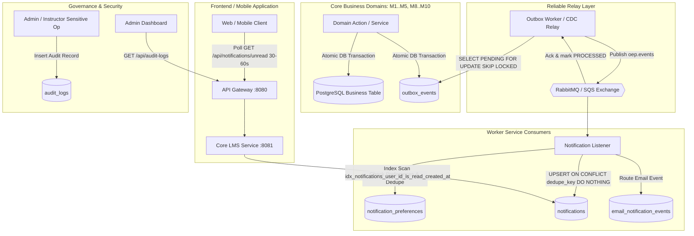
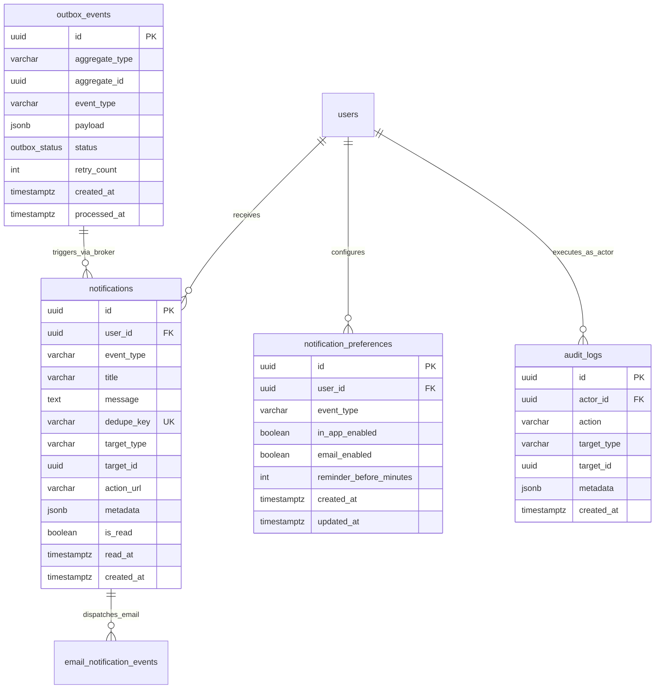

# M6 Async Notifications, Polling API, Outbox Pattern and System Audit Trail

This is the M6 part of the Day 1–3 design deliverable in the **1210** worksheet of `Ke_hoach_8_tuan_Project8.xlsx`.
The contract is `openapi/m6-notification.yaml` (7 operations). It specifies client notification polling,
read lifecycle, user preferences, transactional outbox events, and immutable system audit logging.
The review baseline is `origin/dev` at commit `7af0443`.

---

## 1. Architectural Overview & System Reliability

Module 6 serves as the reliability and event orchestration backbone of the Online Education Platform (OEP).
It decouples high-latency side effects (sending in-app notifications, dispatching emails, auditing)
from core request threads using:

1. **Transactional Outbox Pattern**: Eliminates dual-write inconsistencies between domain operations and message publication.
2. **Idempotent Ingestion & Delivery**: Employs durable message deduplication keys (`dedupe_key`) across broker and worker layers.
3. **High-Efficiency Polling API**: Optimized student/instructor unread inbox polling (30–60s interval) backed by dedicated composite indexing and conditional HTTP caching (`ETag` / `304 Not Modified`).
4. **Unified System Audit Trail**: An append-only audit log across all modules capturing actor identity, target entity, previous state, new state, and change rationale.



---

## 2. Polling API Architecture & SLA

### 2.1 Polling Contract vs. WebSocket / SSE Trade-offs

| Criterion | Long-Polling / Interval Polling (Chosen) | WebSocket / Server-Sent Events |
| :--- | :--- | :--- |
| **Connection Overhead** | Stateless HTTP/1.1 or HTTP/2; connection closed after request | Stateful persistent TCP socket per client |
| **Infrastructure Complexity**| Standard API Gateway rate limiter & stateless backend auto-scaling | Requires sticky sessions, socket clustering, Redis Pub/Sub backplane |
| **Firewall & Proxy Traversal**| 100% compliant with standard HTTP caching, proxies, and VPNs | Frequently dropped or degraded by enterprise middleboxes |
| **Battery & Mobile Network** | Idle between intervals; zero persistent keep-alive pings | Constant heartbeat frames consume socket & battery |
| **Target Polling Frequency** | **30 to 60 seconds** per active web/mobile session | Instantaneous (sub-second) |
| **Readiness for Baseline** | **Immediate deployment** with zero external socket dependencies | Deferred to future real-time collaboration milestones |

### 2.2 Polling Optimization & Conditional Requests

The polling endpoint `GET /api/notifications/unread` is explicitly designed for high traffic and low latency:

1. **Parameters**:
   - `since` (*RFC 3339 Timestamp*, optional): Filters notifications created after this point.
   - `limit` (*integer*, default `20`, max `100`): Caps items returned in memory.
   - `If-None-Match` (*header*, optional): Contains previous `ETag` hash calculated as `W/"{unreadCount}-{latestTimestampMillis}"`.
2. **Conditional 304 Not Modified & Fast Path Execution**:
   - When processing `GET /api/notifications/unread`, the server executes a fast lightweight query to check count and latest timestamp:
     ```sql
     SELECT COUNT(*), MAX(created_at)
     FROM notifications
     WHERE user_id = :userId AND is_read = false;
     ```
   - If the generated `ETag` matches the client's `If-None-Match` header, the server returns HTTP `304 Not Modified` immediately without reading items, reducing server CPU and network payload by **~98%** during idle periods.
3. **Index-Driven Execution**:
   - Backed by composite B-Tree index:
     ```sql
     CREATE INDEX idx_notifications_user_id_is_read_created_at
     ON notifications (user_id, is_read, created_at DESC);
     ```
   - Performance SLA: **p95 latency ≤ 50 ms** on PostgreSQL staging instances for up to 100,000 active students.
4. **Client-Side Smart Polling (Frontend TanStack Query)**:
   - Polling frequency: **30 to 60 seconds** when active.
   - **Pause on background**: Configure `refetchIntervalInBackground: false` to immediately cease polling when the user minimizes or switches tabs, saving mobile device battery and server network connections.
   - **Refetch on focus**: Configure `refetchOnWindowFocus: true` to instantly refresh notification status when the user switches back.
   - **Cache retention on 304**: Ensure the API client retains previous notification state when receiving HTTP 304 without wiping the inbox cache.

### 2.3 Read Lifecycle & Batch Updates

- **Single Item Read**: `PATCH /api/notifications/{notificationId}/read`
  - Idempotent: If already read, returns 200 with unchanged `read_at`.
  - Security hardening (IDOR Prevention): Must ensure `notification.user_id == authenticated_user.id`. To prevent enumeration/brute-force attacks discovering valid notification UUIDs, the server returns `404 Not Found` when the record is not found or does not belong to the user.
- **Single Item Delete/Dismiss**: `DELETE /api/notifications/{notificationId}`
  - Permanently removes or dismisses a notification belonging to the current user. Returns `204 No Content` on success, or `404 Not Found` if not found/mismatched.
- **Batch Read by IDs**: `POST /api/notifications/batch-read`
  - Accepts a list of UUIDs: `{ "notificationIds": ["uuid-1", "uuid-2"] }`.
  - Atomically marks selected notifications as read in a single round-trip. Safely ignores already read or unowned IDs.
  - Returns `{ "updatedCount": 2, "markedAt": "..." }`.
- **Batch Read All**: `POST /api/notifications/read-all`
  - Accepts optional `{ "before": "2026-10-15T12:00:00Z" }` to prevent race conditions where newly arrived notifications are marked read before the student notices them.
  - Clock drift mitigation: The server enforces `cutoff = min(clientBefore, serverNow())` to prevent future timestamps from marking subsequent notifications.
  - Returns `{ "updatedCount": 8, "markedAt": "..." }`.

---

## 3. Transactional Outbox Pattern & Pipeline

### 3.1 Dual-Write Mitigation

Writing to the database and sending a message to a message broker in separate steps causes dual-write failures (e.g., DB commits but network drops before broker publication, or message is published but DB transaction rolls back).

To guarantee **zero message loss**:
1. Business services insert the domain state and the event row into `outbox_events` in the **same local database transaction**.
2. An asynchronous Outbox Relay processes `PENDING` records using `SELECT * FROM outbox_events WHERE status = 'PENDING' ORDER BY created_at ASC LIMIT 100 FOR UPDATE SKIP LOCKED` (enabling seamless horizontal scaling across multiple worker instances), publishes to RabbitMQ exchange `oep.events` with routing key `notification.requested`, and updates the outbox status to `PROCESSED`.
3. If publication fails, `retry_count` is incremented with exponential backoff (`delay = min(2^retry * 1000ms, 60000ms)`). Upon exceeding 5 retries, status becomes `FAILED` and raises an ops alert.

### 3.2 Outbox Event Table Schema

```sql
CREATE TYPE outbox_status AS ENUM ('PENDING', 'PROCESSED', 'FAILED');

CREATE TABLE outbox_events (
    id UUID PRIMARY KEY DEFAULT gen_random_uuid(),
    aggregate_type VARCHAR(100) NOT NULL,
    aggregate_id UUID NOT NULL,
    event_type VARCHAR(100) NOT NULL,
    payload JSONB NOT NULL,
    status outbox_status NOT NULL DEFAULT 'PENDING',
    retry_count INT NOT NULL DEFAULT 0,
    created_at TIMESTAMPTZ NOT NULL DEFAULT now(),
    processed_at TIMESTAMPTZ
);

CREATE INDEX idx_outbox_events_status_created_at
ON outbox_events (status, created_at)
WHERE status = 'PENDING';
```

---

## 4. Deduplication Convention (`dedupe_key`)

### 4.1 Specification & Formula

All asynchronous notification workers must maintain strict idempotency under **at-least-once message delivery**. Duplicate deliveries caused by network timeouts, RabbitMQ redelivery flags, or worker retries must never generate duplicate notifications in the student's or instructor's inbox.

The agreed-upon system convention is:

$$\mathbf{dedupe\_key = \{event\_type\}:\{target\_id\}[:\{discriminator\}]:\{user\_id\}}$$

Where:
- `{event_type}`: Canonical domain event identifier in uppercase snake_case (e.g., `QUIZ_PUBLISHED`, `ASSIGNMENT_REGRADED`).
- `{target_id}`: UUID of the core target business entity (e.g., quiz ID, submission ID, announcement ID, application ID).
- `[:{discriminator}]` (*optional / contextual*): Discriminator segment preventing legitimate repeated business actions on the same entity from being silently dropped by the unique database constraint:
  - **Assignment Regrades**: `v{grade_version}` (e.g., `v2` for second grading evaluation).
  - **Deadline Reminders**: `{window}` (e.g., `24h`, `2h` to permit distinct multi-phase alerts).
  - **Assignment Resubmissions**: `c{submission_count}` (e.g., `c2` when student updates their submission).
  - **Lesson Content Revisions**: `rev{timestamp_epoch}` (enables multiple legitimate updates per lesson).
  - **Re-enrollments**: `cyc{timestamp_epoch}` (when student withdraws and later re-enrolls).
- `{user_id}`: UUID of the recipient user (Student, Instructor, or Admin).

### 4.2 Database Enforcement & Worker Ingestion Behavior

The `notifications` table enforces a database-level unique constraint:

```sql
ALTER TABLE notifications ADD CONSTRAINT uq_notifications_dedupe_key UNIQUE (dedupe_key);
```

When the notification worker consumes a `NotificationRequestedEvent`:
```sql
INSERT INTO notifications (
    id, user_id, event_type, title, message,
    dedupe_key, target_type, target_id, is_read, created_at
) VALUES (
    gen_random_uuid(), :userId, :eventType, :title, :message,
    :dedupeKey, :targetType, :targetId, false, now()
)
ON CONFLICT (dedupe_key) DO NOTHING;
```

In Java Spring Data / JPA:
- The worker executes an upsert query or catches `DataIntegrityViolationException` on `dedupeKey`.
- When a conflict is caught, the worker logs `DEBUG: Duplicate notification suppressed for dedupe_key: ...` and immediately acknowledges (`basicAck`) the message to RabbitMQ without error.

### 4.3 Mapping Table for Common Events

| Event Type | `target_id` Entity | Discriminator | Recipient `user_id` | Resulting `dedupe_key` Example |
| :--- | :--- | :--- | :--- | :--- |
| `QUIZ_PUBLISHED` | `quizzes.id` | None | Enrolled Student ID | `QUIZ_PUBLISHED:4a2d7f8a-9b1c-4e8a-bf90-334455667788:3fa85f64-5717-4562-b3fc-2c963f66afa6` |
| `QUIZ_DUE_REMINDER` | `quizzes.id` | Window (`24h`, `2h`) | Enrolled Student ID | `QUIZ_DUE_REMINDER:4a2d7f8a-9b1c-4e8a-bf90-334455667788:24h:3fa85f64-5717-4562-b3fc-2c963f66afa6` |
| `QUIZ_RESULT_PUBLISHED` | `quiz_attempts.id` | Version (`v1`, `v2`)| Student Candidate ID | `QUIZ_RESULT_PUBLISHED:a1b2c3d4-e5f6-4a5b-8c9d-0e1f2a3b4c5d:v1:3fa85f64-5717-4562-b3fc-2c963f66afa6` |
| `QUIZ_ATTEMPT_RESET` | `quiz_attempts.id` | None | Student Candidate ID | `QUIZ_ATTEMPT_RESET:a1b2c3d4-e5f6-4a5b-8c9d-0e1f2a3b4c5d:3fa85f64-5717-4562-b3fc-2c963f66afa6` |
| `ASSIGNMENT_PUBLISHED` | `assignments.id` | None | Enrolled Student ID | `ASSIGNMENT_PUBLISHED:77777777-7777-4777-8777-777777777777:3fa85f64-5717-4562-b3fc-2c963f66afa6` |
| `ASSIGNMENT_SUBMITTED` | `assignment_submissions.id` | Sub Count (`c1`)| Assigned Instructor ID| `ASSIGNMENT_SUBMITTED:8c3a1100-3344-49a2-9811-1234567890ab:c1:instructor-uuid-001` |
| `ASSIGNMENT_GRADED` | `assignment_submissions.id` | Version (`v1`) | Student Author ID | `ASSIGNMENT_GRADED:8c3a1100-3344-49a2-9811-1234567890ab:v1:3fa85f64-5717-4562-b3fc-2c963f66afa6` |
| `ASSIGNMENT_REGRADED` | `assignment_submissions.id` | Version (`v2`) | Student Author ID | `ASSIGNMENT_REGRADED:8c3a1100-3344-49a2-9811-1234567890ab:v2:3fa85f64-5717-4562-b3fc-2c963f66afa6` |
| `ASSIGNMENT_DUE_REMINDER` | `assignments.id` | Window (`24h`, `2h`)| Enrolled Student ID | `ASSIGNMENT_DUE_REMINDER:77777777-7777-4777-8777-777777777777:24h:3fa85f64-5717-4562-b3fc-2c963f66afa6` |
| `COURSE_ANNOUNCEMENT` | `course_announcements.id` | None | Enrolled Student ID | `COURSE_ANNOUNCEMENT:91827364-55aa-44bb-88cc-998877665544:3fa85f64-5717-4562-b3fc-2c963f66afa6` |
| `COURSE_CONTENT_UPDATED`| `lessons.id` | Rev (`rev1697371200`)| Enrolled Student ID | `COURSE_CONTENT_UPDATED:66666666-6666-4666-8666-666666666666:rev1697371200:3fa85f64-5717-4562-b3fc-2c963f66afa6` |
| `COURSE_APPROVED` | `courses.id` | None | Course Owner ID | `COURSE_APPROVED:11111111-1111-4111-8111-111111111111:instructor-uuid-001` |
| `COURSE_REJECTED` | `courses.id` | Rev (`t1697371200`)| Course Owner ID | `COURSE_REJECTED:11111111-1111-4111-8111-111111111111:t1697371200:instructor-uuid-001` |
| `COURSE_DISABLED` | `courses.id` | None | Enrolled Students & GV| `COURSE_DISABLED:11111111-1111-4111-8111-111111111111:3fa85f64-5717-4562-b3fc-2c963f66afa6` |
| `ENROLLMENT_CONFIRMED` | `enrollments.id` | Cyc (`cyc1`) | Enrolled Student ID | `ENROLLMENT_CONFIRMED:22222222-2222-4222-8222-222222222222:cyc1:3fa85f64-5717-4562-b3fc-2c963f66afa6` |
| `ENROLLMENT_REMOVED` | `enrollments.id` | None | Removed Student ID | `ENROLLMENT_REMOVED:22222222-2222-4222-8222-222222222222:3fa85f64-5717-4562-b3fc-2c963f66afa6` |
| `ENROLLMENT_REQUEST_SUBMITTED`| `enrollment_requests.id` | None | Course Owner ID | `ENROLLMENT_REQUEST_SUBMITTED:eeeeeeee-1111-4222-8333-aaaaaaaaaaaa:instructor-uuid-001` |
| `ENROLLMENT_REQUEST_REJECTED` | `enrollment_requests.id` | None | Requesting Student ID| `ENROLLMENT_REQUEST_REJECTED:eeeeeeee-1111-4222-8333-aaaaaaaaaaaa:3fa85f64-5717-4562-b3fc-2c963f66afa6` |
| `DISCUSSION_REPLIED` | `messages.id` | None | Discussion Author ID| `DISCUSSION_REPLIED:bbbbbbbb-1111-4444-9999-aaaaaaaaaaaa:3fa85f64-5717-4562-b3fc-2c963f66afa6` |
| `DISCUSSION_MENTIONED` | `messages.id` | None | Mentioned User ID | `DISCUSSION_MENTIONED:bbbbbbbb-1111-4444-9999-aaaaaaaaaaaa:3fa85f64-5717-4562-b3fc-2c963f66afa6` |
| `CERTIFICATE_ISSUED` | `certificates.id` | None | Graduated Student ID| `CERTIFICATE_ISSUED:cc112233-4455-6677-8899-00aabbccddee:3fa85f64-5717-4562-b3fc-2c963f66afa6` |
| `INSTRUCTOR_APPLICATION_APPROVED` | `instructor_applications.id` | None | Applicant User ID | `INSTRUCTOR_APPLICATION_APPROVED:dd334455-6677-8899-0011-223344556677:3fa85f64-5717-4562-b3fc-2c963f66afa6` |
| `INSTRUCTOR_APPLICATION_REJECTED` | `instructor_applications.id` | None | Applicant User ID | `INSTRUCTOR_APPLICATION_REJECTED:dd334455-6677-8899-0011-223344556677:3fa85f64-5717-4562-b3fc-2c963f66afa6` |
| `COURSE_INVITATION_RECEIVED` | `course_invitations.id` | None | Invited Student ID | `COURSE_INVITATION_RECEIVED:ff112233-4455-6677-8899-00aabbccddee:3fa85f64-5717-4562-b3fc-2c963f66afa6` |
| `ACCOUNT_SUSPENDED` | `users.id` | Time (`t1697371200`)| Target User ID | `ACCOUNT_SUSPENDED:3fa85f64-5717-4562-b3fc-2c963f66afa6:t1697371200` |
| `SYSTEM_MAINTENANCE_ALERT`| `maintenance_windows.id` | None | All Active Users | `SYSTEM_MAINTENANCE_ALERT:99999999-8888-7777-6666-555544443333:3fa85f64-5717-4562-b3fc-2c963f66afa6` |

---

## 5. Domain Event Catalog (`event_type`) & Outbox Payloads

The platform defines domain notification events across all functional modules, covering student learning lifecycles, instructor teaching operations, administrative governance, and system-wide broadcasts. Each event payload encapsulates all metadata needed for template rendering, push notification generation, and frontend deep-linking.

### Event Catalog Summary

| # | Event Type (`event_type`) | Source Module | Trigger Condition | Recipient Role | Delivery Channels |
| :- | :--- | :--- | :--- | :--- | :--- |
| **Assessment & Quizzes** |
| 1 | `QUIZ_PUBLISHED` | M4 - Quiz Engine | Instructor publishes a new quiz | Enrolled Students (`ACTIVE`) | In-app, Email |
| 2 | `QUIZ_DUE_REMINDER` | M4 - Quiz Engine | Deadline in 24h / 2h and attempt remaining | Enrolled Students with no submission | In-app, Email |
| 3 | `QUIZ_RESULT_PUBLISHED` | M4 - Quiz Engine | Quiz auto-graded or review score published | Student Candidate | In-app |
| 4 | `QUIZ_ATTEMPT_RESET` | M4 - Quiz Engine | Instructor resets tainted attempt (`RESET_QUIZ_ATTEMPT`) | Student Candidate | In-app, Email |
| **Assessment & Assignments** |
| 5 | `ASSIGNMENT_PUBLISHED` | M5 - Assignment | Instructor publishes new homework / assignment | Enrolled Students (`ACTIVE`) | In-app, Email |
| 6 | `ASSIGNMENT_SUBMITTED` | M5 - Assignment | Student submits or resubmits assignment | Course Instructor / Grader | In-app |
| 7 | `ASSIGNMENT_GRADED` | M5 - Assignment | Instructor publishes initial evaluation score | Submission Student Author | In-app, Email |
| 8 | `ASSIGNMENT_REGRADED` | M5 - Assignment | Instructor publishes regrade / adjusted score | Submission Student Author | In-app, Email |
| 9 | `ASSIGNMENT_DUE_REMINDER`| M5 - Assignment | Deadline in 24h / 2h and no submission | Enrolled Students with no submission | In-app, Email |
| **Course Management & Curriculum** |
| 10 | `COURSE_ANNOUNCEMENT` | M2 - Course Management| Instructor posts course-wide broadcast | All Enrolled Students | In-app, Email |
| 11 | `COURSE_CONTENT_UPDATED`| M2 - Course Management| New lesson / video / resource added | Enrolled Students | In-app |
| 12 | `COURSE_APPROVED` | M2 - Course Management| Admin approves course curriculum for publishing | Course Instructor / Owner | In-app, Email |
| 13 | `COURSE_REJECTED` | M2 - Course Management| Admin rejects course curriculum with feedback | Course Instructor / Owner | In-app, Email |
| 14 | `COURSE_DISABLED` | M2 - Course Management| Admin disables course (copyright, policy breach) | Enrolled Students & Instructors | In-app, Email |
| **Enrollment & Access Control** |
| 15 | `ENROLLMENT_CONFIRMED` | M3 - Enrollment | Successful enrollment or reactivation | Enrolled Student | In-app, Email |
| 16 | `ENROLLMENT_REMOVED` | M3 - Enrollment | Instructor/Admin expels student from course | Target Student | In-app, Email |
| 17 | `ENROLLMENT_REQUEST_SUBMITTED`| M3/M9 - Private Course| Student applies to join private course | Course Instructor / Owner | In-app |
| 18 | `ENROLLMENT_REQUEST_REJECTED` | M3/M9 - Private Course| Instructor declines private enrollment request | Applicant Student | In-app, Email |
| **Social, Discussion & Community** |
| 19 | `DISCUSSION_REPLIED` | M8 - Social & Q&A | Participant answers student question | Discussion Author | In-app |
| 20 | `DISCUSSION_MENTIONED` | M8 - Social & Q&A | User tagged (`@username`) in comment | Mentioned User | In-app |
| **Certification & Onboarding** |
| 21 | `CERTIFICATE_ISSUED` | M3 / Certification | Student achieves 100% course completion | Graduated Student | In-app, Email |
| 22 | `INSTRUCTOR_APPLICATION_APPROVED` | M9 - Onboarding | Admin approves instructor registration | Applicant User | In-app, Email |
| 23 | `INSTRUCTOR_APPLICATION_REJECTED` | M9 - Onboarding | Admin rejects instructor application with reason | Applicant User | In-app, Email |
| 24 | `COURSE_INVITATION_RECEIVED` | M9 - Invitations | Direct invitation sent to student email/account | Invited Student | In-app, Email |
| **Identity & System Security** |
| 25 | `ACCOUNT_SUSPENDED` | M1 - Identity | Admin locks user account (`DISABLE_USER`) | Target User | Email |
| 26 | `SYSTEM_MAINTENANCE_ALERT`| M6 - System | Platform-wide maintenance or emergency notice | All Active Users | In-app |

---

### Detailed Payloads

#### 1. `QUIZ_PUBLISHED`
- **Context**: A quiz attached to a course or lesson transitions from draft to published.
- **Dedupe Key**: `QUIZ_PUBLISHED:{quiz_id}:{student_id}`
- **Sample Payload**:
```json
{
  "eventId": "e001a1b2-1111-4000-8000-000000000001",
  "eventType": "QUIZ_PUBLISHED",
  "aggregateType": "QUIZ",
  "aggregateId": "4a2d7f8a-9b1c-4e8a-bf90-334455667788",
  "occurredAt": "2026-10-15T10:00:00Z",
  "recipientUserId": "3fa85f64-5717-4562-b3fc-2c963f66afa6",
  "title": "Bài kiểm tra mới: Trắc nghiệm Kiến trúc Microservices",
  "message": "Giảng viên Nguyễn Văn A đã mở bài kiểm tra 'Trắc nghiệm Kiến trúc Microservices' trong khóa học Lập trình Backend.",
  "targetType": "QUIZ",
  "targetId": "4a2d7f8a-9b1c-4e8a-bf90-334455667788",
  "data": {
    "courseId": "11111111-1111-4111-8111-111111111111",
    "courseTitle": "Lập trình Backend chuyên sâu",
    "quizTitle": "Trắc nghiệm Kiến trúc Microservices",
    "durationMinutes": 45,
    "totalQuestions": 30,
    "deadline": "2026-10-22T23:59:59Z"
  }
}
```

#### 2. `ASSIGNMENT_GRADED`
- **Context**: An assignment submission has been evaluated or regraded by an instructor.
- **Dedupe Key**: `ASSIGNMENT_GRADED:{submission_id}:v1:{student_id}`
- **Sample Payload**:
```json
{
  "eventId": "e002a1b2-1111-4000-8000-000000000002",
  "eventType": "ASSIGNMENT_GRADED",
  "aggregateType": "ASSIGNMENT_SUBMISSION",
  "aggregateId": "8c3a1100-3344-49a2-9811-1234567890ab",
  "occurredAt": "2026-10-15T11:15:00Z",
  "recipientUserId": "3fa85f64-5717-4562-b3fc-2c963f66afa6",
  "title": "Bài tập của bạn đã được chấm điểm",
  "message": "Bài tập 'Thiết kế REST API với OpenAPI 3.0' đã được chấm: 9.5 / 10 điểm.",
  "targetType": "SUBMISSION",
  "targetId": "8c3a1100-3344-49a2-9811-1234567890ab",
  "data": {
    "assignmentId": "77777777-7777-4777-8777-777777777777",
    "assignmentTitle": "Thiết kế REST API với OpenAPI 3.0",
    "courseId": "11111111-1111-4111-8111-111111111111",
    "score": 9.5,
    "maxScore": 10.0,
    "feedback": "Cấu trúc endpoint rất chuẩn RESTful, mô tả schema đầy đủ.",
    "isRegrade": false,
    "gradedBy": "instructor-uuid-001"
  }
}
```

#### 3. `ASSIGNMENT_DUE_REMINDER`
- **Context**: 24 hours prior to assignment deadline for students who have not yet submitted.
- **Dedupe Key**: `ASSIGNMENT_DUE_REMINDER:{assignment_id}:{window}:{student_id}`
- **Sample Payload**:
```json
{
  "eventId": "e003a1b2-1111-4000-8000-000000000003",
  "eventType": "ASSIGNMENT_DUE_REMINDER",
  "aggregateType": "ASSIGNMENT",
  "aggregateId": "77777777-7777-4777-8777-777777777777",
  "occurredAt": "2026-10-15T08:00:00Z",
  "recipientUserId": "3fa85f64-5717-4562-b3fc-2c963f66afa6",
  "title": "Nhắc nhở: Sắp đến hạn nộp bài tập",
  "message": "Bài tập 'Thiết kế REST API với OpenAPI 3.0' sẽ hết hạn nộp trong vòng 24 giờ tới.",
  "targetType": "ASSIGNMENT",
  "targetId": "77777777-7777-4777-8777-777777777777",
  "data": {
    "courseId": "11111111-1111-4111-8111-111111111111",
    "courseTitle": "Lập trình Backend chuyên sâu",
    "deadline": "2026-10-16T08:00:00Z",
    "hoursRemaining": 24
  }
}
```

#### 4. `COURSE_ANNOUNCEMENT`
- **Context**: An instructor broadcasts an announcement to all students enrolled in a course.
- **Dedupe Key**: `COURSE_ANNOUNCEMENT:{announcement_id}:{student_id}`
- **Sample Payload**:
```json
{
  "eventId": "e004a1b2-1111-4000-8000-000000000004",
  "eventType": "COURSE_ANNOUNCEMENT",
  "aggregateType": "COURSE_ANNOUNCEMENT",
  "aggregateId": "91827364-55aa-44bb-88cc-998877665544",
  "occurredAt": "2026-10-15T09:30:00Z",
  "recipientUserId": "3fa85f64-5717-4562-b3fc-2c963f66afa6",
  "title": "Thông báo: Lịch giải đáp thắc mắc trực tuyến tuần 4",
  "message": "Buổi Q&A trực tuyến sẽ diễn ra vào lúc 20:00 tối Thứ 6 qua đường link Google Meet.",
  "targetType": "COURSE",
  "targetId": "11111111-1111-4111-8111-111111111111",
  "data": {
    "courseId": "11111111-1111-4111-8111-111111111111",
    "courseTitle": "Lập trình Backend chuyên sâu",
    "authorName": "TS. Trần Văn B",
    "announcementId": "91827364-55aa-44bb-88cc-998877665544"
  }
}
```

#### 5. `COURSE_CONTENT_UPDATED`
- **Context**: An instructor adds or updates a lesson or learning material in an active course.
- **Dedupe Key**: `COURSE_CONTENT_UPDATED:{lesson_id}:rev{timestamp_epoch}:{student_id}`
- **Sample Payload**:
```json
{
  "eventId": "e005a1b2-1111-4000-8000-000000000005",
  "eventType": "COURSE_CONTENT_UPDATED",
  "aggregateType": "LESSON",
  "aggregateId": "66666666-6666-4666-8666-666666666666",
  "occurredAt": "2026-10-15T14:00:00Z",
  "recipientUserId": "3fa85f64-5717-4562-b3fc-2c963f66afa6",
  "title": "Nội dung bài học mới đã được cập nhật",
  "message": "Bài học 'Bài 5: Tối ưu hiệu năng Database với Indexing' vừa được bổ sung video bài giảng mới.",
  "targetType": "LESSON",
  "targetId": "66666666-6666-4666-8666-666666666666",
  "data": {
    "courseId": "11111111-1111-4111-8111-111111111111",
    "lessonTitle": "Bài 5: Tối ưu hiệu năng Database với Indexing",
    "contentType": "VIDEO",
    "durationSeconds": 1800
  }
}
```

#### 6. `ENROLLMENT_CONFIRMED`
- **Context**: A student completes course enrollment (public or approved private request).
- **Dedupe Key**: `ENROLLMENT_CONFIRMED:{enrollment_id}:cyc{cycle_count}:{student_id}`
- **Sample Payload**:
```json
{
  "eventId": "e006a1b2-1111-4000-8000-000000000006",
  "eventType": "ENROLLMENT_CONFIRMED",
  "aggregateType": "ENROLLMENT",
  "aggregateId": "22222222-2222-4222-8222-222222222222",
  "occurredAt": "2026-10-15T12:00:00Z",
  "recipientUserId": "3fa85f64-5717-4562-b3fc-2c963f66afa6",
  "title": "Ghi danh khóa học thành công!",
  "message": "Chào mừng bạn đến với khóa học 'Lập trình Backend chuyên sâu'. Bắt đầu học ngay hôm nay!",
  "targetType": "COURSE",
  "targetId": "11111111-1111-4111-8111-111111111111",
  "data": {
    "enrollmentId": "22222222-2222-4222-8222-222222222222",
    "courseId": "11111111-1111-4111-8111-111111111111",
    "courseTitle": "Lập trình Backend chuyên sâu",
    "enrolledAt": "2026-10-15T12:00:00Z"
  }
}
```

#### 7. `ENROLLMENT_REMOVED`
- **Context**: Instructor or Admin removes student from course (status transitions to `REMOVED`).
- **Dedupe Key**: `ENROLLMENT_REMOVED:{enrollment_id}:{student_id}`
- **Sample Payload**:
```json
{
  "eventId": "e007a1b2-1111-4000-8000-000000000007",
  "eventType": "ENROLLMENT_REMOVED",
  "aggregateType": "ENROLLMENT",
  "aggregateId": "22222222-2222-4222-8222-222222222222",
  "occurredAt": "2026-10-15T15:00:00Z",
  "recipientUserId": "3fa85f64-5717-4562-b3fc-2c963f66afa6",
  "title": "Ghi danh khóa học đã bị hủy",
  "message": "Bạn đã bị xóa khỏi khóa học 'Lập trình Backend chuyên sâu' do vi phạm điều khoản tham gia.",
  "targetType": "COURSE",
  "targetId": "11111111-1111-4111-8111-111111111111",
  "data": {
    "enrollmentId": "22222222-2222-4222-8222-222222222222",
    "courseId": "11111111-1111-4111-8111-111111111111",
    "reason": "Vi phạm quy chế lớp học",
    "removedBy": "instructor-uuid-001"
  }
}
```

#### 8. `DISCUSSION_REPLIED`
- **Context**: Another participant or instructor responds to a student's discussion thread or comment.
- **Dedupe Key**: `DISCUSSION_REPLIED:{comment_id}:{student_id}`
- **Sample Payload**:
```json
{
  "eventId": "e008a1b2-1111-4000-8000-000000000008",
  "eventType": "DISCUSSION_REPLIED",
  "aggregateType": "COMMENT",
  "aggregateId": "bbbbbbbb-1111-4444-9999-aaaaaaaaaaaa",
  "occurredAt": "2026-10-15T16:20:00Z",
  "recipientUserId": "3fa85f64-5717-4562-b3fc-2c963f66afa6",
  "title": "Có phản hồi mới trong thảo luận của bạn",
  "message": "Giảng viên Trần Văn B đã trả lời câu hỏi của bạn trong bài giảng 'Kiến trúc Outbox Pattern'.",
  "targetType": "DISCUSSION",
  "targetId": "dddddddd-2222-4333-8888-ffffffffffff",
  "data": {
    "discussionId": "dddddddd-2222-4333-8888-ffffffffffff",
    "commentId": "bbbbbbbb-1111-4444-9999-aaaaaaaaaaaa",
    "authorName": "TS. Trần Văn B",
    "courseId": "11111111-1111-4111-8111-111111111111"
  }
}
```

#### 9. `CERTIFICATE_ISSUED`
- **Context**: Student completes 100% required lessons and meets all completion rules for an accredited course.
- **Dedupe Key**: `CERTIFICATE_ISSUED:{certificate_id}:{student_id}`
- **Sample Payload**:
```json
{
  "eventId": "e009a1b2-1111-4000-8000-000000000009",
  "eventType": "CERTIFICATE_ISSUED",
  "aggregateType": "CERTIFICATE",
  "aggregateId": "cc112233-4455-6677-8899-00aabbccddee",
  "occurredAt": "2026-10-15T17:00:00Z",
  "recipientUserId": "3fa85f64-5717-4562-b3fc-2c963f66afa6",
  "title": "Chúc mừng! Bạn đã nhận được chứng chỉ hoàn thành",
  "message": "Chứng chỉ hoàn thành khóa học 'Lập trình Backend chuyên sâu' đã được cấp. Bạn có thể xem và tải chứng chỉ ngay.",
  "targetType": "CERTIFICATE",
  "targetId": "cc112233-4455-6677-8899-00aabbccddee",
  "data": {
    "certificateNumber": "CERT-2026-OEP-9988",
    "courseId": "11111111-1111-4111-8111-111111111111",
    "courseTitle": "Lập trình Backend chuyên sâu",
    "issuedDate": "2026-10-15"
  }
}
```

#### 10. `INSTRUCTOR_APPLICATION_APPROVED`
- **Context**: Admin approves an applicant's submission to become an instructor on the platform.
- **Dedupe Key**: `INSTRUCTOR_APPLICATION_APPROVED:{application_id}:{user_id}`
- **Sample Payload**:
```json
{
  "eventId": "e010a1b2-1111-4000-8000-000000000010",
  "eventType": "INSTRUCTOR_APPLICATION_APPROVED",
  "aggregateType": "INSTRUCTOR_APPLICATION",
  "aggregateId": "dd334455-6677-8899-0011-223344556677",
  "occurredAt": "2026-10-15T18:00:00Z",
  "recipientUserId": "3fa85f64-5717-4562-b3fc-2c963f66afa6",
  "title": "Hồ sơ Giảng viên đã được phê duyệt",
  "message": "Chúc mừng bạn đã chính thức trở thành Giảng viên trên nền tảng OEP. Bạn hiện đã có quyền tạo và phát hành khóa học.",
  "targetType": "USER",
  "targetId": "3fa85f64-5717-4562-b3fc-2c963f66afa6",
  "data": {
    "applicationId": "dd334455-6677-8899-0011-223344556677",
    "approvedBy": "admin-uuid-001",
    "assignedRole": "INSTRUCTOR"
  }
}
```

#### 11. `ASSIGNMENT_PUBLISHED`
- **Context**: An instructor publishes a new assignment attached to a course or lesson.
- **Dedupe Key**: `ASSIGNMENT_PUBLISHED:{assignment_id}:{student_id}`
- **Sample Payload**:
```json
{
  "eventId": "e011a1b2-1111-4000-8000-000000000011",
  "eventType": "ASSIGNMENT_PUBLISHED",
  "aggregateType": "ASSIGNMENT",
  "aggregateId": "77777777-7777-4777-8777-777777777777",
  "occurredAt": "2026-10-15T09:00:00Z",
  "recipientUserId": "3fa85f64-5717-4562-b3fc-2c963f66afa6",
  "title": "Bài tập mới: Thiết kế REST API với OpenAPI 3.0",
  "message": "Giảng viên đã giao bài tập mới trong khóa học 'Lập trình Backend chuyên sâu'. Hạn nộp: 22/10/2026.",
  "targetType": "ASSIGNMENT",
  "targetId": "77777777-7777-4777-8777-777777777777",
  "data": {
    "courseId": "11111111-1111-4111-8111-111111111111",
    "courseTitle": "Lập trình Backend chuyên sâu",
    "assignmentTitle": "Thiết kế REST API với OpenAPI 3.0",
    "deadline": "2026-10-22T23:59:59Z",
    "maxScore": 10.0,
    "allowLateSubmission": false
  }
}
```

#### 12. `ASSIGNMENT_SUBMITTED`
- **Context**: A student submits or resubmits an assignment; dispatched to the assigned instructor.
- **Dedupe Key**: `ASSIGNMENT_SUBMITTED:{submission_id}:c{submission_count}:{instructor_id}`
- **Sample Payload**:
```json
{
  "eventId": "e012a1b2-1111-4000-8000-000000000012",
  "eventType": "ASSIGNMENT_SUBMITTED",
  "aggregateType": "ASSIGNMENT_SUBMISSION",
  "aggregateId": "8c3a1100-3344-49a2-9811-1234567890ab",
  "occurredAt": "2026-10-15T10:30:00Z",
  "recipientUserId": "instructor-uuid-001",
  "title": "Học viên vừa nộp bài tập",
  "message": "Học viên Nguyễn Văn C vừa nộp bài tập 'Thiết kế REST API với OpenAPI 3.0' (Lần nộp: 1).",
  "targetType": "SUBMISSION",
  "targetId": "8c3a1100-3344-49a2-9811-1234567890ab",
  "data": {
    "assignmentId": "77777777-7777-4777-8777-777777777777",
    "studentId": "3fa85f64-5717-4562-b3fc-2c963f66afa6",
    "studentName": "Nguyễn Văn C",
    "submissionCount": 1,
    "isLate": false
  }
}
```

#### 13. `ASSIGNMENT_REGRADED`
- **Context**: Instructor re-evaluates an assignment submission or overrides an existing score following a grade dispute.
- **Dedupe Key**: `ASSIGNMENT_REGRADED:{submission_id}:v{grade_version}:{student_id}`
- **Sample Payload**:
```json
{
  "eventId": "e013a1b2-1111-4000-8000-000000000013",
  "eventType": "ASSIGNMENT_REGRADED",
  "aggregateType": "ASSIGNMENT_SUBMISSION",
  "aggregateId": "8c3a1100-3344-49a2-9811-1234567890ab",
  "occurredAt": "2026-10-15T15:30:00Z",
  "recipientUserId": "3fa85f64-5717-4562-b3fc-2c963f66afa6",
  "title": "Điểm bài tập của bạn đã được cập nhật sau phúc khảo",
  "message": "Bài tập 'Thiết kế REST API với OpenAPI 3.0' đã được chấm lại: 9.0 / 10 (Điểm cũ: 7.0).",
  "targetType": "SUBMISSION",
  "targetId": "8c3a1100-3344-49a2-9811-1234567890ab",
  "data": {
    "assignmentId": "77777777-7777-4777-8777-777777777777",
    "previousScore": 7.0,
    "newScore": 9.0,
    "gradeVersion": 2,
    "regradeReason": "Cập nhật bổ sung điểm phần test tự động",
    "gradedBy": "instructor-uuid-001"
  }
}
```

#### 14. `QUIZ_RESULT_PUBLISHED`
- **Context**: A quiz attempt is finalized and auto-graded, or quiz final score is released to the student.
- **Dedupe Key**: `QUIZ_RESULT_PUBLISHED:{attempt_id}:{student_id}`
- **Sample Payload**:
```json
{
  "eventId": "e014a1b2-1111-4000-8000-000000000014",
  "eventType": "QUIZ_RESULT_PUBLISHED",
  "aggregateType": "QUIZ_ATTEMPT",
  "aggregateId": "a1b2c3d4-e5f6-4a5b-8c9d-0e1f2a3b4c5d",
  "occurredAt": "2026-10-15T11:00:00Z",
  "recipientUserId": "3fa85f64-5717-4562-b3fc-2c963f66afa6",
  "title": "Kết quả bài kiểm tra trắc nghiệm",
  "message": "Bạn đã hoàn thành bài kiểm tra 'Trắc nghiệm Kiến trúc Microservices'. Điểm số: 85 / 100.",
  "targetType": "QUIZ_ATTEMPT",
  "targetId": "a1b2c3d4-e5f6-4a5b-8c9d-0e1f2a3b4c5d",
  "data": {
    "quizId": "4a2d7f8a-9b1c-4e8a-bf90-334455667788",
    "attemptNumber": 1,
    "autoScore": 85.0,
    "maxScore": 100.0,
    "passed": true
  }
}
```

#### 15. `QUIZ_ATTEMPT_RESET`
- **Context**: Instructor or Admin cancels a tainted quiz attempt (network interruption, system glitch) and grants a retake.
- **Dedupe Key**: `QUIZ_ATTEMPT_RESET:{attempt_id}:{student_id}`
- **Sample Payload**:
```json
{
  "eventId": "e015a1b2-1111-4000-8000-000000000015",
  "eventType": "QUIZ_ATTEMPT_RESET",
  "aggregateType": "QUIZ_ATTEMPT",
  "aggregateId": "a1b2c3d4-e5f6-4a5b-8c9d-0e1f2a3b4c5d",
  "occurredAt": "2026-10-15T14:15:00Z",
  "recipientUserId": "3fa85f64-5717-4562-b3fc-2c963f66afa6",
  "title": "Lượt thi của bạn đã được cấp lại",
  "message": "Lượt làm bài kiểm tra 'Trắc nghiệm Kiến trúc Microservices' đã được làm mới. Bạn có thể thực hiện lại bài thi.",
  "targetType": "QUIZ",
  "targetId": "4a2d7f8a-9b1c-4e8a-bf90-334455667788",
  "data": {
    "quizId": "4a2d7f8a-9b1c-4e8a-bf90-334455667788",
    "reason": "Mất điện phòng máy đột ngột trong giờ thi",
    "resetBy": "instructor-uuid-001"
  }
}
```

#### 16. `ENROLLMENT_REQUEST_SUBMITTED`
- **Context**: A student requests to join a private course; sent to the course owner/instructor for approval.
- **Dedupe Key**: `ENROLLMENT_REQUEST_SUBMITTED:{request_id}:{instructor_id}`
- **Sample Payload**:
```json
{
  "eventId": "e016a1b2-1111-4000-8000-000000000016",
  "eventType": "ENROLLMENT_REQUEST_SUBMITTED",
  "aggregateType": "ENROLLMENT_REQUEST",
  "aggregateId": "eeeeeeee-1111-4222-8333-aaaaaaaaaaaa",
  "occurredAt": "2026-10-15T08:45:00Z",
  "recipientUserId": "instructor-uuid-001",
  "title": "Yêu cầu tham gia khóa học riêng tư mới",
  "message": "Học viên Lê Thị D đã gửi yêu cầu tham gia khóa học riêng tư 'Kỹ thuật Microservices nâng cao'.",
  "targetType": "ENROLLMENT_REQUEST",
  "targetId": "eeeeeeee-1111-4222-8333-aaaaaaaaaaaa",
  "data": {
    "requestId": "eeeeeeee-1111-4222-8333-aaaaaaaaaaaa",
    "courseId": "11111111-1111-4111-8111-111111111111",
    "courseTitle": "Kỹ thuật Microservices nâng cao",
    "studentId": "3fa85f64-5717-4562-b3fc-2c963f66afa6",
    "studentName": "Lê Thị D"
  }
}
```

#### 17. `ENROLLMENT_REQUEST_REJECTED`
- **Context**: Instructor declines an applicant's request to join a private course.
- **Dedupe Key**: `ENROLLMENT_REQUEST_REJECTED:{request_id}:{student_id}`
- **Sample Payload**:
```json
{
  "eventId": "e017a1b2-1111-4000-8000-000000000017",
  "eventType": "ENROLLMENT_REQUEST_REJECTED",
  "aggregateType": "ENROLLMENT_REQUEST",
  "aggregateId": "eeeeeeee-1111-4222-8333-aaaaaaaaaaaa",
  "occurredAt": "2026-10-15T11:30:00Z",
  "recipientUserId": "3fa85f64-5717-4562-b3fc-2c963f66afa6",
  "title": "Yêu cầu tham gia khóa học không được phê duyệt",
  "message": "Yêu cầu tham gia khóa học 'Kỹ thuật Microservices nâng cao' đã bị từ chối: Lớp học đã đủ sĩ số.",
  "targetType": "COURSE",
  "targetId": "11111111-1111-4111-8111-111111111111",
  "data": {
    "requestId": "eeeeeeee-1111-4222-8333-aaaaaaaaaaaa",
    "courseId": "11111111-1111-4111-8111-111111111111",
    "rejectionReason": "Lớp học đã đủ sĩ số mục tiêu",
    "reviewedBy": "instructor-uuid-001"
  }
}
```

#### 18. `COURSE_APPROVED`
- **Context**: Admin reviews and approves course curriculum, transitioning lifecycle status to `PUBLISHED`.
- **Dedupe Key**: `COURSE_APPROVED:{course_id}:{instructor_id}`
- **Sample Payload**:
```json
{
  "eventId": "e018a1b2-1111-4000-8000-000000000018",
  "eventType": "COURSE_APPROVED",
  "aggregateType": "COURSE",
  "aggregateId": "11111111-1111-4111-8111-111111111111",
  "occurredAt": "2026-10-15T16:00:00Z",
  "recipientUserId": "instructor-uuid-001",
  "title": "Khóa học của bạn đã được phê duyệt xuất bản",
  "message": "Khóa học 'Lập trình Backend chuyên sâu' đã được Admin duyệt và chính thức xuất bản trên sàn đào tạo.",
  "targetType": "COURSE",
  "targetId": "11111111-1111-4111-8111-111111111111",
  "data": {
    "courseId": "11111111-1111-4111-8111-111111111111",
    "courseTitle": "Lập trình Backend chuyên sâu",
    "approvedBy": "admin-uuid-001"
  }
}
```

#### 19. `COURSE_REJECTED`
- **Context**: Admin reviews and rejects course curriculum with feedback for revisions.
- **Dedupe Key**: `COURSE_REJECTED:{course_id}:{instructor_id}`
- **Sample Payload**:
```json
{
  "eventId": "e019a1b2-1111-4000-8000-000000000019",
  "eventType": "COURSE_REJECTED",
  "aggregateType": "COURSE",
  "aggregateId": "11111111-1111-4111-8111-111111111111",
  "occurredAt": "2026-10-15T16:15:00Z",
  "recipientUserId": "instructor-uuid-001",
  "title": "Hồ sơ khóa học cần chỉnh sửa bổ sung",
  "message": "Khóa học 'Lập trình Backend chuyên sâu' chưa được duyệt: Chất lượng âm thanh video bài 3 chưa đạt chuẩn.",
  "targetType": "COURSE",
  "targetId": "11111111-1111-4111-8111-111111111111",
  "data": {
    "courseId": "11111111-1111-4111-8111-111111111111",
    "rejectionReason": "Chất lượng âm thanh video bài 3 bị rè, thiếu tài liệu tham khảo kèm theo",
    "reviewedBy": "admin-uuid-001"
  }
}
```

#### 20. `INSTRUCTOR_APPLICATION_REJECTED`
- **Context**: Admin reviews and rejects an applicant's registration to become an accredited instructor.
- **Dedupe Key**: `INSTRUCTOR_APPLICATION_REJECTED:{application_id}:{user_id}`
- **Sample Payload**:
```json
{
  "eventId": "e020a1b2-1111-4000-8000-000000000020",
  "eventType": "INSTRUCTOR_APPLICATION_REJECTED",
  "aggregateType": "INSTRUCTOR_APPLICATION",
  "aggregateId": "dd334455-6677-8899-0011-223344556677",
  "occurredAt": "2026-10-15T17:30:00Z",
  "recipientUserId": "3fa85f64-5717-4562-b3fc-2c963f66afa6",
  "title": "Hồ sơ ứng tuyển Giảng viên chưa được duyệt",
  "message": "Hồ sơ ứng tuyển Giảng viên của bạn chưa đạt yêu cầu kiểm định: Chứng chỉ giảng dạy đã hết hạn.",
  "targetType": "INSTRUCTOR_APPLICATION",
  "targetId": "dd334455-6677-8899-0011-223344556677",
  "data": {
    "applicationId": "dd334455-6677-8899-0011-223344556677",
    "rejectionReason": "Chứng chỉ nghiệp vụ sư phạm cung cấp đã quá hạn 5 năm",
    "reviewedBy": "admin-uuid-001"
  }
}
```

#### 21. `QUIZ_DUE_REMINDER`
- **Context**: Advance deadline reminder triggered by cron poller at 24h or 2h before quiz closure for students with unsubmitted attempts.
- **Dedupe Key**: `QUIZ_DUE_REMINDER:{quiz_id}:{window}:{student_id}`
- **Sample Payload**:
```json
{
  "eventId": "e021a1b2-1111-4000-8000-000000000021",
  "eventType": "QUIZ_DUE_REMINDER",
  "aggregateType": "QUIZ",
  "aggregateId": "4a2d7f8a-9b1c-4e8a-bf90-334455667788",
  "occurredAt": "2026-10-15T08:00:00Z",
  "recipientUserId": "3fa85f64-5717-4562-b3fc-2c963f66afa6",
  "title": "Nhắc nhở: Sắp hết hạn làm bài kiểm tra trắc nghiệm",
  "message": "Bài kiểm tra 'Trắc nghiệm Kiến trúc Microservices' sẽ kết thúc trong vòng 24 giờ tới. Vui lòng vào làm bài sớm.",
  "targetType": "QUIZ",
  "targetId": "4a2d7f8a-9b1c-4e8a-bf90-334455667788",
  "data": {
    "courseId": "11111111-1111-4111-8111-111111111111",
    "courseTitle": "Lập trình Backend chuyên sâu",
    "quizTitle": "Trắc nghiệm Kiến trúc Microservices",
    "deadline": "2026-10-16T08:00:00Z",
    "hoursRemaining": 24
  }
}
```

#### 22. `COURSE_DISABLED`
- **Context**: Admin disables/unpublishes a course curriculum due to policy breaches or copyright disputes; dispatched to all enrolled students and course instructors.
- **Dedupe Key**: `COURSE_DISABLED:{course_id}:{user_id}`
- **Sample Payload**:
```json
{
  "eventId": "e022a1b2-1111-4000-8000-000000000022",
  "eventType": "COURSE_DISABLED",
  "aggregateType": "COURSE",
  "aggregateId": "11111111-1111-4111-8111-111111111111",
  "occurredAt": "2026-10-15T13:00:00Z",
  "recipientUserId": "3fa85f64-5717-4562-b3fc-2c963f66afa6",
  "title": "Thông báo: Khóa học đã tạm ngừng hoạt động",
  "message": "Khóa học 'Lập trình Backend chuyên sâu' đã bị gỡ khỏi hệ thống để kiểm định bản quyền bài giảng.",
  "targetType": "COURSE",
  "targetId": "11111111-1111-4111-8111-111111111111",
  "data": {
    "courseId": "11111111-1111-4111-8111-111111111111",
    "courseTitle": "Lập trình Backend chuyên sâu",
    "reason": "Kiểm định khiếu nại bản quyền bài giảng video từ tác giả gốc",
    "disabledBy": "admin-uuid-001"
  }
}
```

#### 23. `DISCUSSION_MENTIONED`
- **Context**: A user is tagged (@username) in a course discussion channel message or comment.
- **Dedupe Key**: `DISCUSSION_MENTIONED:{message_id}:{mentioned_user_id}`
- **Sample Payload**:
```json
{
  "eventId": "e023a1b2-1111-4000-8000-000000000023",
  "eventType": "DISCUSSION_MENTIONED",
  "aggregateType": "MESSAGE",
  "aggregateId": "bbbbbbbb-1111-4444-9999-aaaaaaaaaaaa",
  "occurredAt": "2026-10-15T15:45:00Z",
  "recipientUserId": "3fa85f64-5717-4562-b3fc-2c963f66afa6",
  "title": "Bạn được nhắc đến trong một cuộc thảo luận",
  "message": "Học viên Lê Thị D đã nhắc đến bạn trong kênh trao đổi khóa học: '@Nam bạn xem giúp mình cấu hình RabbitMQ này với'.",
  "targetType": "DISCUSSION",
  "targetId": "dddddddd-2222-4333-8888-ffffffffffff",
  "data": {
    "courseId": "11111111-1111-4111-8111-111111111111",
    "channelId": "dddddddd-2222-4333-8888-ffffffffffff",
    "messageId": "bbbbbbbb-1111-4444-9999-aaaaaaaaaaaa",
    "senderName": "Lê Thị D",
    "snippet": "@Nam bạn xem giúp mình cấu hình RabbitMQ này với"
  }
}
```

#### 24. `COURSE_INVITATION_RECEIVED`
- **Context**: An instructor issues a direct, non-public enrollment invitation to an invited student.
- **Dedupe Key**: `COURSE_INVITATION_RECEIVED:{invitation_id}:{user_id}`
- **Sample Payload**:
```json
{
  "eventId": "e024a1b2-1111-4000-8000-000000000024",
  "eventType": "COURSE_INVITATION_RECEIVED",
  "aggregateType": "COURSE_INVITATION",
  "aggregateId": "ff112233-4455-6677-8899-00aabbccddee",
  "occurredAt": "2026-10-15T14:20:00Z",
  "recipientUserId": "3fa85f64-5717-4562-b3fc-2c963f66afa6",
  "title": "Bạn nhận được lời mời tham gia khóa học",
  "message": "TS. Trần Văn B đã gửi lời mời bạn tham gia khóa học chuyên đề 'Thiết kế Hệ thống Phân tán cao cấp'.",
  "targetType": "COURSE_INVITATION",
  "targetId": "ff112233-4455-6677-8899-00aabbccddee",
  "data": {
    "invitationId": "ff112233-4455-6677-8899-00aabbccddee",
    "courseId": "11111111-1111-4111-8111-111111111111",
    "courseTitle": "Thiết kế Hệ thống Phân tán cao cấp",
    "inviterName": "TS. Trần Văn B",
    "expiresAt": "2026-10-25T23:59:59Z"
  }
}
```

#### 25. `ACCOUNT_SUSPENDED`
- **Context**: Admin disables a user account (DISABLE_USER) due to policy violation or detected cheating.
- **Dedupe Key**: `ACCOUNT_SUSPENDED:{user_id}:t{timestamp_epoch}`
- **Sample Payload**:
```json
{
  "eventId": "e025a1b2-1111-4000-8000-000000000025",
  "eventType": "ACCOUNT_SUSPENDED",
  "aggregateType": "USER",
  "aggregateId": "3fa85f64-5717-4562-b3fc-2c963f66afa6",
  "occurredAt": "2026-10-15T17:10:00Z",
  "recipientUserId": "3fa85f64-5717-4562-b3fc-2c963f66afa6",
  "title": "Tài khoản của bạn đã bị tạm khóa",
  "message": "Tài khoản của bạn đã bị tạm khóa do vi phạm chính sách cộng đồng. Vui lòng liên hệ bộ phận hỗ trợ để khiếu nại.",
  "targetType": "USER",
  "targetId": "3fa85f64-5717-4562-b3fc-2c963f66afa6",
  "data": {
    "reason": "Phát hiện gian lận tự động nộp bài liên tục qua bot script",
    "revokedSessionsCount": 3,
    "supportEmail": "security@oep.edu.vn",
    "suspendedAt": "2026-10-15T17:10:00Z"
  }
}
```

#### 26. `SYSTEM_MAINTENANCE_ALERT`
- **Context**: Platform-wide scheduled maintenance or emergency downtime broadcast to all active users.
- **Dedupe Key**: `SYSTEM_MAINTENANCE_ALERT:{maintenance_id}:{user_id}`
- **Sample Payload**:
```json
{
  "eventId": "e026a1b2-1111-4000-8000-000000000026",
  "eventType": "SYSTEM_MAINTENANCE_ALERT",
  "aggregateType": "SYSTEM_ALERT",
  "aggregateId": "99999999-8888-7777-6666-555544443333",
  "occurredAt": "2026-10-15T09:00:00Z",
  "recipientUserId": "3fa85f64-5717-4562-b3fc-2c963f66afa6",
  "title": "Thông báo: Bảo trì nâng cấp hệ thống định kỳ",
  "message": "Nền t trạng sẽ tạm ngừng một số dịch vụ để nâng cấp hạ tầng mạng từ 01:00 đến 03:00 Chủ Nhật tuần này.",
  "targetType": "SYSTEM_ALERT",
  "targetId": "99999999-8888-7777-6666-555544443333",
  "data": {
    "maintenanceId": "99999999-8888-7777-6666-555544443333",
    "startTime": "2026-10-18T01:00:00Z",
    "expectedDurationMinutes": 120,
    "affectedModules": ["ASSESSMENT", "VIDEO_STREAMING"]
  }
}
```

---

## 6. Comprehensive Cross-Module Audit Log Catalog

Audit logs in `audit_logs` are immutable forensic records. They track high-risk, administrative, and score-impacting decisions across all functional modules.

### 6.1 Audit Log Table Schema

```sql
CREATE TABLE audit_logs (
    id UUID PRIMARY KEY DEFAULT gen_random_uuid(),
    actor_id UUID NOT NULL REFERENCES users(id),
    action VARCHAR(100) NOT NULL,
    target_type VARCHAR(50) NOT NULL,
    target_id UUID NOT NULL,
    metadata JSONB,
    created_at TIMESTAMPTZ NOT NULL DEFAULT now()
);

CREATE INDEX idx_audit_logs_actor_id ON audit_logs (actor_id);
CREATE INDEX idx_audit_logs_target_type_target_id ON audit_logs (target_type, target_id);
CREATE INDEX idx_audit_logs_action_created_at ON audit_logs (action, created_at DESC);
```

> [!NOTE]
> **Data Enrichment**: Bảng CSDL `audit_logs` lưu trữ chuẩn hóa với khóa ngoại `actor_id` (`users.id`). Thuộc tính `actorEmail` trong API contract (`AuditLog` DTO) là trường được làm giàu tại thời điểm truy vấn (query-time enrichment qua `JOIN users`) nhằm phục vụ hiển thị trên Admin Dashboard mà không gây dư thừa dữ liệu ở CSDL.

### 6.2 Catalog of Required Audit Actions (Complete Cross-Module Catalog)

| # | Action Code (`action`) | Source Module | Permitted Actor Role | Target Type & ID | Mandatory Justification / Reason |
| :- | :--- | :--- | :--- | :--- | :--- |
| **I** | **Module 1: Identity & IAM** | | | | |
| 1 | `DISABLE_USER` | M1 - Identity | `ADMIN` | `USER` (`users.id`) | **Bắt buộc**: Phải ghi rõ lý do khóa tài khoản |
| 2 | `ENABLE_USER` | M1 - Identity | `ADMIN` | `USER` (`users.id`) | **Bắt buộc**: Ghi rõ căn cứ mở khóa tài khoản |
| 3 | `CHANGE_USER_ROLE` | M1 - Identity | `ADMIN` | `USER` (`users.id`) | **Bắt buộc**: Phê chuẩn quyết định bổ nhiệm/hạ vai trò |
| 4 | `REVOKE_ALL_SESSIONS` | M1 - Identity | `ADMIN` | `USER` (`users.id`) | **Bắt buộc**: Thu hồi khẩn cấp phiên làm việc / rò rỉ token |
| 5 | `ADMIN_RESET_PASSWORD` | M1 - Identity | `ADMIN` | `USER` (`users.id`) | **Bắt buộc**: Cấp lại mật khẩu tạm theo yêu cầu hỗ trợ |
| **II** | **Module 2: Course & Media** | | | | |
| 6 | `DISABLE_COURSE` | M2 - Course | `ADMIN` | `COURSE` (`courses.id`) | **Bắt buộc**: Lý do gỡ khóa học khỏi danh mục |
| 7 | `APPROVE_COURSE` | M2 - Course | `ADMIN` | `COURSE` (`courses.id`) | Tùy chọn (Ghi nhận biên bản kiểm duyệt nội dung) |
| 8 | `REJECT_COURSE` | M2 - Course | `ADMIN` | `COURSE` (`courses.id`) | **Bắt buộc**: Lý do từ chối phát hành khóa học |
| 9 | `TRANSFER_COURSE_OWNERSHIP`| M2 - Course | `ADMIN`, `INSTRUCTOR` | `COURSE` (`courses.id`) | **Bắt buộc**: Chuyển giao quyền chủ sở hữu (Owner) |
| 10 | `ASSIGN_CO_INSTRUCTOR` | M2 - Course | `ADMIN`, `INSTRUCTOR` | `COURSE` (`courses.id`) | **Bắt buộc**: Bổ nhiệm đồng giảng viên |
| 11 | `REMOVE_CO_INSTRUCTOR` | M2 - Course | `ADMIN`, `INSTRUCTOR` | `COURSE` (`courses.id`) | **Bắt buộc**: Miễn nhiệm đồng giảng viên |
| **III** | **Module 3: Enrollment & Progress** | | | | |
| 12 | `FORCE_REMOVE_ENROLLMENT`| M3 - Enrollment | `INSTRUCTOR`, `ADMIN` | `ENROLLMENT` (`enrollments.id`) | **Bắt buộc**: Lý do trục xuất học viên khỏi khóa |
| 13 | `ADMIN_MANUAL_ENROLL` | M3 - Enrollment | `ADMIN` | `ENROLLMENT` (`enrollments.id`) | **Bắt buộc**: Đặc cách ghi danh / vượt sĩ số / khóa kín |
| 14 | `RESTORE_ENROLLMENT` | M3 - Enrollment | `INSTRUCTOR`, `ADMIN` | `ENROLLMENT` (`enrollments.id`) | **Bắt buộc**: Khôi phục học viên sau giải trình khiếu nại |
| **IV** | **Module 4: Assessment - Quiz Engine** | | | | |
| 15 | `RESET_QUIZ_ATTEMPT` | M4 - Quiz Engine | `INSTRUCTOR`, `ADMIN` | `QUIZ_ATTEMPT` (`quiz_attempts.id`)| **Bắt buộc**: Căn cứ hủy phiên thi (lỗi mạng, gian lận) |
| 16 | `ADJUST_QUIZ_SCORE` | M4 - Quiz Engine | `INSTRUCTOR`, `ADMIN` | `QUIZ_RESULT` (`quiz_results.id`)| **Bắt buộc**: Phúc khảo, giải trình điều chỉnh điểm trắc nghiệm |
| 17 | `UNLOCK_QUIZ_CONTENT` | M4 - Quiz Engine | `INSTRUCTOR`, `ADMIN` | `QUIZ` (`quizzes.id`)| **Bắt buộc**: Mở khóa sửa câu hỏi khi đã có thí sinh làm bài |
| **V** | **Module 5: Assessment - Assignment Engine** | | | | |
| 18 | `REGRADE` | M5 - Assignment | `INSTRUCTOR`, `ADMIN` | `SUBMISSION` (`assignment_submissions.id`)| **Bắt buộc**: Chấm lại bài tập, điểm cũ vs điểm mới |
| 19 | `ADJUST_SCORE` | M5 - Assignment | `INSTRUCTOR`, `ADMIN` | `SUBMISSION` (`assignment_submissions.id`)| **Bắt buộc**: Ghi đè điểm thủ công kèm lý do |
| 20 | `EXTEND_ASSIGNMENT_DEADLINE`| M5 - Assignment | `INSTRUCTOR`, `ADMIN` | `ASSIGNMENT` (`assignments.id`)| **Bắt buộc**: Gia hạn hạn nộp bài tập cho học viên |
| **VI** | **Module 6: Notifications & System** | | | | |
| 21 | `UPDATE_SYSTEM_SETTING`| M6/M1 - System | `ADMIN` | `SYSTEM_SETTING` (`system_settings.id`)| **Bắt buộc**: Ghi vết thay đổi cấu hình runtime nhạy cảm |
| 22 | `BROADCAST_SYSTEM_ALERT`| M6 - Notification | `ADMIN` | `SYSTEM_ALERT` (`notifications.id`)| **Bắt buộc**: Gửi thông báo khẩn toàn hệ thống |
| 23 | `RETRY_FAILED_OUTBOX` | M6 - System | `ADMIN` | `OUTBOX_EVENT` (`outbox_events.id`)| **Bắt buộc**: Ép gửi lại outbox event bị fail |
| **VII** | **Module 8: Reviews & Communication** | | | | |
| 24 | `MODERATE_HIDE_REVIEW` | M8 - Reviews | `ADMIN` | `COURSE_REVIEW` (`course_reviews.id`)| **Bắt buộc**: Ẩn đánh giá vi phạm quy chuẩn cộng đồng |
| 25 | `UNHIDE_REVIEW` | M8 - Reviews | `ADMIN` | `COURSE_REVIEW` (`course_reviews.id`)| **Bắt buộc**: Khôi phục hiển thị đánh giá sau xác minh |
| 26 | `MUTE_CHANNEL_MEMBER` | M8 - Channels | `INSTRUCTOR`, `ADMIN` | `COURSE_CHANNEL` (`course_channels.id`)| **Bắt buộc**: Cấm chat thành viên vi phạm trong kênh khóa học |
| **VIII** | **Module 9: Applications & Invitations** | | | | |
| 27 | `APPROVE_INSTRUCTOR_APPLICATION`| M9 - Registration | `ADMIN` | `INSTRUCTOR_APPLICATION` (`instructor_applications.id`)| Tùy chọn (Ghi nhận thẩm định hồ sơ ứng viên) |
| 28 | `REJECT_INSTRUCTOR_APPLICATION` | M9 - Registration | `ADMIN` | `INSTRUCTOR_APPLICATION` (`instructor_applications.id`)| **Bắt buộc**: Ghi rõ lý do từ chối hồ sơ giảng viên |
| 29 | `REVOKE_INVITE_CODE` | M9 - Registration | `INSTRUCTOR`, `ADMIN` | `COURSE_INVITE_CODE` (`course_invite_codes.id`)| **Bắt buộc**: Hủy mã mời trước thời hạn |
| **IX** | **Module 10: AI Tutor Knowledge Assistant** | | | | |
| 30 | `TOGGLE_COURSE_AI_TUTOR`| M10 - AI Tutor | `INSTRUCTOR`, `ADMIN` | `COURSE` (`courses.id`)| **Bắt buộc**: Bật/tắt trợ lý AI cho khóa học |
| 31 | `PURGE_AI_KNOWLEDGE_BASE`| M10 - AI Tutor | `INSTRUCTOR`, `ADMIN` | `COURSE` (`courses.id`)| **Bắt buộc**: Xóa toàn bộ vector embeddings tài liệu |

---

### 6.3 Detailed Audit Action Schemas & Metadata Payloads

#### 1. `DISABLE_USER`
- **Description**: Admin disables a user account.
- **Metadata Payload**:
```json
{
  "reason": "Phát hiện gian lận tự động nộp bài liên tục qua bot script",
  "previousStatus": "ACTIVE",
  "newStatus": "DISABLED",
  "userEmail": "violator@example.com",
  "revokedSessionsCount": 3,
  "clientIp": "192.168.1.45",
  "userAgent": "Mozilla/5.0 (X11; Linux x86_64) AppleWebKit/537.36"
}
```

#### 2. `ENABLE_USER`
- **Description**: Admin unbans or restores an account following grievance review.
- **Metadata Payload**:
```json
{
  "reason": "Đã hoàn tất xác minh danh tính và giải trình khiếu nại thành công",
  "previousStatus": "DISABLED",
  "newStatus": "ACTIVE",
  "userEmail": "student@example.com",
  "supportTicketId": "TICKET-2026-8871",
  "clientIp": "192.168.1.45",
  "userAgent": "Mozilla/5.0 (Windows NT 10.0; Win64; x64)"
}
```

#### 3. `CHANGE_USER_ROLE`
- **Description**: Admin promotes or demotes a user's global role.
- **Metadata Payload**:
```json
{
  "reason": "Bổ nhiệm trợ giảng kiêm đồng sở hữu chuyên môn",
  "previousRole": "STUDENT",
  "newRole": "INSTRUCTOR",
  "targetUserEmail": "instructor.candidate@oep.edu.vn",
  "approvalDecisionRef": "QD-2026-10-HR",
  "clientIp": "10.0.4.12"
}
```

#### 4. `REVOKE_ALL_SESSIONS`
- **Description**: Admin forcibly terminates all active sessions and refresh tokens of a user.
- **Metadata Payload**:
```json
{
  "reason": "Phát hiện đăng nhập bất thường từ dải IP lạ, nghi ngờ rò rỉ JWT",
  "targetUserEmail": "compromised@example.com",
  "revokedTokensCount": 4,
  "clientIp": "10.0.0.1",
  "userAgent": "Mozilla/5.0"
}
```

#### 5. `ADMIN_RESET_PASSWORD`
- **Description**: Admin issues a temporary password and forces reset on next login.
- **Metadata Payload**:
```json
{
  "reason": "Người dùng yêu cầu hỗ trợ khôi phục tài khoản qua hotline xác thực",
  "targetUserEmail": "user@example.com",
  "supportTicketRef": "TICKET-2026-9011",
  "forcePasswordChange": true,
  "clientIp": "10.0.0.1"
}
```

#### 6. `DISABLE_COURSE`
- **Description**: Admin forcibly disables/unpublishes a course due to policy, copyright, or quality issues.
- **Metadata Payload**:
```json
{
  "reason": "Khóa học bị khiếu nại bản quyền bài giảng video từ tác giả gốc",
  "previousLifecycleStatus": "PUBLISHED",
  "newLifecycleStatus": "DISABLED",
  "courseTitle": "Lập trình React Native thực chiến",
  "activeEnrollmentsAffected": 240,
  "copyrightClaimant": "Academy XYZ Corp",
  "clientIp": "192.168.1.10"
}
```

#### 7. `APPROVE_COURSE`
- **Description**: Admin or Department Head reviews and approves course curriculum for public publishing.
- **Metadata Payload**:
```json
{
  "reason": "Nội dung bài giảng đạt chuẩn kiểm định chất lượng đào tạo",
  "previousLifecycleStatus": "DRAFT",
  "newLifecycleStatus": "PUBLISHED",
  "courseTitle": "Nhập môn Trí tuệ nhân tạo",
  "totalLessonsCount": 32,
  "verifiedByReviewer": "Dr. Le Van C",
  "clientIp": "10.0.1.25"
}
```

#### 8. `REJECT_COURSE`
- **Description**: Admin rejects course publication request and returns it to DRAFT with feedback.
- **Metadata Payload**:
```json
{
  "reason": "Thiếu học liệu thực hành và vi phạm chuẩn chất lượng âm thanh video bài 3-5",
  "previousLifecycleStatus": "DRAFT",
  "newLifecycleStatus": "DRAFT",
  "courseTitle": "Thiết kế Vi mạch số",
  "rejectionChecklist": ["Video chất lượng < 720p", "Chưa có bài tập tự luận bắt buộc"],
  "clientIp": "10.0.1.25"
}
```

#### 9. `TRANSFER_COURSE_OWNERSHIP`
- **Description**: Current course owner or admin transfers primary course ownership to another instructor.
- **Metadata Payload**:
```json
{
  "reason": "Bàn giao quyền chủ nhiệm học phần cho giảng viên phụ trách mới",
  "courseTitle": "Cấu trúc Dữ liệu & Giải thuật",
  "previousOwnerId": "11111111-1111-4111-8111-111111111111",
  "newOwnerId": "22222222-2222-4222-8222-222222222222",
  "clientIp": "10.0.2.14"
}
```

#### 10. `ASSIGN_CO_INSTRUCTOR` / `REMOVE_CO_INSTRUCTOR`
- **Description**: Course owner or admin assigns or removes a co-instructor from a course.
- **Metadata Payload**:
```json
{
  "reason": "Phân công trợ giảng chấm bài tập tự luận và theo dõi tiến độ",
  "courseId": "11111111-1111-4111-8111-111111111111",
  "instructorId": "33333333-3333-4333-8333-333333333333",
  "instructorEmail": "assistant@techuniv.edu.vn",
  "roleAssigned": "CO_INSTRUCTOR",
  "clientIp": "10.0.2.14"
}
```

#### 11. `FORCE_REMOVE_ENROLLMENT`
- **Description**: Course instructor or admin forcibly expels a student from an enrolled course.
- **Metadata Payload**:
```json
{
  "reason": "Học viên liên tục spam ngôn từ độc hại trong diễn đàn trao đổi khóa học",
  "previousStatus": "ACTIVE",
  "newStatus": "REMOVED",
  "studentId": "3fa85f64-5717-4562-b3fc-2c963f66afa6",
  "courseId": "11111111-1111-4111-8111-111111111111",
  "retainedCompletedLessons": 4,
  "clientIp": "172.16.0.8"
}
```

#### 12. `ADMIN_MANUAL_ENROLL`
- **Description**: Admin manually enrolls a student into a full or private course.
- **Metadata Payload**:
```json
{
  "reason": "Học viên được cấp học bổng doanh nghiệp, duyệt vào lớp chuyên đề kín",
  "studentId": "3fa85f64-5717-4562-b3fc-2c963f66afa6",
  "courseId": "11111111-1111-4111-8111-111111111111",
  "bypassCapacityCheck": true,
  "scholarshipRef": "SCHOLARSHIP-2026-FPT",
  "clientIp": "10.0.0.1"
}
```

#### 13. `RESTORE_ENROLLMENT`
- **Description**: Instructor or admin restores a withdrawn or accidentally removed student.
- **Metadata Payload**:
```json
{
  "reason": "Khôi phục quyền học sau khi xác minh học viên nộp nhầm đơn xin rút lui",
  "previousStatus": "WITHDRAWN",
  "newStatus": "ACTIVE",
  "studentId": "3fa85f64-5717-4562-b3fc-2c963f66afa6",
  "courseId": "11111111-1111-4111-8111-111111111111",
  "clientIp": "10.0.2.14"
}
```

#### 14. `RESET_QUIZ_ATTEMPT`
- **Description**: Instructor cancels a tainted attempt or grants an additional quiz attempt.
- **Metadata Payload**:
```json
{
  "reason": "Mạng phòng máy tính bị mất điện đột ngột khi làm bài thi giữa kỳ",
  "attemptId": "a1b2c3d4-e5f6-4a5b-8c9d-0e1f2a3b4c5d",
  "quizId": "4a2d7f8a-9b1c-4e8a-bf90-334455667788",
  "studentId": "3fa85f64-5717-4562-b3fc-2c963f66afa6",
  "previousAttemptStatus": "TIMED_OUT",
  "newAttemptStatus": "RESET",
  "previousScore": 3.0,
  "clientIp": "192.168.10.15"
}
```

#### 15. `ADJUST_QUIZ_SCORE`
- **Description**: Instructor modifies automated quiz score in `quiz_results` after reviewing question error.
- **Metadata Payload**:
```json
{
  "reason": "Câu 12 đề thi trắc nghiệm đáp án gốc bị nhầm key, cộng 1 điểm cho thí sinh",
  "attemptId": "a1b2c3d4-e5f6-4a5b-8c9d-0e1f2a3b4c5d",
  "quizId": "4a2d7f8a-9b1c-4e8a-bf90-334455667788",
  "studentId": "3fa85f64-5717-4562-b3fc-2c963f66afa6",
  "autoScore": 7.5,
  "previousFinalScore": 7.5,
  "newFinalScore": 8.5,
  "questionId": "55555555-5555-4555-8555-555555555555",
  "clientIp": "192.168.10.15"
}
```

#### 16. `UNLOCK_QUIZ_CONTENT`
- **Description**: Instructor forcibly unlocks a quiz (`is_locked = false`) to fix errors when attempts exist.
- **Metadata Payload**:
```json
{
  "reason": "Sửa chính tả và đáp án câu hỏi số 4 bị sai đề",
  "quizId": "4a2d7f8a-9b1c-4e8a-bf90-334455667788",
  "existingAttemptsCount": 18,
  "modifiedQuestionIds": ["55555555-5555-4555-8555-555555555555"],
  "clientIp": "10.0.1.50"
}
```

#### 17. `REGRADE` / `ADJUST_SCORE`
- **Description**: Instructor re-evaluates an assignment submission or overrides an assignment grade.
- **Metadata Payload**:
```json
{
  "reason": "Cập nhật thang điểm sau phúc khảo: bổ sung điểm phần kiểm thử tự động",
  "submissionId": "8c3a1100-3344-49a2-9811-1234567890ab",
  "assignmentId": "77777777-7777-4777-8777-777777777777",
  "studentId": "3fa85f64-5717-4562-b3fc-2c963f66afa6",
  "previousScore": 7.0,
  "newScore": 9.0,
  "previousVersion": 1,
  "newVersion": 2,
  "disputeTicketId": "DISPUTE-2026-042",
  "clientIp": "192.168.1.100"
}
```

#### 18. `EXTEND_ASSIGNMENT_DEADLINE`
- **Description**: Instructor grants deadline extension for an assignment to an individual or whole cohort.
- **Metadata Payload**:
```json
{
  "reason": "Gia hạn nộp bài tập lớn đồ án kỳ do kỳ nghỉ lễ kéo dài",
  "assignmentId": "77777777-7777-4777-8777-777777777777",
  "previousDeadline": "2026-10-20T23:59:59Z",
  "newDeadline": "2026-10-25T23:59:59Z",
  "affectedStudentsCount": 85,
  "clientIp": "10.0.1.12"
}
```

#### 19. `UPDATE_SYSTEM_SETTING`
- **Description**: Admin updates critical platform-wide runtime configurations.
- **Metadata Payload**:
```json
{
  "settingKey": "MAX_ASSIGNMENT_UPLOAD_SIZE_MB",
  "previousValue": "20",
  "newValue": "50",
  "reason": "Nâng hạn mức tải tệp đồ án môn học thiết kế đồ họa 3D",
  "clientIp": "10.0.0.1",
  "userAgent": "Mozilla/5.0 (Windows NT 10.0; Win64; x64)"
}
```

#### 20. `BROADCAST_SYSTEM_ALERT`
- **Description**: Admin sends platform-wide broadcast notification for emergency maintenance or incidents.
- **Metadata Payload**:
```json
{
  "title": "Bảo trì nâng cấp hệ thống máy chủ cơ sở dữ liệu",
  "reason": "Nâng cấp bảo mật định kỳ cụm PostgreSQL lúc 02:00 sáng ngày 18/10",
  "targetAudience": "ALL_USERS",
  "estimatedDowntimeMinutes": 60,
  "clientIp": "10.0.0.1"
}
```

#### 21. `RETRY_FAILED_OUTBOX`
- **Description**: Admin or automated supervisor forces retry of an outbox message in FAILED status.
- **Metadata Payload**:
```json
{
  "outboxEventId": "99999999-9999-4999-8999-999999999999",
  "eventType": "ENROLLMENT_COMPLETED",
  "failedAttempts": 5,
  "lastErrorMessage": "Connection to SQS message broker timed out",
  "clientIp": "10.0.0.1"
}
```

#### 22. `MODERATE_HIDE_REVIEW` / `UNHIDE_REVIEW`
- **Description**: Admin hides or unhides a toxic or spam course review.
- **Metadata Payload**:
```json
{
  "reason": "Nội dung nhận xét chứa từ ngữ xúc phạm danh dự giảng viên, vi phạm Điều khoản",
  "reviewId": "66666666-6666-4666-8666-666666666666",
  "courseId": "11111111-1111-4111-8111-111111111111",
  "studentId": "3fa85f64-5717-4562-b3fc-2c963f66afa6",
  "rating": 1.0,
  "actionTaken": "HIDE",
  "clientIp": "10.0.1.30"
}
```

#### 23. `MUTE_CHANNEL_MEMBER`
- **Description**: Instructor or admin mutes a disruptive student in the course chat channel.
- **Metadata Payload**:
```json
{
  "reason": "Học viên spam link quảng cáo độc hại liên tục trong kênh thảo luận chung",
  "channelId": "88888888-8888-4888-8888-888888888888",
  "studentId": "3fa85f64-5717-4562-b3fc-2c963f66afa6",
  "muteDurationHours": 72,
  "clientIp": "172.16.0.8"
}
```

#### 24. `APPROVE_INSTRUCTOR_APPLICATION`
- **Description**: Admin evaluates credentials and approves an applicant to become an accredited course instructor.
- **Metadata Payload**:
```json
{
  "applicationId": "dd334455-6677-8899-0011-223344556677",
  "applicantUserId": "3fa85f64-5717-4562-b3fc-2c963f66afa6",
  "applicantEmail": "teacher@techuniv.edu.vn",
  "degreesVerified": ["PhD in Computer Science - Bach Khoa"],
  "reason": "Hồ sơ năng lực chuyên môn và chứng chỉ giảng dạy đạt chuẩn",
  "clientIp": "10.0.0.5"
}
```

#### 25. `REJECT_INSTRUCTOR_APPLICATION`
- **Description**: Admin rejects an instructor application due to inadequate credentials.
- **Metadata Payload**:
```json
{
  "applicationId": "dd334455-6677-8899-0011-223344556677",
  "applicantEmail": "candidate@external.com",
  "reason": "Chứng chỉ chuyên môn không đủ 3 năm kinh nghiệm theo yêu cầu khung giảng dạy",
  "missingRequirements": ["Bằng Thạc sĩ đúng chuyên ngành", "Chứng chỉ nghiệp vụ sư phạm"],
  "clientIp": "10.0.0.5"
}
```

#### 26. `REVOKE_INVITE_CODE`
- **Description**: Instructor or admin revokes a private course invitation code before its expiration.
- **Metadata Payload**:
```json
{
  "reason": "Mã mời lớp học nội bộ bị phát tán công khai trên mạng xã hội",
  "code": "INTERNAL-VIP-2026",
  "courseId": "11111111-1111-4111-8111-111111111111",
  "usedCountBeforeRevoke": 14,
  "clientIp": "10.0.1.15"
}
```

#### 27. `TOGGLE_COURSE_AI_TUTOR`
- **Description**: Instructor or admin toggles AI Tutor availability for a course.
- **Metadata Payload**:
```json
{
  "reason": "Tạm tắt AI Tutor trong tuần thi kết thúc học phần để đảm bảo tính khách quan",
  "courseId": "11111111-1111-4111-8111-111111111111",
  "previousState": true,
  "newState": false,
  "clientIp": "10.0.1.20"
}
```

#### 28. `PURGE_AI_KNOWLEDGE_BASE`
- **Description**: Admin or instructor purges all vectorized document embeddings of a course from pgvector.
- **Metadata Payload**:
```json
{
  "reason": "Yêu cầu gỡ bỏ tài liệu giáo trình bản quyền cũ khỏi cơ sở tri thức RAG",
  "courseId": "11111111-1111-4111-8111-111111111111",
  "purgedChunksCount": 1420,
  "copyrightClaimant": "NXB Giao Duc",
  "clientIp": "10.0.0.1"
}
```

---

## 7. M6 ERD & Table Specifications



---

## 8. Integration & Implementation Gaps

1. **API Gateway Routes**:
   - `backend/api-gateway/src/main/resources/application.yml` maps `/api/notifications/**` and `/api/audit-logs/**` to `core-lms`:
     ```yaml
     - id: core-lms
       uri: ${CORE_LMS_URL:http://localhost:8081}
       predicates:
         - Path=/api/auth/**,/api/users/**,/api/courses/**,/api/enrollments/**,/api/notifications/**,/api/audit-logs/**
     ```
2. **Message Broker Abstraction (RabbitMQ & AWS SQS)**:
   - **Local Development / Docker Compose**: Outbox publisher pushes to RabbitMQ exchange `oep.events` with routing key `notification.requested`. Queue `oep.worker.notification` is bound to `notification.*`.
   - **Dead Letter Queue (DLQ) & Poisoned Messages**: Unprocessable messages (failing after 5 retries) are rejected (`basicNack(requeue = false)`) and routed to Dead Letter Exchange `oep.dlx` and queue `oep.dlq.notification` to prevent blocking the worker consumer.
   - **Production AWS Cloud**: Uses AWS SQS standard queue with deduplication or FIFO depending on throughput constraints. The worker listener interface remains identical via Spring Cloud Stream / Messaging abstraction.
3. **Table Partitioning & Retention Policy**:
   - `notifications`: Rows marked `is_read = true` older than 90 days are archived or purged by a nightly scheduled maintenance job:
     ```sql
     CREATE INDEX idx_notifications_cleanup 
     ON notifications (is_read, created_at) 
     WHERE is_read = true;
     ```
   - `outbox_events`: Rows with `status = 'PROCESSED'` older than 14 days are purged by a nightly cleanup cron to prevent table bloat:
     ```sql
     DELETE FROM outbox_events 
     WHERE status = 'PROCESSED' AND processed_at < now() - INTERVAL '14 days';
     ```
   - `audit_logs`: Legally immutable. When reaching high volume (>10 million rows), partition table by RANGE on `created_at` (monthly partitions) to preserve query performance.
4. **Email Delivery Idempotency**:
   - Bảng `email_notification_events` được bổ sung ràng buộc `UNIQUE(dedupe_key)` để đảm bảo khi worker bị sự cố mạng và RabbitMQ redeliver thông điệp, hệ thống không bao giờ gửi 2 email giống hệt nhau cho cùng một sự kiện.
