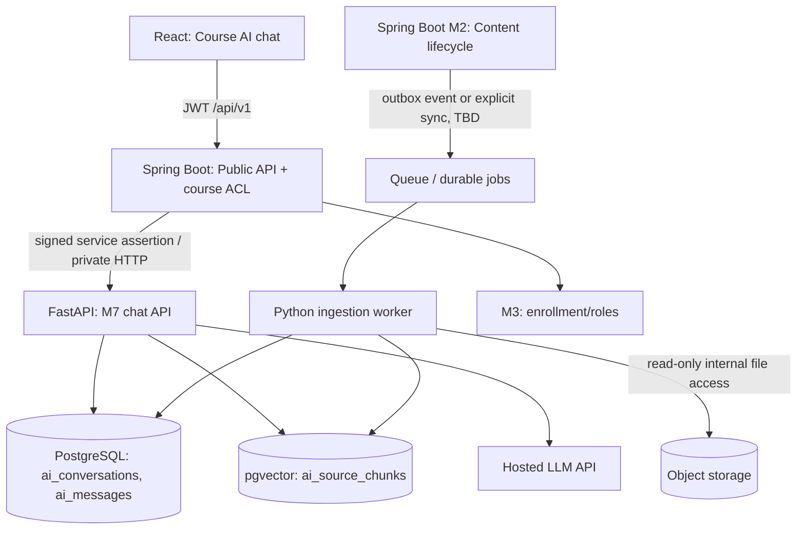
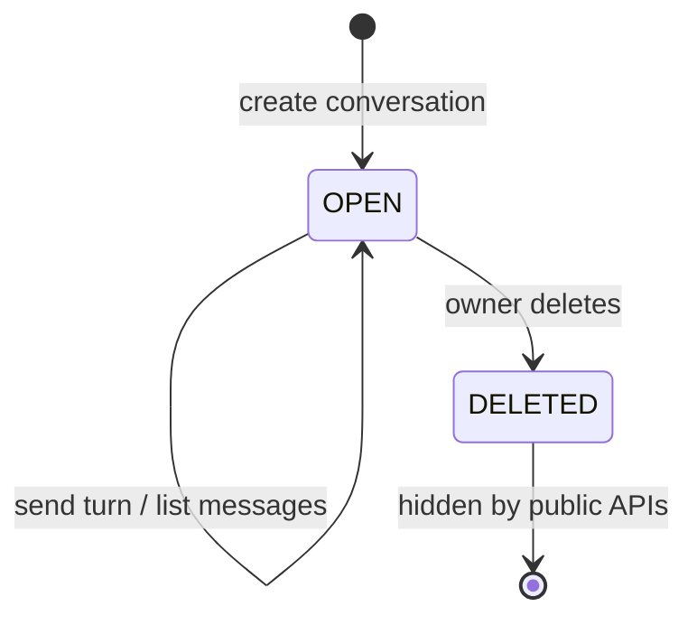
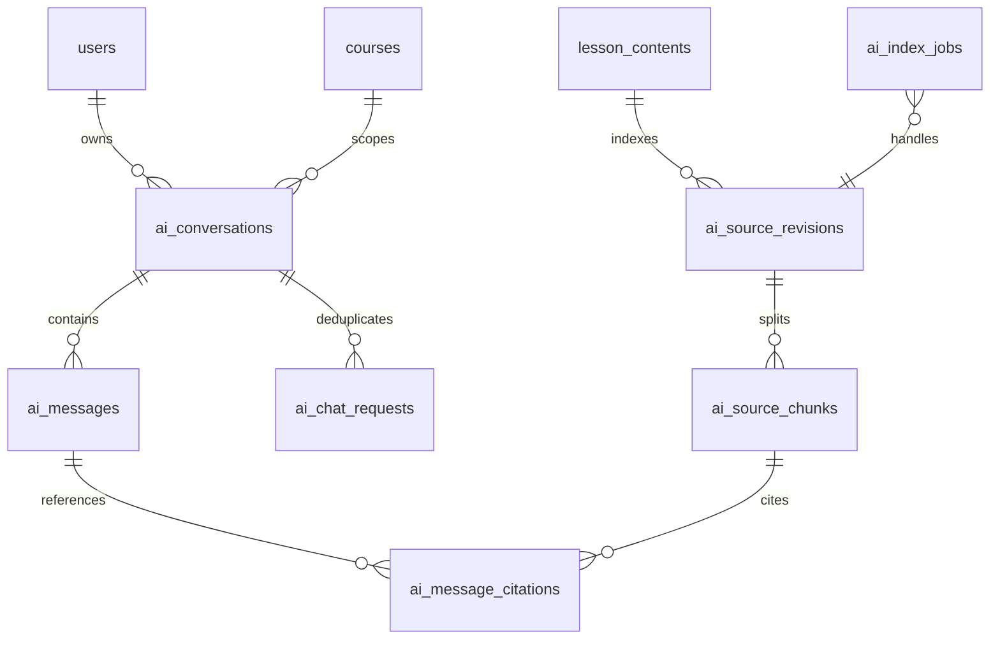
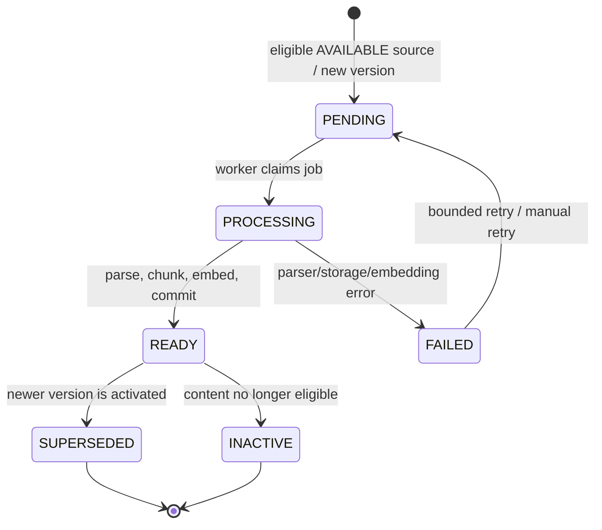
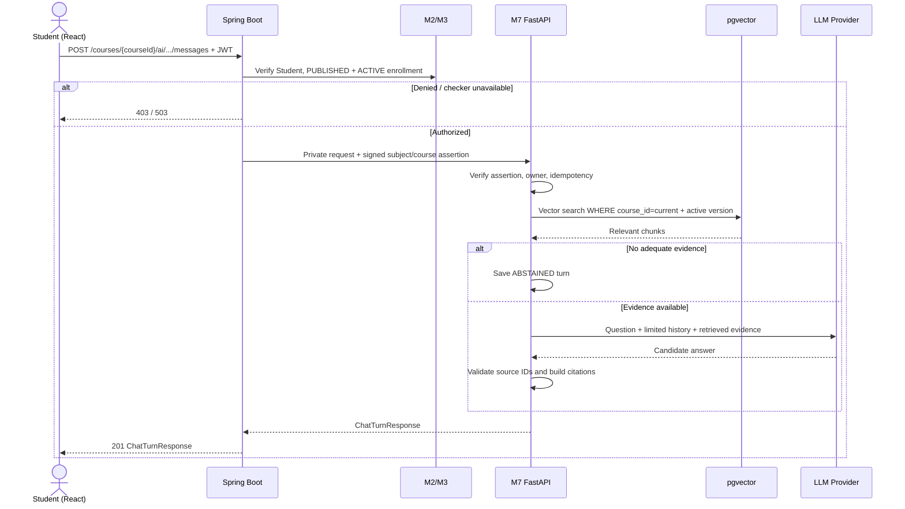

# M7 AI Tutor: RAG, access isolation, conversation, indexing and integration

> **Status:** REVIEW DRAFT — 2026-10-22. This document specifies *intended* M7 behavior; it does **not** assert that controllers, workers, migrations, cloud deployment or evaluation have been implemented.
>
> **API contract:** [`openapi/m7-ai-tutor.yaml`](../openapi/m7-ai-tutor.yaml) — OpenAPI 3.0.3. The public contract is exposed by Spring Boot; the AI runtime is implemented in Python/FastAPI.
>
> **Reviewed inputs:** M2 course-management design and `openapi/m2-course.yaml`; M3 enrollment/progress design and `openapi/m3-enrollment.yaml`; Project 8 Cloud requirements. M5/notifications/common API standards were **not** supplied for this review.

## 1. Product scope and decisions

**Objective.** Provide a course-scoped AI Tutor that answers student questions from **authorized course learning materials** using Retrieval-Augmented Generation (RAG), with source citations, separate per-user conversations, and safe abstention when evidence is insufficient.

| Capability | MVP decision / status |
| --- | --- |
| Course-grounded question answering with retrieved evidence | **PROPOSED P0** |
| Retrieval isolation by authorized `course_id` | **PROPOSED P0**; mandatory security invariant |
| Conversation history per `(user_id, course_id)` | **PROPOSED P0** |
| Citations with M2 `content_id`, `lesson_id`, and source excerpt | **PROPOSED P0** |
| Abstain on missing/insufficient material | **PROPOSED P0** |
| Idempotent chat request retry and request limits | **PROPOSED P0** |
| Async content ingestion and reindex on updates | **PROPOSED P0**; integration trigger remains OPEN |
| Indexed-source status / not-ready behavior | **PROPOSED P0** |
| Streaming via SSE, reranking, OCR, multi-course chat | **OUT** of first MVP |
| General platform FAQ / open-domain answers | **OUT** of first MVP; use a separately authorized FAQ knowledge base if approved later |
| Agent/tool use, quiz/assignment grading, recommendations | **OUT** of first MVP |

**Source-grounded constraints (existing M2/M3):**

- M2 organizes materials as `Course → Module → Lesson → Content`. Source identifiers are M2 `lesson_contents.id`, `lesson_id`, `content_type`, `upload_status`, and `version_number`. File types include `VIDEO`, `PDF`, `SLIDE`, `DOCUMENT`, `FILE`; inline types include `TEXT`, `LINK`.
- M2 uses object storage and presigned upload/access URLs, **not video streaming**. Do not copy storage object keys or signed URLs into AI public responses.
- M2 confirms `ARCHIVED` denies student access even with `ACTIVE` enrollment; `DRAFT`, `DISABLED` and unpublished content are not student-readable. Previously issued signed URLs expire by TTL and are not immediately revoked; this does **not** authorize new AI answers after access revocation.
- M3 enrollment states are `ACTIVE`, `COMPLETED`, `WITHDRAWN`, `REMOVED`. `WITHDRAWN` and `REMOVED` retain history but do not have current learning access. The M2 policy for `COMPLETED` course-content access remains **OPEN**; M7 uses **provisional ACTIVE-only** student access, failing closed pending agreement.
- A `PRIVATE` course is accessible to an eligible Student only after M3 successfully enrolls them via the invite-code flow. `PUBLIC + PUBLISHED` catalog visibility is **not** authorization to view AI-grounding material.
- M2's proposed outbox events, content upload integration, pagination, error envelope and several M3 access decisions are draft interfaces rather than implemented guarantees.

## 2. Authorization matrix and invariants

| Actor / course and enrollment state | Create/list/read/delete own M7 chat | Ask on M2 content | Notes |
| --- | :---: | :---: | --- |
| Student + `PUBLISHED` + `ACTIVE` | Yes | Yes | PUBLIC or PRIVATE; PRIVATE requires prior valid enrollment |
| Student + `PUBLISHED` + `COMPLETED` | No (provisional) | No (provisional) | **OPEN** product decision; align with M2/M3 |
| Student + `WITHDRAWN` or `REMOVED` | No | No | Retain stored history; do not expose via M7 APIs |
| Student + `ARCHIVED`, `DRAFT` or `DISABLED` | No | No | Even if an enrollment row exists |
| Instructor, `OWNER`, `CO_INSTRUCTOR` or `ADMIN` | No | No | M7 AI Tutor is Student-only; content authoring/management remains in M2 |
| Unauthenticated or student from another course | No | No | 401 or 403; cross-user chat IDs return 404 |

**Mandatory checks for *every* request:**

1. React sends its normal bearer token to Spring Boot; **user identity must be derived from authenticated credentials**, never `user_id` supplied by React.
2. Spring Boot checks that the course is `PUBLISHED` and verifies the Student's `ACTIVE` M3 enrollment for the requested `courseId`. If a required check is unavailable, return **503 and fail closed**; never fall back to permissive chat.
3. Spring Boot forwards verified identity and `course_id` to a **private** FastAPI endpoint over an authenticated service-to-service channel (e.g. short-lived signed internal assertion, restricted network). FastAPI validates issuer, audience, expiry, signature and course claim. A mere untrusted `X-User-Id` header is insufficient.
4. M7 enforces `(conversation.user_id == verified_user_id)` **and** `(conversation.course_id == verified_course_id)` on read/write/delete. Unknown or foreign conversation IDs return **404** to avoid enumeration.
5. Search must filter **inside the vector query** by verified `course_id`, active source version and authorized source state; filtering LLM output *after* retrieving cross-course chunks is forbidden.
6. A citation link uses the M2 endpoint `GET /contents/{contentId}/access-url`, which independently rechecks permission. Never issue raw storage keys or durable public file URLs.
7. Recheck access on every turn, including a follow-up in a previously valid conversation. Do not rely on permission observed when the conversation was created.

> **Revocation consistency:** An authorization decision applies to one request. In-flight requests, caches and already-issued presigned URLs may have different revocation latency. M7 must not cache enrollment entitlements across requests for the MVP; decide any stronger immediate-cancellation requirement explicitly.

## 3. Architecture and responsibilities



**Ownership:**

- **M2** owns courses, lesson/content metadata, lifecycle, storage access, and authoritative content versions.
- **M3** owns enrollment state and enrollment authorization decisions.
- **Spring Boot / gateway** owns public JWT authentication, current course entitlement checks, public M7 route and uniform external errors.
- **M7 (FastAPI)** owns RAG logic, its own chat records, indexing jobs, AI vector metadata, citation generation and request-level AI rate limits. M7 does **not** create a second enrollment database.
- **React** owns the UI and requests protected content URLs from M2 when a citation is opened; it does not call the private Python service directly. Course media delivery and any CDN remain under M2/cloud infrastructure, not M7 ingestion.

**Integration boundary:** Public `openapi/m7-ai-tutor.yaml` paths are under `/api/v1/courses/{courseId}/ai/...`. Spring Boot can proxy their exact method, body, query and response to equivalent private FastAPI handlers after authorization. This is a logical contract, **not** proof of an implemented gateway route. Internal index-job endpoints are explicitly specified in the same YAML, use service credentials, and must not be publicly routed.

**Proposed Spring Boot → FastAPI identity assertion (not client-controllable):**

```json
{
  "iss": "oep-gateway",
  "aud": "m7-ai-tutor",
  "sub": "33333333-3333-4333-8333-333333333333",
  "course_id": "11111111-1111-4111-8111-111111111111",
  "access_type": "STUDENT_ACTIVE",
  "iat": 1792634400,
  "exp": 1792634460,
  "jti": "88888888-8888-4888-8888-888888888888"
}
```

These claims are **illustrative**, not an approved JWT/issuer contract. Only the gateway may issue the signed assertion after checking live M2/M3 permissions; FastAPI must validate its signature and claims rather than trust client headers. The public end-user JWT must not be blindly forwarded as an internal service credential. A mutually authenticated alternative (mTLS plus verified context) is also possible.

**Storage proposal:** Use PostgreSQL and `pgvector` if supported by the team's cloud PostgreSQL instance. Keep M7-owned tables/schema isolated from M2/M3, with database role privileges limited accordingly. If M2/M7 do **not** share an authoritative database/view, agree on a version/status verification endpoint before relying on source metadata snapshots.

## 4. Conversation lifecycle, persistence and idempotency



- The conversation has a **fixed** `user_id` and `course_id`. Switching courses always requires another conversation.
- Each turn stores one USER message and one ASSISTANT message (possibly `ABSTAINED`), preserving creation order. Store referenced citation IDs / excerpts as of answer time, but never bypass current M2 access checks when opening old citations.
- `DELETE` hides the conversation and its messages from public APIs and future model context immediately. **Proposed retention:** physically purge a user-deleted conversation within 30 days; purge inactive conversations after 12 months without activity. These periods are a proposal pending the team's data-retention decision. Retaining chat across `WITHDRAWN`/`REMOVED` is not permission to read it.
- `Idempotency-Key` is a required client-generated UUID v4 on **send message**. Bind it to user, conversation and normalized payload hash. The same key/payload replays the persisted result without duplicate turns; same key/different payload returns `409 IDEMPOTENCY_CONFLICT`.
- Keep a durable request ledger with a unique `(user_id, conversation_id, idempotency_key)`, state `PROCESSING|COMPLETED|FAILED_RETRYABLE|FAILED_FINAL`, payload hash, attempt metadata and cached response reference. A `FAILED_RETRYABLE` request may resume with the same key and identical payload; a `FAILED_FINAL` request replays its terminal error. Concurrent duplicate requests return `409 AI_REQUEST_IN_PROGRESS` (retry the same key later). Validation and authorization failures occur before the ledger is claimed. Check current authorization before replaying any cached result.
- Commit the USER message, ASSISTANT message and `COMPLETED` request state atomically. A transient failure before that commit can be retried without creating a partial turn. If a provider timeout leaves it uncertain whether generation completed, retry may incur another provider charge; the ledger still prevents more than one committed turn.
- Guarantee **at most one committed chat turn per idempotency key**, not exactly-once execution or exactly-once upstream LLM charges in the event of process crashes.

### Proposed M7 ERD



| M7 table (proposed) | Key fields / constraints |
| --- | --- |
| `ai_conversations` | UUID `id` PK; `user_id`, `course_id` FKs or validated external IDs; title, created/updated/deleted timestamps; index `(user_id, course_id, updated_at)` |
| `ai_messages` | UUID PK; `conversation_id`, `role`, `content`, `answer_status`, `created_at`; index `(conversation_id, created_at, id)` |
| `ai_chat_requests` | UUID PK; unique `(user_id, conversation_id, idempotency_key)`; `payload_hash`, `status`, `response_message_id`, timestamps |
| `ai_source_revisions` | UUID PK; `(content_id, version_number)` unique; `course_id`, `lesson_id`, `content_type`, `state`, checksum; one current `READY` revision per content at a time |
| `ai_source_chunks` | UUID PK; `source_revision_id`, `course_id`, `chunk_index`, `text`, `embedding`, page nullable; unique `(source_revision_id, chunk_index)` |
| `ai_message_citations` | UUID PK; `message_id`, `chunk_id`/snapshot metadata, ordinal; only for grounded assistant messages |
| `ai_index_jobs` | UUID PK; source/version/action, `event_id` unique, `status`, `attempt_count`, error and timestamps |

`users`, `courses` and `lesson_contents` belong to other modules. Cross-service database foreign keys may not be possible; validation and ownership responsibilities must be made explicit at the integration boundary. There is **no** new M7 enrollment or course membership table.

## 5. Content eligibility and indexing state machine

**First MVP ingestion allowlist (PROPOSED):** `TEXT` and text-based `PDF`. Extend to `DOCUMENT` (`.docx`) when parser integration is verified. `LINK` is metadata/external navigation, **not** automatically crawled (avoid SSRF and unknown copyright/authority). `VIDEO` is a downloadable file, not a transcript; do not claim video QA without transcription. `SLIDE`/generic `FILE` are excluded until concrete MIME allowlists and parsers are approved. Scanned PDF/OCR is deferred.



**Sequence (intended):**

1. An M2 `TEXT` creation/update becomes `AVAILABLE` immediately, or a file upload is verified and becomes `AVAILABLE` through M2's completion workflow.
2. **Proposed** M2 outbox event / direct internal sync submits `{event_id, course_id, lesson_id, content_id, version_number, action}` to the M7 index queue. This is an **integration proposal**, because M2's event catalog/outbox has not yet been approved or implemented.
3. The M7 worker loads authoritative M2 metadata, validates full `Course → Module → Lesson → Content` ancestry and checks content availability/type. For file content it gets a *private* object-storage read grant; it must not reuse a student's presigned access URL.
4. Parser → deterministic chunking → embeddings → vector persistence. Tag every chunk with `course_id`, `content_id`, `lesson_id`, `version_number` and parser metadata (page for PDF when available).
5. Write the new revision/chunks durably, atomically set the current revision `READY` and retire any former revision. Idempotent repeated events for the same `(content_id, version_number, action)` must not duplicate chunks; out-of-order older versions must not replace newer versions.
6. Retrieval selects only `READY`, current, eligible revisions and the verified course. No answer is generated from stale, failed or deleted sources.

**Content invalidation/deletion protocol (AGREED FOR IMPLEMENTATION):** M2 first transitions the source to a non-readable state such as `DELETING`/unavailable, so new student access and indexing stop. M2 then synchronously requests M7 to deactivate the affected revision and remove it from retrieval, and waits for an acknowledgement. Only after acknowledgement does M2 finalize deletion (or replacement). If M7 is unavailable or does not acknowledge, M2 leaves the source unavailable and the operation pending/retryable; it must not finalize deletion while stale chunks remain queryable. The invalidation operation is idempotent. For replacement, M7 must not retrieve the old version after M2 activates the new version; the old version can remain until the new revision is ready only if M2 still considers the old version current and authorized. An after-the-fact asynchronous event alone cannot guarantee no stale retrieval.

**Index readiness (AGREED):** `GET /courses/{courseId}/ai/status` reports counts of eligible sources in each state. `NOT_READY` means there is no queryable source and no source currently being processed (for example, there are no eligible sources, or all attempts failed); counts distinguish these cases. `INDEXING` means no source is queryable yet and at least one is pending or processing. `READY` means every currently eligible source has a current queryable revision. `DEGRADED` means at least one source is queryable while another eligible source is pending, processing or failed. A course with zero eligible sources is `NOT_READY` with all counts zero. If no source is queryable, chat returns `409 AI_INDEX_NOT_READY` rather than generating an answer without evidence.

## 6. RAG answering and source citations



**Answer generation rules (PROPOSED):**

- Only `COURSE` mode in MVP. The model must treat retrieved material as *untrusted data*, not instructions to override the application/system policy.
- On follow-up questions, load only messages from the current conversation. Bound history length/token budget; optional query rewriting cannot alter verified course scope.
- Retrieve Top-K candidate chunks (initial experiment `K=5`; **not** a guaranteed optimum). Use threshold/abstention criteria tuned on an evaluation set instead of assuming any returned chunk is relevant.
- Require each factual assertion relying on course material to be supported by supplied chunk IDs. The server validates citations against the current result set and current source version. The LLM never invents `content_id` or page numbers.
- If relevant evidence is absent or contradictory, answer with `answer_status=ABSTAINED` and a brief explanation. An answer without citations is acceptable **only** for an explicit abstention, not as an ungrounded course answer.
- Never expose raw S3 keys, signing credentials, other students' conversations, hidden content, or arbitrary retrieved metadata.

**Citation response fields:** `content_id`, `lesson_id`, `chunk_id`, `source_title`, `excerpt`, `version_number`, optional `page_number`. React displays these alongside the answer; opening a PDF calls M2 `GET /contents/{contentId}/access-url` with the original user JWT. Inline `TEXT` may navigate to the protected lesson instead. A citation contains **no signed URL**.

## 7. API contract, pagination and errors

Public APIs require the normal end-user JWT and course entitlement; user IDs are **never** client-controlled.

| Method | Public path (prefix `/api/v1`) | Purpose |
| --- | --- | --- |
| `GET` | `/courses/{courseId}/ai/status` | Index readiness for course tutor |
| `POST` | `/courses/{courseId}/ai/conversations` | Create empty conversation |
| `GET` | `/courses/{courseId}/ai/conversations` | List current user's conversations |
| `GET` | `/courses/{courseId}/ai/conversations/{conversationId}` | Read own conversation metadata |
| `DELETE` | `/courses/{courseId}/ai/conversations/{conversationId}` | Logically delete own conversation |
| `GET` | `/courses/{courseId}/ai/conversations/{conversationId}/messages` | List own messages |
| `POST` | `/courses/{courseId}/ai/conversations/{conversationId}/messages` | Send a grounded chat turn; requires `Idempotency-Key` |

Private operational routes (not internet-exposed) are `POST /internal/v1/ai/index-jobs` and `GET /internal/v1/ai/index-jobs/{jobId}`. They accept only an internal service token. The enqueue endpoint is an **alternative to** event-driven ingestion where the group's event transport is not yet available; do not call it from React.

**Draft conventions and compatibility:**

- M7 deliberately adopts **M2-style** `page` starting at 1, `page_size` default 20 (max 100), `items` + `pagination`; and M2-style `{"error":{"code","message","request_id","details"}}`.
- M3 currently uses **0-based** `page`, `size` and a *different* error model. M7 keeps M2 conventions for its public contract; the gateway translates internal M3 checker errors rather than exposing M3's response envelope to M7 clients. The common gateway can align this later.
- Standard timestamps: UTC RFC 3339; identifiers: UUID; consistent request IDs across Spring Boot ↔ FastAPI.
- Main errors: `401 UNAUTHORIZED`; `403 AI_COURSE_ACCESS_DENIED`; `404 AI_CONVERSATION_NOT_FOUND`; `409 AI_INDEX_NOT_READY`, `IDEMPOTENCY_CONFLICT` or `AI_REQUEST_IN_PROGRESS`; `422 VALIDATION_ERROR`; `429 AI_RATE_LIMITED`; `503 ENROLLMENT_CHECK_UNAVAILABLE` or `AI_SERVICE_UNAVAILABLE`.
- On authorization failure, **do not** fall back to generic LLM chat. On no evidence, save an `ABSTAINED` turn. External LLM/provider errors should return a safe 503 and not a fabricated answer.

## 8. Integration interfaces to confirm

| Owner / dependency | Proposed interface or event | Status / decision needed |
| --- | --- | --- |
| **M7 → M2** | Query authoritative `course.lifecycle_status`, `lesson_contents` ancestry, `content_type`, `upload_status=AVAILABLE`, and `version_number` | Confirm internal read interface / DB-view ownership and when files are ready |
| **M7 → M3** | Spring Boot `EnrollmentChecker` before every Student chat/read; `ACTIVE` only until `COMPLETED` policy resolved | **OPEN:** completed-student entitlement and checker contract |
| **M2 → M7 indexing** | Proposed `content.available`, `content.updated`, `content.deactivated`, with stable `event_id`, content ID and version; or private index-job enqueue | **OPEN:** event names, outbox deployment, retries and who publishes |
| **M7 ↔ M2 delete** | M2 makes source unavailable, synchronously asks M7 to deactivate its revision, and finalizes only after acknowledgement; otherwise leave operation pending and retry | **AGREED FOR IMPLEMENTATION** |
| **Gateway → M7** | Private HTTP proxy + signed user/course assertion, request/correlation ID | **OPEN:** route prefix, service-token issuance, network policy, failure mapping |
| **M7 → Object Storage** | Least-privilege server-side read of eligible source objects | **OPEN:** cloud provider, bucket/prefix permissions and key lookup |
| **React ↔ M7/M2** | Chat list/history, citations; open citation via M2 protected access URL | **OPEN:** UI error/not-ready and pagination conventions |
| **Common API** | Public M7 uses `/api/v1`, M2 `page`/`page_size` and M2 error envelope; gateway translates internal dependency errors to the public contract | **TEMPORARILY AGREED**; can be aligned later with common gateway standards |

Do not assume M5 is the notification owner: the supplied M2 notes themselves flag module-name ambiguity, and M5 API material was not supplied for M7 review.

## 9. Cloud operations, limits and performance plan

| Area | MVP implementation target / trade-off |
| --- | --- |
| Runtime | FastAPI HTTP service + Python worker (same codebase/image, different entrypoints), deployed as separate containers |
| Queue | Managed queue if available; durable jobs table acceptable for an initial demo if retries are safe |
| Storage | Shared authorized object storage; PostgreSQL + `pgvector` as proposed cost-conscious vector storage |
| External model | Hosted LLM API to avoid GPU ops; pin model/version, timeout and token budget; protect data sent to provider |
| Autoscaling | Scale stateless FastAPI containers by CPU/concurrency; scale ingestion workers by queue depth; DB/LLM quotas remain bottlenecks |
| Security | JWT at gateway, signed internal identity, private network, principle of least privilege, secret manager, prompt-injection defense, size/rate limits |
| Observability | Request ID, log event/latency/error codes, ingestion state/duration, retrieval count, LLM token counts/cost; never log bearer tokens, signed URLs or complete private conversations by default |
| CI/CD | Lint/type-check/unit tests, OpenAPI validation, Docker build, integration tests, cloud deployment pipeline |
| Budget | Proposed maximum question length, history window, prompt/output token caps, per-user request rate and spend alert; quantify after testing |
| Reliability | Timeouts, bounded retry only for safe/idempotent operations, dead-letter jobs, health/readiness endpoints, graceful 503 |

**Proposed measurable demo targets (not measured):** 20 simultaneous M7 chat clients and a p95 latency report (record actual observed value, no unsupported guarantee); index a PDF and answer with correct citations; show ingestion job failure/retry; exercise unauthorized cross-course access; record prompt/output tokens per request. The separately required concurrent quiz/load scenario remains owned by the quiz module.

## 10. Acceptance and evaluation cases

| ID | Scenario | Expected behavior |
| --- | --- | --- |
| M7-01 | Student with `ACTIVE` enrollment asks about published course material | `201 ANSWERED`, at least one verifiable citation |
| M7-02 | Student A asks a course B not enrolled in, including PUBLIC catalog course | `403`, no cross-course retrieval or LLM call |
| M7-03 | Student A requests Student B's conversation UUID | `404`; no history exposure |
| M7-04 | Student switches the path `courseId` for an existing conversation | `404`; original scope cannot be changed |
| M7-05 | Enrollment transitions `ACTIVE → WITHDRAWN` or `REMOVED` | Subsequent M7 read/send denied; history remains stored |
| M7-06 | Course `PUBLISHED → ARCHIVED` | Subsequent student chat/history denied regardless of enrollment |
| M7-07 | `COMPLETED` enrollment asks AI | **Provisional** `403`; update test after policy approval |
| M7-08 | Student asks an unsupported or out-of-scope question | `201 ABSTAINED`, no invented citation |
| M7-09 | Same send request is retried 100 times with same key and payload | Exactly one committed pair of messages, replayed result |
| M7-10 | Same idempotency key is reused with a different message | `409 IDEMPOTENCY_CONFLICT` |
| M7-11 | Content new version indexed twice/out of order | Only current eligible version returned; no duplicate chunks |
| M7-12 | Content no longer `AVAILABLE` or is pending deletion | No retrieval from invalidated chunks; enforce M2 deletion coordination |
| M7-13 | Enrollment checker unavailable | `503`, no LLM/retrieval access (fail closed) |
| M7-14 | Citation clicked after enrollment revoked | M2 denies new access URL; no raw object key exposed |
| M7-15 | 20 concurrent chats on staging | Report throughput, error rate, p50/p95 and LLM cost, without claiming a priori SLA |

**Golden evaluation set (initial proposal):** 20–30 course-based questions, including direct lookup, paraphrase, multi-chunk, follow-up, unanswerable, misleading/prompt-injection text and unauthorized-access negatives. Evaluate retrieval Recall@K, answer correctness, citation support, abstention precision/recall, leakage rate, p50/p95 latency and cost/query. Report measured values and failure examples rather than an unsupported overall RAG “accuracy”.

## 11. Decisions and remaining open items

**Agreed for implementation:** M7 is Student-only; content invalidation follows the synchronous M2-M7 acknowledgement flow in section 5; index-readiness definitions in section 5 are agreed; idempotency retry and atomic chat-turn commit in section 4 are agreed. Public M7 temporarily uses `/api/v1`, M2 pagination and error format, with gateway translation for internal M3 errors.

**Still open:**

1. **COMPLETED enrollment:** may a completed Student access learning materials and M7? Existing M2/M3 material does not settle this; provisional **deny** pending the team's decision.
2. **Eligible formats:** start with `TEXT` + text PDF; confirm `DOCUMENT`/DOCX and SLIDE parser rollout. Do not promise video ingestion without transcription.
3. **Index trigger:** choose M2 outbox/event vs service-to-service enqueue; settle event names, retries and publisher ownership.
4. **Private service identity:** choose signed internal JWT/mTLS and trust boundaries; verify M7 never trusts client-supplied user/course claims.
5. **Storage/LLM provider and retention:** cloud deployment, DB/pgvector availability, cost caps, logging consent and conversation retention/deletion policy. Proposed MVP retention: user-deleted chats are hidden immediately and physically purged within 30 days; chats inactive for 12 months are purged. Confirm or replace these periods before implementation.
6. **Source publication semantics:** M2 has course-level lifecycle and content `AVAILABLE`, but no independently approved per-content `PUBLISHED` field; confirm whether additional visibility/lesson gating is needed.
**Design status:** M7 scope, architecture, API contract and tests are proposed here. Approval, code, migrations, cloud infrastructure, measured performance and end-to-end integration remain to be implemented and evidenced separately.
